<a href="https://rafaelgb.github.io/Obsidian-ZettelFlow/"><picture>
  <source media="(prefers-color-scheme: dark)" srcset="docs/resources/readme/banner-dark.svg">
  <source media="(prefers-color-scheme: light)" srcset="docs/resources/readme/banner-light.svg">
  
</picture></a>

  
  
  
  
  

  
  
  

  <a href="#-what-it-asks-of-you">Practice loops</a> ·
  <a href="#-read-like-a-book--the-reader-and-your-library"><b>Reader &amp; Library</b></a> ·
  <a href="#-how-it-works">Canvas workflows</a> ·
  <a href="#-get-started-in-5-minutes">Get started</a> ·
  <a href="https://rafaelgb.github.io/Obsidian-ZettelFlow/why/">Why ZettelFlow</a> ·
  <a href="https://rafaelgb.github.io/Obsidian-ZettelFlow/reference/capabilities/">Everything it does</a>

> **Most plugins help you _write_. Almost none help you _think_.**

**Stop managing notes. Start managing knowledge.** Obsidian is the store; **ZettelFlow is the engine that makes the knowledge inside it evolve.** It turns a native Canvas into a note-creation wizard, opens your notes, PDFs and EPUBs in a Reader built for thinking, and gives you a small set of **practice loops** that ask something of *you*. Every loop is offline, works with AI switched off, and writes nothing to your vault you did not decide.

## 🔁 What it asks of you

Before any feature list, the things ZettelFlow asks you to **do** — each a small loop on your own notes, each reached where you already are (**Home**, **Think**, the **Reader**, a note's right-click menu):

| | |
|---|---|
| 🔁 **Return a claim** — say in one sentence what a note claims; later it comes back **blind** from Home and asks what you say about it *now*. [The return of a claim →](docs/development/claim-returns.md) | 📖 **Look again at what you marked** — your Reader highlights come back from Home a few at a time, with one question: *do you still think so?* [A few things you marked →](docs/development/highlights-review.md) |
| 📄 **What survived?** — at the end of a chapter you marked, the book gives you a blank leaf: your marks, what they touched, and *is one worth a note?* [What survived →](docs/development/reader.md#what-survived) | ✍️ **Recall a chapter** — put the chapter and your marks away, write what it argued in your own words, then look. Nothing is scored. [Recall →](docs/development/reader.md#recall) |
| 🎲 **Collide two notes** — from Think, two of your notes with nothing in common, side by side: what could they share? It never answers. [Two things far apart (collision) →](docs/architecture/collision.md) | ⚖️ **Place a wager** — add *what you expect to see* and *by when* to a claim; on the day, it asks what happened *before* it shows your prediction. [A wager →](docs/development/wagers.md) |
| 🧠 **Make a move on an idea** — challenge it, reframe it, branch it, set it aside: a cognitive move, recorded as something you did. [Make a move →](docs/development/cultivate.md#the-moves) | ✨ **And everything else** — the Canvas wizard, the semantic graph, health, discovery, dashboards. [Everything it does →](https://rafaelgb.github.io/Obsidian-ZettelFlow/reference/capabilities/) |

**AI is one action, never the product.** Every loop and every view works fully with AI disabled; when it is on it **proposes**, and you accept, edit or reject — the verdict is recorded, never assumed. **Knowledge with purpose** — starting from your own question and writing a provisional response — needs no AI, methodology or Canvas setup; see [Cultivate](docs/development/cultivate.md).

---

## 📚 Read like a book — the Reader and your Library

**Right-click any note → _Read from here_.** The Reader takes the window and walks you through the note and the notes around it, one chapter at a time — no MOC needed. **Your Library** puts your PDFs, EPUBs and Web Clipper articles on one shelf, beside the reading paths you saved, and opens them in the same Reader. What you mark lands in **Think**, never in the book; **Esc** gives your workspace back exactly as it was.

  <a href="https://rafaelgb.github.io/Obsidian-ZettelFlow/development/reader/"></a>

<table>
<tr>
<td width="33%" valign="top"> <b>One shelf</b> Books, papers, clipped articles and saved paths — with what each one produced in your vault.</td>
<td width="33%" valign="top"> <b>Highlight and write in the margin</b> Write with a pen and it stays on the page; keep what you lasso. <i>Read as text</i>, when you ask, proposes what your hand says.</td>
<td width="33%" valign="top"> <b>Alongside</b> Your own notes beside the page you are reading, each saying why it is there — and what argues with it.</td>
</tr>
<tr>
<td width="33%" valign="top"><a href="https://rafaelgb.github.io/Obsidian-ZettelFlow/development/reader/#listen">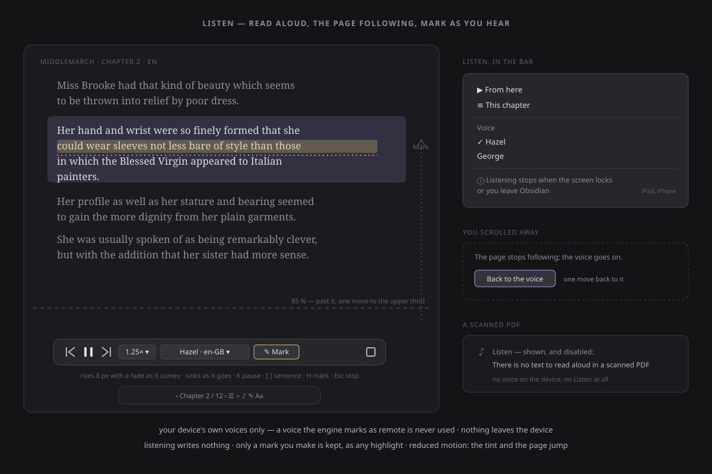</a> <b>Listen</b> Reads aloud in your device's own voices, the page following the voice. <b>Mark</b> keeps the sentence you hear.</td>
<td width="33%" valign="top"><a href="https://rafaelgb.github.io/Obsidian-ZettelFlow/development/reader/#cite-a-passage">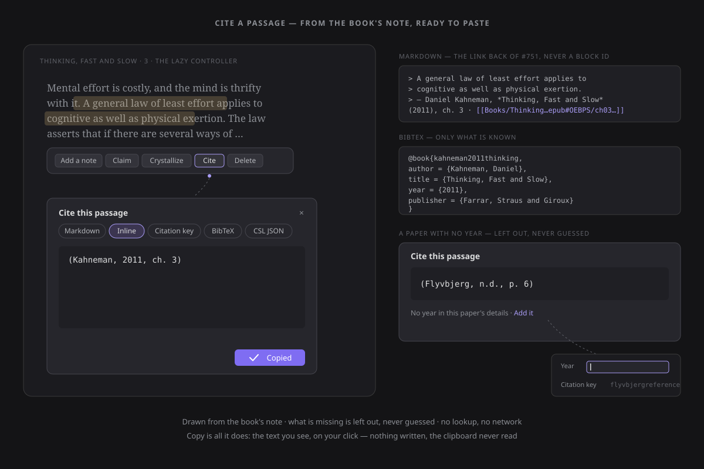</a> <b>Cite a passage</b> Markdown with a link back, inline, a Pandoc key, BibTeX or CSL JSON — never a guessed field.</td>
<td width="33%" valign="top"><a href="https://rafaelgb.github.io/Obsidian-ZettelFlow/development/reader/#snapshot-a-figure-or-a-table">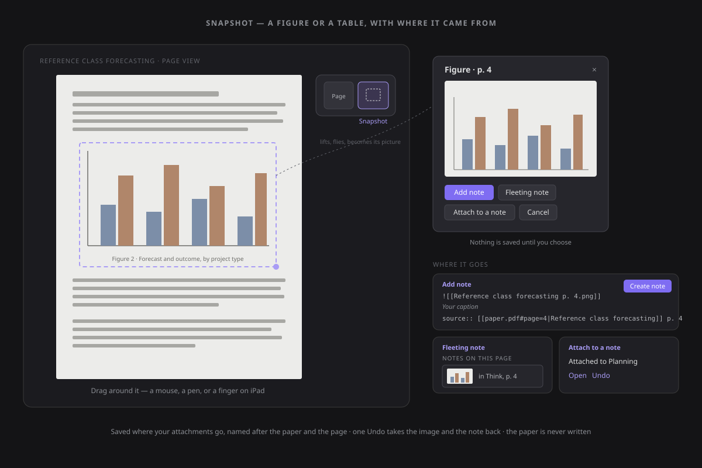</a> <b>Snapshot a figure</b> Drag around a chart or a table on a printed page and keep it as a note that cites its page.</td>
</tr>
<tr>
<td width="33%" valign="top"><a href="https://rafaelgb.github.io/Obsidian-ZettelFlow/development/reader/#look-up-and-translate">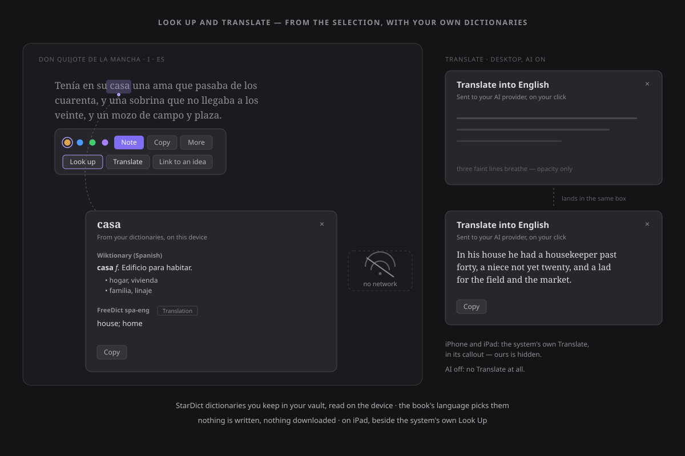</a> <b>Look up, offline</b> A word in your own dictionaries, beside the line, with no network.</td>
<td width="33%" valign="top"><a href="https://rafaelgb.github.io/Obsidian-ZettelFlow/development/reader/#the-overview">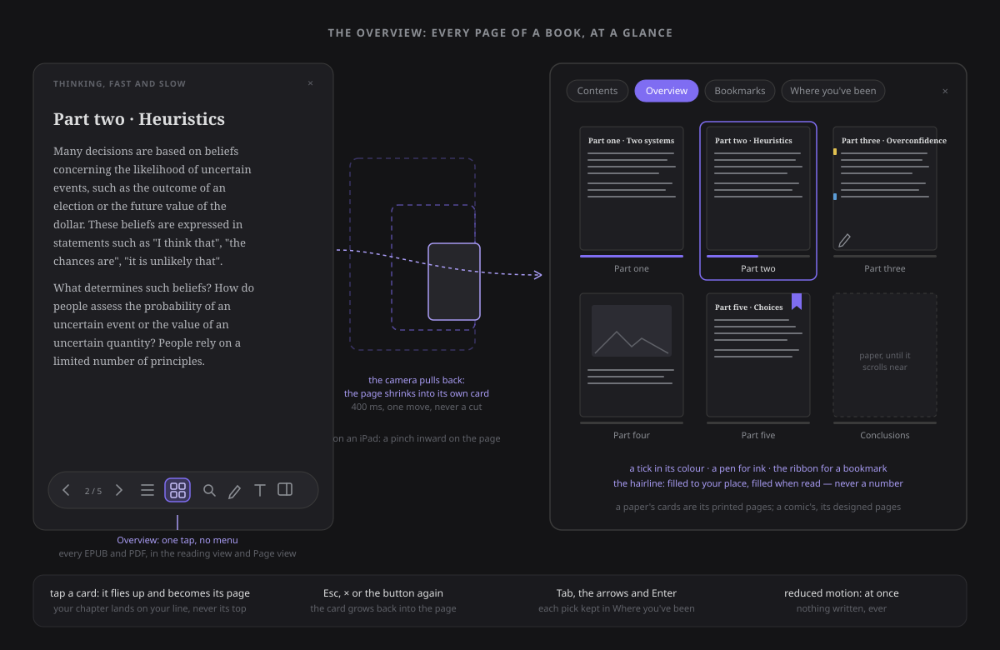</a> <b>Every page at once</b> The camera pulls back to the whole book: your marks, your ink, your bookmarks, how far you read.</td>
<td width="33%" valign="top"> <b>Desktop and iPad</b> Pages, scroll or a two-page spread; swipe to turn, type you can tune, Pencil in the margin.</td>
</tr>
</table>

<a href="https://rafaelgb.github.io/Obsidian-ZettelFlow/development/reader/"><b>The Reader →</b></a> &nbsp;·&nbsp; <a href="https://rafaelgb.github.io/Obsidian-ZettelFlow/development/library/"><b>Your library →</b></a> &nbsp;·&nbsp; Nothing is imported or uploaded, and your book files are never modified.

---

## ⚡ How it works

**ZettelFlow turns an Obsidian Canvas into a guided note-creation wizard.** Draw your workflow as a graph — steps as nodes, order as arrows — and the plugin walks you through it every time you create a note, filling in frontmatter, body content, dates and selectors without you touching a template by hand. Each note lands already related, cross-checked and scored, with a companion beside it.

  

1. **Design** — create a `.canvas` file. Each node is a step; arrows define the order. Mark one node as the root.
2. **Configure** — select a canvas node → *Edit step* to add actions (ask for text, pick a date, choose an option, add tags…).
3. **Run** — click the ZettelFlow ribbon button → **Create note** (or bind a hotkey to *Open workflow*). ZettelFlow walks the graph and builds the note.

**…and the wizard is only the door.** **[Home](docs/development/zettelflow-home.md)** is where you land each day: a greeting, Think's composer, where you left off and what came back today, answered in place.

  <a href="docs/architecture/thought-lab.md">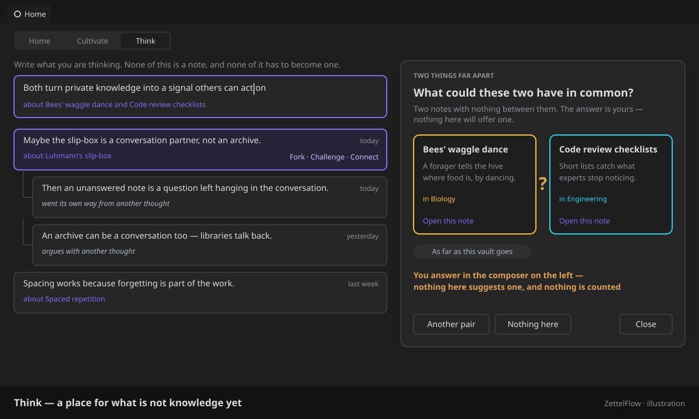</a>
  <a href="docs/development/ask-your-graph.md">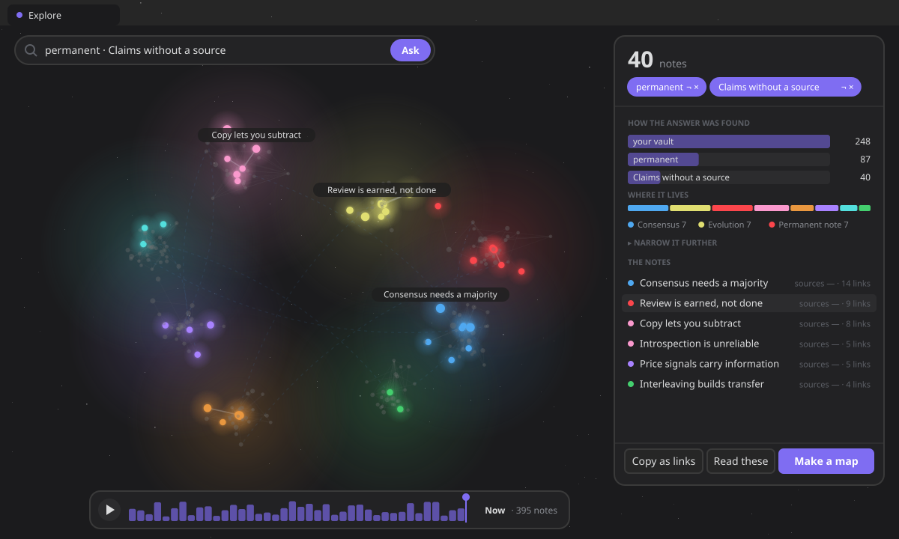</a>
  <a href="docs/development/cultivate.md">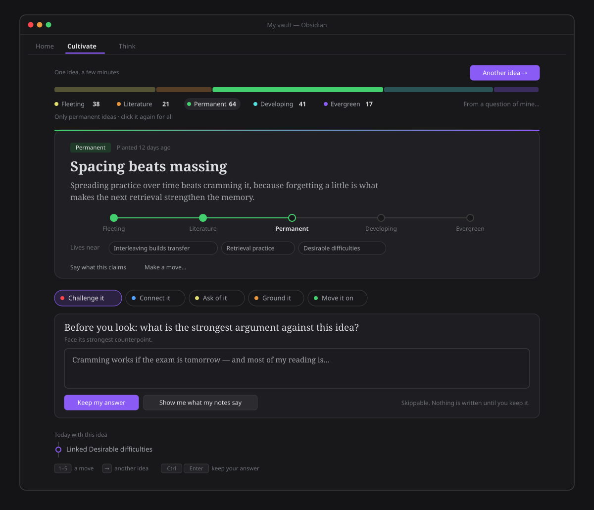</a>

<b>Think</b> · a place for what isn't knowledge yet &nbsp;·&nbsp; <b>Explore</b> · ask, and the graph answers &nbsp;·&nbsp; <b>Cultivate</b> · grow an idea by hand

<table>
<tr>
<td width="50%" valign="top"><a href="https://rafaelgb.github.io/Obsidian-ZettelFlow/development/this-note/">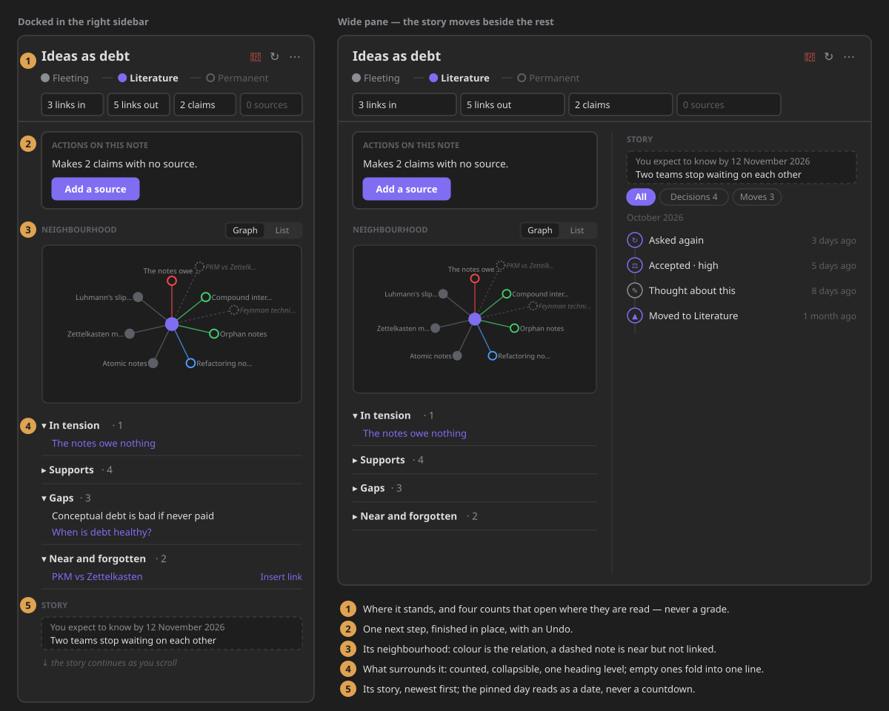</a> <b>🧭 This note, beside every note</b> A sidebar companion: where the note stands, what argues with it, what supports it, what it is missing — and its next step, finished in place.</td>
<td width="50%" valign="top"><a href="https://rafaelgb.github.io/Obsidian-ZettelFlow/development/base-dashboards/">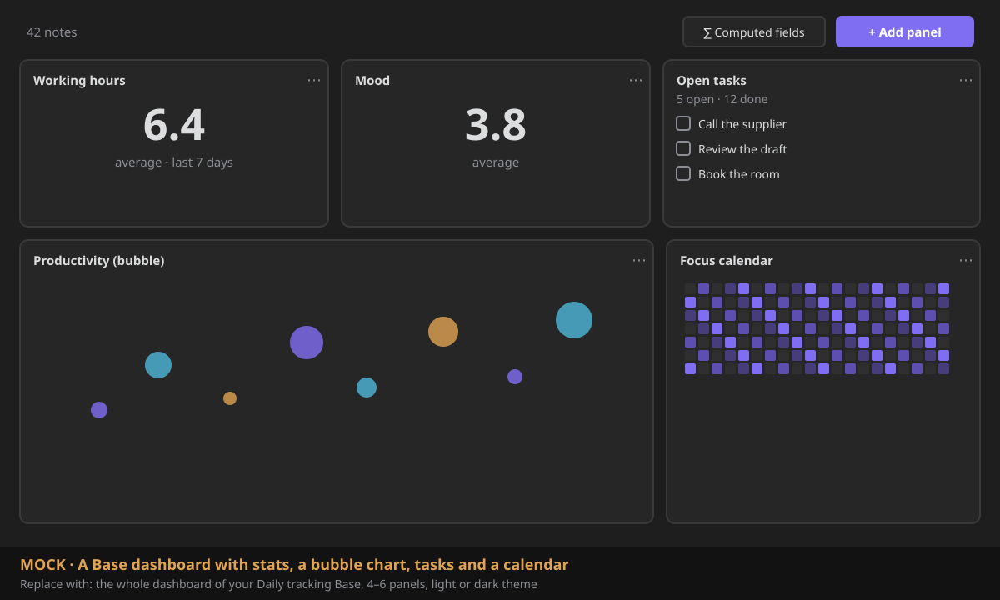</a> <b>📊 Dashboards for your vault</b> Point an <a href="https://help.obsidian.md/bases">Obsidian Base</a> at a folder: stat, bar, line, pie, heatmap and calendar panels with no <code>dataviewjs</code> — a local Grafana.</td>
</tr>
</table>

---

## 🚀 Get started in 5 minutes

**Fastest path** — no Canvas needed, works in an empty vault:

1. Install **ZettelFlow** from the Obsidian community plugin browser — or [open it in Obsidian](https://obsidian.md/plugins?id=zettelflow).
2. Click the ZettelFlow ribbon button (or run *Open ZettelFlow* from the command palette).
3. On the welcome screen, click **Start with my own idea**, then choose an existing note or capture one.
4. State a question, inspect the material, write a response or a gap, and **Save progress**.

**Build your own flow:**

1. Create a `.canvas` file (e.g. `flows/daily-note.canvas`).
2. In **Settings → ZettelFlow**, set that canvas as the "new notes canvas".
3. On the canvas, press *Create a step* (the Z in the bottom bar), and turn on **Starts the flow**.
4. Click the ribbon button → **Create note** — your first wizard run.

<b>See it drawn</b> — installing, and your first flow in three steps

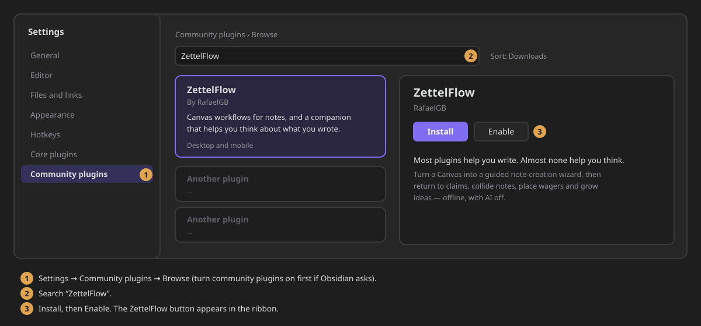


Stuck? Read the [getting started guide](https://rafaelgb.github.io/Obsidian-ZettelFlow/) or open a [discussion](https://github.com/RafaelGB/Obsidian-ZettelFlow/discussions).

---

## 🔒 Capabilities & privacy

ZettelFlow collects **no telemetry** and sends **no personal data or vault contents** anywhere. No account, no backend: the network is touched only by the two opt-in paths below.

<b>Everything the plugin can touch, and when</b>

- **File system (vault).** Reads canvas flow files and creates/edits notes (e.g. the **Change note state** command writes a single lifecycle property to the active note). All access goes through Obsidian's `Vault` / `FrontmatterService` API — never a hardcoded path. Works on desktop and mobile.
- **Vault enumeration.** ZettelFlow lists every markdown file **path** to build the offline knowledge model that health, discovery, the graph and Cultivate all read. Paths and metadata only, all local — and you can keep folders out of it with the knowledge scope.
- **Network — two opt-in paths, nothing until you use them.** The **community gallery** does read-only `GET`s of the static catalog on GitHub (no backend, no account, no uploads), and the optional **AI provider** sends length-bounded note content to the single https endpoint *you* configure. Both are off until you open the browser or enable AI.
- **Dynamic code execution.** The Script action, dynamic selectors, vault hooks and workflow-event conditions run **JavaScript you write**, with the plugin's access to your vault — including read-only access to the whole knowledge model via `zf.knowledge` — so only run scripts you trust. No remote code is ever fetched or executed, and every runtime function is built in one audited module.
- **Clipboard — write only.** The “copy” buttons put a step or action configuration on your clipboard as JSON. ZettelFlow never *reads* your clipboard. **Cite**'s *Copy* puts the citation you see there, on that click only.
- **Handwriting — opt-in, per press.** Reading ink sends an image of that one ink note's strokes and its passage to your AI provider, only when you press **Read as text**. Nothing reads ink by itself.
- **The Reader's AI moves — opt-in, per click.** Six moves on a passage you selected (*Why?*, *Challenge*, *Question*, *What's the claim*, *Reflect*, *Explain*) send that passage, its paragraph and the one before, and the book and chapter titles to your AI provider, only when you click one. Nothing from your vault is sent, and nothing runs by itself. On desktop and Android, **Translate** sends one selected passage and the target language, on a click; **Look up** reads your own dictionaries on the device and makes no request at all. **Listen** uses only your device's own voices: no text leaves the device.

See [Capabilities & privacy](https://rafaelgb.github.io/Obsidian-ZettelFlow/development/capabilities-and-privacy/) for full details.

---

## 🤝 Contributing & support

**[Report a bug](https://github.com/RafaelGB/Obsidian-ZettelFlow/issues/new?template=bug_report.yaml)** · **[Request a feature](https://github.com/RafaelGB/Obsidian-ZettelFlow/issues/new?template=feature_request.yaml)** · **[Start a discussion](https://github.com/RafaelGB/Obsidian-ZettelFlow/discussions)** · **[Contribute code](https://rafaelgb.github.io/Obsidian-ZettelFlow/development/contributing-and-conventions/)**

If ZettelFlow saves you time, a ⭐ helps others find it — and you can support development:

  
  

