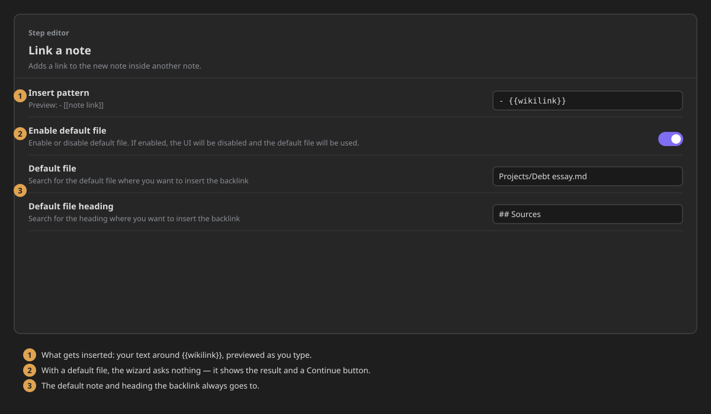
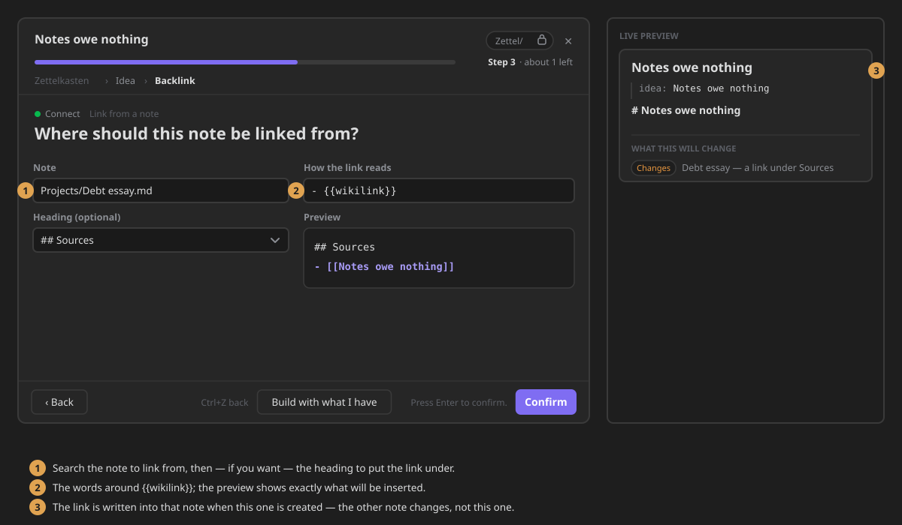

# Link a note

Adds a link to the new note inside another note.

*Called `backlink` in the step's YAML.*

When the new note is created, a line linking to it is inserted under a heading of another note —
for example, every new reading note listed under `## Sources` of your project note.

## Settings

- **Insert pattern** — the line inserted into the default file. Write `{{wikilink}}` where the link
  goes. Default: `{{wikilink}}`. The description under it previews the result, e.g. `- {{wikilink}}`
  previews as `- [[note link]]`. (When the wizard asks, the line is set there, in **How the link
  reads**.)
- **Enable default file** — always insert into the same note and heading, without asking. Off by
  default, so the wizard asks for the note and heading each time.
    - **Default file** — the note the link goes into. Shown only when **Enable default file** is on.
    - **Default file heading** — the heading in that note the link goes under. Shown once a
      **Default file** is chosen.

With **Enable default file** on, the step is not shown in the wizard and the link goes to the default
file — unless the step **Can be skipped**, in which case the wizard shows a preview of the link and
**Continue**.



## What it writes

Nothing in the new note. With **Insert pattern** `- {{wikilink}}`, a new note called *Debt essay*
adds this line right under the chosen heading of the other note:

```markdown
## Sources
- [[Debt essay]]
```

## In the wizard

When **Enable default file** is off, the step asks for:

- **Note** — the note to insert the link into.
- **Heading (optional)** — the heading to insert it under. It lists the headings of the note you
  picked. Pick one: today the link is only inserted under a heading, so with none nothing is
  written.
- **How the link reads** — the line to insert. It starts as `{{wikilink}}`.

A **Preview** shows the line as it will appear. **Confirm** needs a note.


