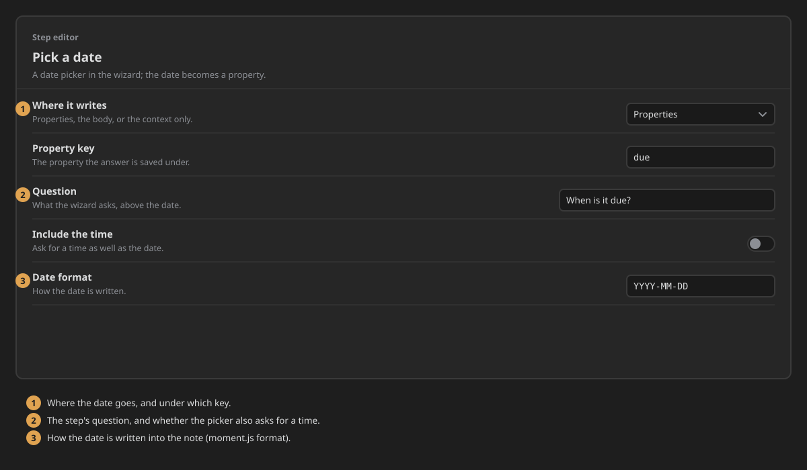
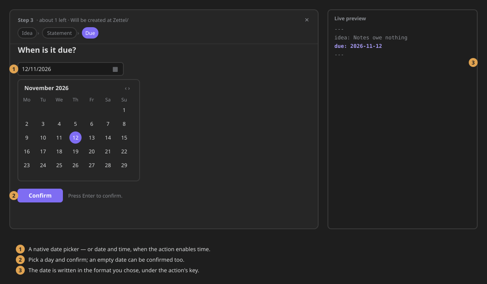

# Pick a date

A date, and a time if you want one, written to the note.

*Called `calendar` in the step's YAML.*

## Settings

- **Where it writes** — **Properties** (a property on the note), **Body** (replaces `{{key}}` in the
  step's note body) or **Context only** (not written to the note; the next steps can use it as
  `{{key}}`). Default: **Properties**.
- **Property key** — the property the date is saved under, e.g. `due`.
- **Question** — what the wizard asks, above the date. Empty by default.
- **Include the time** — ask for a time as well as a date. Off by default.
- **Date format** — how the date is written, in [Moment.js tokens](https://momentjs.com/docs/#/displaying/format/).
  Empty uses `YYYY-MM-DD`, or `YYYY-MM-DDTHH:mm:ss` when **Include the time** is on. Turning
  **Include the time** on or off resets the saved format, so set it after the toggle.
- **Always the same answer** — skip the question and write a fixed value. Off by default.
- **Fixed value** — the date (and time) written every time. Shown only when **Always the same
  answer** is on.



## What it writes

With **Property key** `due`, **Properties** and an empty **Date format**:

```yaml
---
due: 2026-10-13
---
```

With **Include the time** on: `due: 2026-10-13T09:30:00`.

## In the wizard

Obsidian's own date field, with your question above it. Type the date, or open the field's picker
when you want one. Press `Enter` or **Confirm** to continue. A date that is not a date is refused.
When the step can be skipped, **Skip this step** moves on without one.


