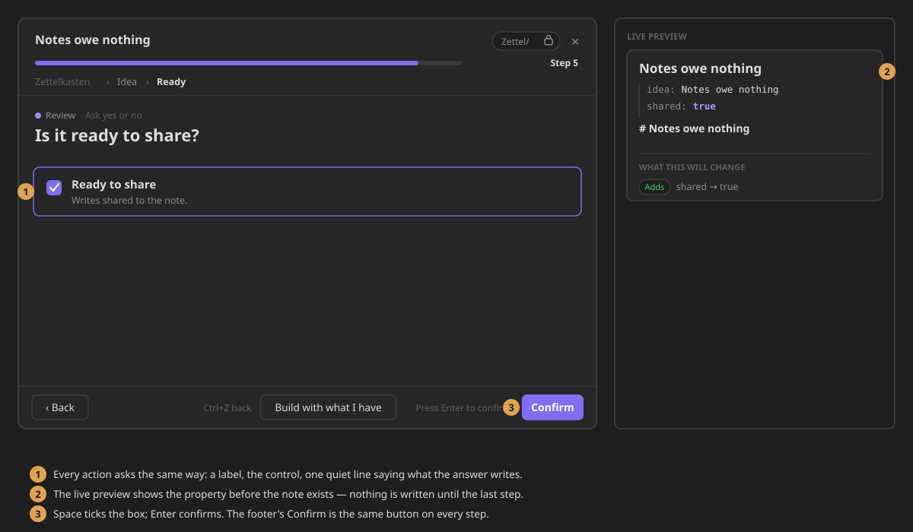

# Yes or no

A box to tick. Writes true or false to the note.

*Called `checkbox` in the step's YAML.*

## Settings

- **Where it writes** — **Properties** (a property on the note), **Body** (replaces `{{key}}` in the
  step's note body with `true` or `false`) or **Context only** (not written to the note; the next
  steps can use it as `{{key}}`). Default: **Properties**.
- **Property key** — the property the answer is saved under, e.g. `reviewed`.
- **Question** — what the wizard asks; it is shown beside the box. Empty by default.
- **Always the same answer** — skip the question and write a fixed value. Off by default.
- **Fixed value** — a toggle: on writes `true`, off writes `false`. Shown only when **Always the same
  answer** is on.

## What it writes

With **Property key** `reviewed` and **Properties**:

```yaml
---
reviewed: true
---
```

## In the wizard

A checkbox with your question beside it. The whole row is clickable, and a line under the question
says which property the answer writes. `Space` ticks the box, and `Enter` or **Confirm** saves the
answer. With no question, the wizard shows the property key instead.


