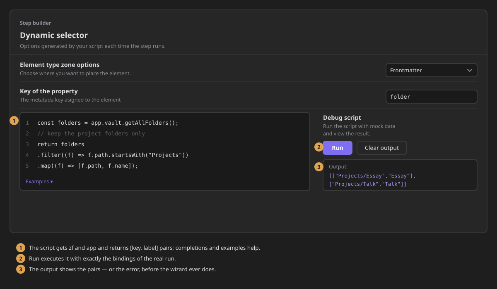

# Choose from a script

A list of options a script builds when the step opens.

*Called `dynamic-selector` in the step's YAML.*

Like [Choose an option](Selector.md), but the options come from your JavaScript instead of a fixed
list — every folder in the vault, the notes a query finds, anything you can compute.

## Settings

All of these are in the action's form in the step editor.

- **Where it writes** — **Properties** (a property on the note), **Body** (replaces `{{key}}` in the
  step's note body) or **Context only** (not written to the note; the next steps can use it as
  `{{key}}`). Default: **Properties**.
- **Property key** — the property the choice is saved under, e.g. `folder`.
- The **script editor** — the code that builds the options (see below). Under it, **Examples**
  inserts a working starting point.
- **Debug script** — **Run** runs the script with the same variables as the real run and shows the
  result under it; **Clear output** empties it.
- **Allow several answers** — let the wizard pick more than one option; they are written as a list.
  Off by default.



## Writing the script

The script must return a list of pairs, `[string, string][]`: the first string is **written to the
note**, the second is **shown in the wizard**.

```javascript
return [
  ["home", "Home"],
  ["about", "About us"],
  ["contact", "Contact"],
];
```

A script that builds the list from the vault:

```javascript
const folders = app.vault.getAllFolders();
return folders.map((folder) => [folder.path, folder.name]);
```

### Available variables

| Variable | What it is |
|---|---|
| `zf` | The [ZettelFlow script API](../api/ZettelFlowAPI.md). |
| `app` | Obsidian's own API. |

Unlike [Run a script](Script.md), an options script gets no `note` or `content`: it runs *before*
you pick anything, so there is nothing to write to yet. With or without **Allow several answers**
the script is the same, and **Run** executes it with exactly the variables of the real run.

The editor completes `zf.` and `app.` from the live objects, hovers show signatures, and syntax
errors are flagged in the gutter.

## What it writes

With **Property key** `folder` and **Properties**, picking *Essay*:

```yaml
---
folder: Projects/Essay
---
```

With **Allow several answers** on, the property is a list.
