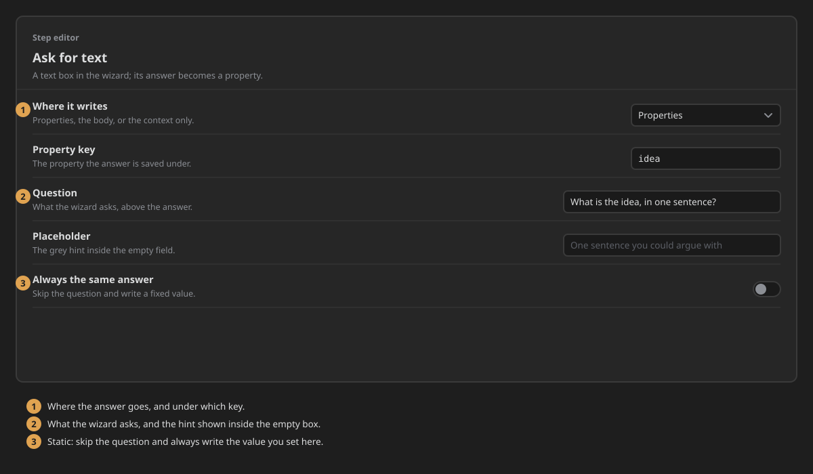
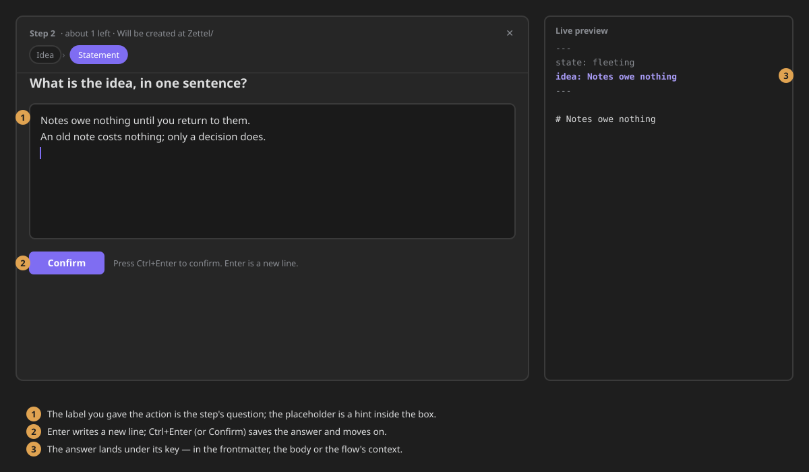

# Ask for text

A text field. The answer is written to the note.

*Called `prompt` in the step's YAML.*

## Settings

- **Where it writes** — **Properties** (a property on the note), **Body** (replaces `{{key}}` in the
  step's note body) or **Context only** (not written to the note; the next steps can use it as
  `{{key}}`). Default: **Properties**.
- **Property key** — the property the answer is saved under, e.g. `idea`. With **Body** or
  **Context only** it is the name of the `{{key}}` placeholder.
- **Question** — what the wizard asks, above the answer. Empty by default.
- **Placeholder** — the grey hint inside the empty field. Empty by default.
- **Always the same answer** — skip the question and write a fixed value. Off by default.
- **Fixed value** — what is written every time. Shown only when **Always the same answer** is on.



## What it writes

With **Property key** `idea` and **Properties**:

```yaml
---
idea: Notes should be written to be argued with
---
```

With **Body**, a body containing `Idea: {{idea}}` becomes `Idea: Notes should be written to be argued with`.

## In the wizard

A text area with your question above it and your placeholder as a hint. `Enter` starts a new line;
`Ctrl`/`Cmd`+`Enter` (or **Confirm**) saves the answer and continues.


