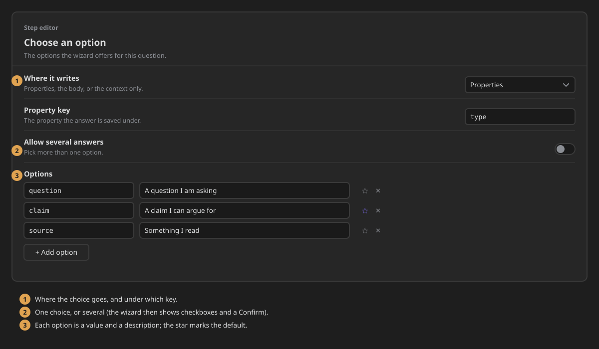
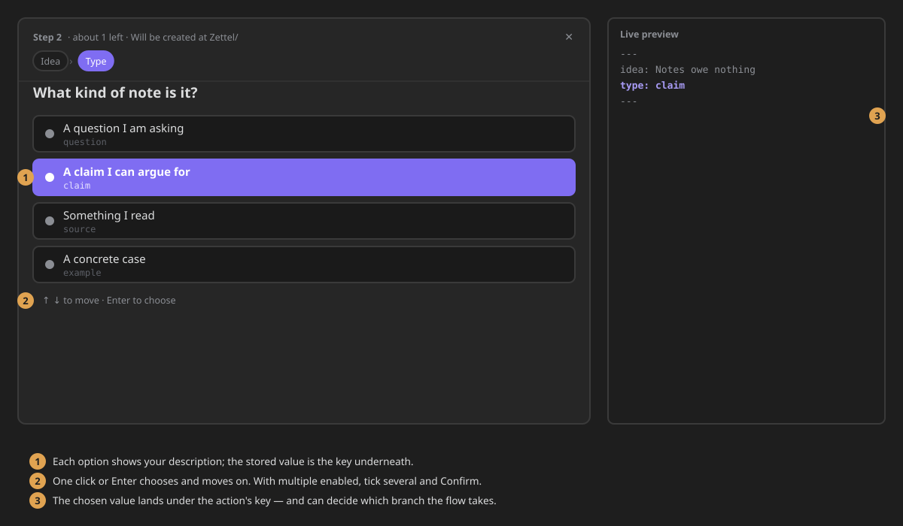

# Choose an option

The options the wizard offers for this question.

*Called `selector` in the step's YAML.*

## Settings

- **Where it writes** — **Properties** (a property on the note), **Body** (replaces `{{key}}` in the
  step's note body) or **Context only** (not written to the note; the next steps can use it as
  `{{key}}`). Default: **Properties**.
- **Property key** — the property the choice is saved under, e.g. `type`.
- **Question** — what the wizard asks, above the options. Empty by default.
- **Allow several answers** — let the wizard pick more than one option; they are written as a list.
  Off by default.
- Then the list of options, under its own *Choose an option* heading. Add a row with the **+**
  button (**Add option**). Each row has:
    - **Written to the note** — the value saved, e.g. `claim`.
    - **Shown in the wizard** — the label the person picking reads, e.g. `A claim I can argue for`.
    - **Default** — the option the wizard starts on. One option at most.

  Reorder a row with its **Drag to reorder** handle, or remove it with **Delete** (the bin).



## What it writes

With **Property key** `type` and **Properties**:

```yaml
---
type: claim
---
```

With **Allow several answers** on, the property is a list:

```yaml
---
type:
  - claim
  - source
---
```

## In the wizard

The wizard lists the options you defined. Click one, or move with the arrow keys and press `Enter` or
**Confirm**, to choose it and continue. The keyboard starts on the default option, which is marked
**default**. With **Allow several answers**, pick several and press **Confirm**.


