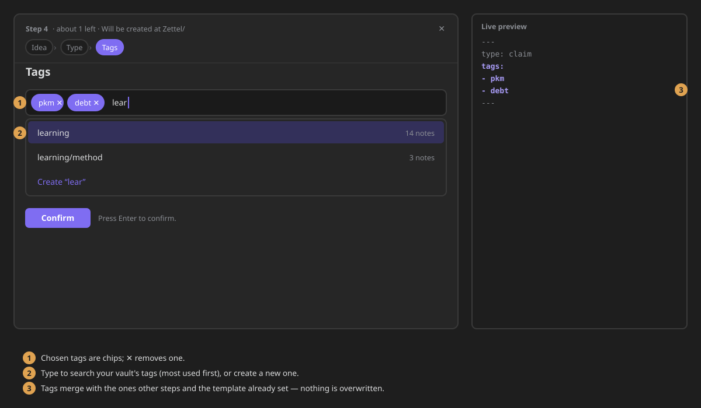

# Add tags

Lets you pick tags for the new note.

*Called `tags` in the step's YAML.*

The tags are always written to the note's `tags` property, and are merged with the tags of other
steps and with tags already in the note's properties.

## Settings

- **Always the same answer** — skip the question and write a fixed value. Off by default.
- **Fixed value** — the tags written every time: search your vault's tags, or type a new one to
  create it. Shown only when **Always the same answer** is on.

## What it writes

```yaml
---
tags:
  - idea
  - reading
---
```

## In the wizard

A multi-select: search your vault's tags, pick several, or create a new one. Chosen tags show as
chips.


