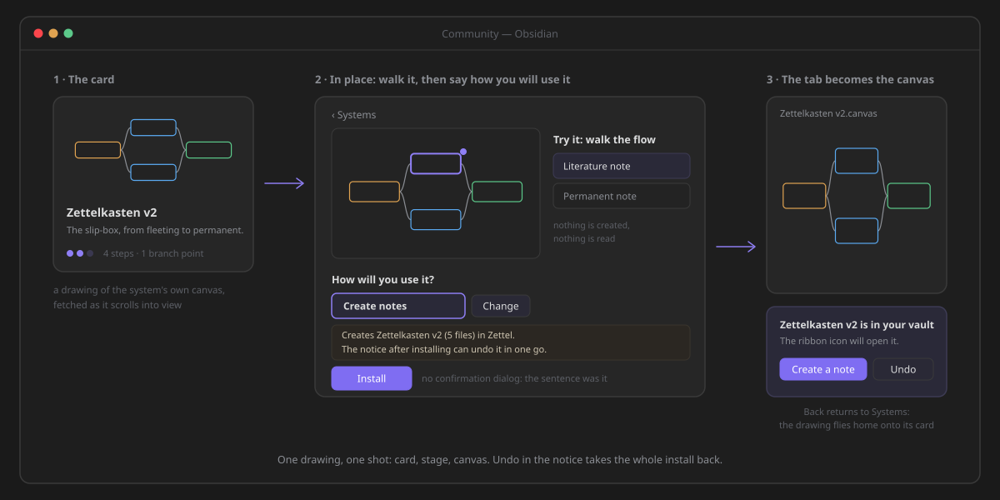

# Community

**Community** is where you learn ZettelFlow, find a ready-made system, give one back, and look after
what you installed. It is one tab with four rooms side by side: **Learn**, **Systems**,
**Contribute** and **Installed**. Choosing a room moves the camera along the strip; you never leave
the tab.

Open it from the ZettelFlow ribbon button → *Community*. The first time it opens on Learn; after that,
on the room you used last.

| Room | What it is for |
|---|---|
| **Learn** | A short tutorial for every feature, a search, and your progress. |
| **Systems** | Ready-made systems — Zettelkasten, PARA, GTD, research… — tried before they are installed. |
| **Contribute** | Share a canvas as a system, suggest an idea, report a bug, talk to other users. |
| **Installed** | The systems and pieces you brought from the gallery, and how to take them back. |

## Learn

Learn teaches every feature, a few steps at a time, written from these docs.

- **Find what you want to do.** At the top, *Everything ZettelFlow does, step by step*, a large search
  *What do you want to do?* (press `/` to jump to it) and a few chips to start from. The search looks
  through the tutorials, the reference and the questions at once; case and accents do not matter.
- **Your progress.** A ring and *n of N tutorials*, with the next thing to do: *Start here* the first
  time, then *Pick up where you left off*. *Your progress stays in this vault.*
- **Tracks.** The tutorials come in eight tracks — *Your first ten minutes*, *Think and capture*, *Read*… — each a row of cards.
  A card says *Done* when you marked it, and *New* when it arrived since your last visit.
- **Look anything up.** One line for every capability, where it is, and a link to its tutorial or its
  page. *Questions people ask* answers the common ones.

**A lesson** opens in place. The pictures fill the stage and the panel beside them says *Where it is*,
then the steps — click one, or use the arrow keys. At the end: *Mark as done*, a button to **do it
now** when there is one (it runs the feature for you, and Community stays where it was), *Read the full
page* on this site, *Up next* and *Related*. Back or Esc returns to the card you came from.

### It stays current without an update

The tutorials are not inside the plugin. Learn reads them from this project's GitHub when you open it
— at most once a session — so a tutorial added today reaches you on your next visit, with no plugin
release. A tutorial about a feature newer than your ZettelFlow stays hidden until you update.

- **Offline**, Learn shows the copy it saved last time and says so: *Offline: you are seeing the copy
  saved on* that date. Its pictures need the network and are left blank.
- **The very first time with no network**, it says *Learn needs a connection the first time.* and
  offers *Open the docs site*.
- When the tutorials need a newer plugin than yours, it says *Update ZettelFlow to see the latest
  tutorials.* and keeps showing the copy it has.

Nothing is ever shown as a pop-up; it is all said in the room.

## Systems

A system is a canvas ready to create notes. **Try it here before you install it: nothing is written
until you press Install.**

1. **Pick one.** Systems come in two groups, *A whole method* and *One note, done well*. Each card is
   a small drawing of the system's own canvas, its level (three dots) and its steps and branch points.
   *Search systems* is the only control. A system you already installed says *In your vault*.
2. **Open it.** The card's drawing grows into the stage, in the same tab. Under *Try it: walk the flow*
   you walk it on the drawing: the step you are on lights up, and choosing an exit moves you
   along its arrow. It is a rehearsal — nothing is created and nothing is read from your vault.
3. **Say how you will use it.** *How will you use it?* suggests one role — *Create notes* only when no
   canvas creates notes yet — and *Change* offers the rest: *Edit the open note*, *For a folder*,
   *When something happens* and *Just the files*. One sentence under it says exactly what will happen:
   what is created and where, how it will run, what it replaces, and that the notice can undo it. If
   the system brings code, it says so, and *Install* waits until you tick *I have looked at it and I
   want it*.
4. **Install.** There is no confirmation dialog — the sentence was the confirmation. The drawing fills
   the tab and **the tab becomes the canvas**. The notice says the system is in your vault and how it
   runs, with *Create a note* and *Undo*. Obsidian's Back returns you to Systems, where the drawing
   flies home onto its card.

Steps and markdown templates are folded at the bottom, under *Loose pieces*; each opens its own
install dialog. If the gallery cannot be reached, the room says so and offers *Try again*. Nothing is
written.

## Contribute

*Everything goes through GitHub. Nothing leaves your vault until you publish it yourself.*

- ***Share this canvas as a system*** leads. It shows the canvas you last had open (or, if none, your
  creation flow) drawn as it is, with its steps. *Prepare the system* turns it into a `.zftemplate`
  and opens a GitHub form already filled in. When the system is too large for the form, it is
  downloaded instead, and the card tells you to paste it in. With no canvas at all, the card says
  *Open a canvas to share it.*
- ***Suggest an idea*** opens a feature request on GitHub.
- ***Report a bug*** shows what the report will include — the plugin version, the Obsidian version and
  the platform — before you press it, so you only describe what happened.
- ***Talk to other users*** opens GitHub Discussions.
- ***How to contribute well*** moves the camera to Learn and opens the tutorial on sharing a system.

To write a tutorial for Learn, see [Adding a tutorial](../how-to-contribute/adding-a-tutorial.md); to
author a system, the [Systems gallery](../how-to-contribute/systems-gallery.md).

## Installed

What you brought from the gallery, and how to take it back.

- ***Systems you installed***, newest first. Each row draws its canvas as it is in your vault now,
  with when, where and in which role it was installed. Installs made before this view existed are not
  listed.
- ***Open canvas*** grows the drawing to fill the tab, and the tab becomes the canvas. Back returns to
  the row.
- ***Remove*** asks once: press it, then *Remove n files*. Moving to another room cancels it. What it
  takes back is below. The answer stays where the row was, for example *Removed 4 files. Kept 1 you
  changed: Permanent.md.* Back in Systems, the card no longer says *In your vault*.
- A canvas you deleted or moved leaves its row with *Canvas not found* and ***Forget it***, which
  forgets the install and touches nothing in your vault.
- ***Loose pieces*** are the steps and actions you installed, each with *Edit* and *Remove*. While a
  step or action is copied in its editor, *Add the template from the clipboard* adds it here.

With nothing installed, the room says *Nothing installed yet.* and offers *Browse systems*.

## Undo and Remove

Both take an install back, and neither deletes anything for good: files go to **Obsidian's trash**.

| | *Undo*, in the notice after Install | *Remove*, in Installed — any time later |
|---|---|---|
| When | while the notice is open | whenever you want |
| Files | every file the install wrote | only the files still as they were installed |
| Files you changed | left alone, and named | **kept, and named** |
| The role's setting | back to what it was, if it still points at this system's canvas | the same |
| Folders it made | removed when empty | removed when empty |

Most shipped systems are one canvas with the steps drawn inside it, so once you edit that canvas,
*Remove* keeps it and says so — *Removed 0 files. Kept 1 you changed: …* Delete it yourself if you no
longer want it, then use *Forget it*.

## Where things are kept

| What | Where | Why |
|---|---|---|
| What you installed | the plugin's `data.json` | follows the vault to your other devices |
| Your Learn progress (done, last opened) | the plugin's `data.json` | *Your progress stays in this vault.* |
| The saved copy of the tutorials, which ones you have seen (*New*) and the last room | this device's local storage for the vault | a copy for offline, not your data |

Just looking at Learn writes nothing. Opening a lesson records it as the last one, and *Mark as done*
records it done.

## Ways in

- The ZettelFlow ribbon button → ***Community***, or the command *Open community*: the room you used
  last, Learn the first time.
- The command *Browse systems*, and the buttons that say so — the welcome window's *Browse systems to
  get started*, *Browse systems* on the settings start card *Install a ready system*, on an empty
  canvas and in the note wizard when no flow is set: the Systems room.
- **Settings → ZettelFlow → Flows**, group *Systems gallery*: *Community systems* → *Browse* opens
  Systems, and *Manage installed templates* → *Manage* opens Installed.
- The older commands *Open community templates* (Systems) and *Open manage templates* (Installed) still
  work, so a hotkey you bound keeps working.

## Privacy

Opening Community reads the gallery's catalog from GitHub, and Learn reads the tutorials when it is
shown: read-only `GET`s, with no account, no upload and no telemetry. Nothing in your vault is sent.
See [Capabilities & privacy](../development/capabilities-and-privacy.md).

For how it is built, see [the Community gallery architecture](../architecture/community.md).
