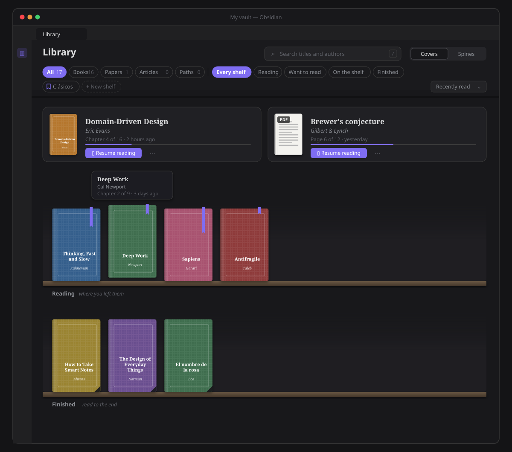
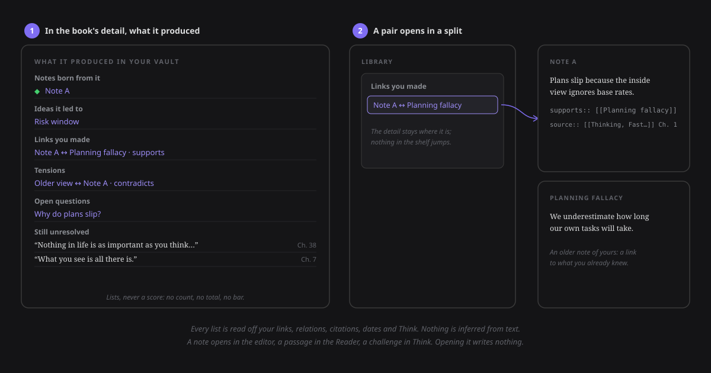
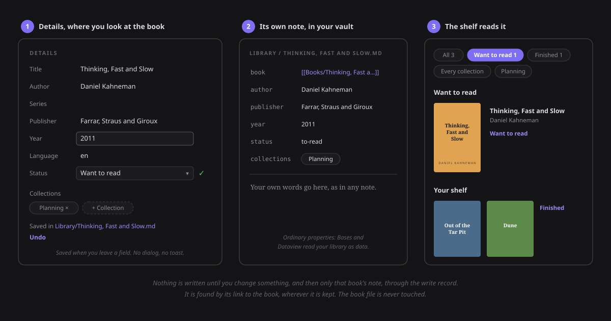
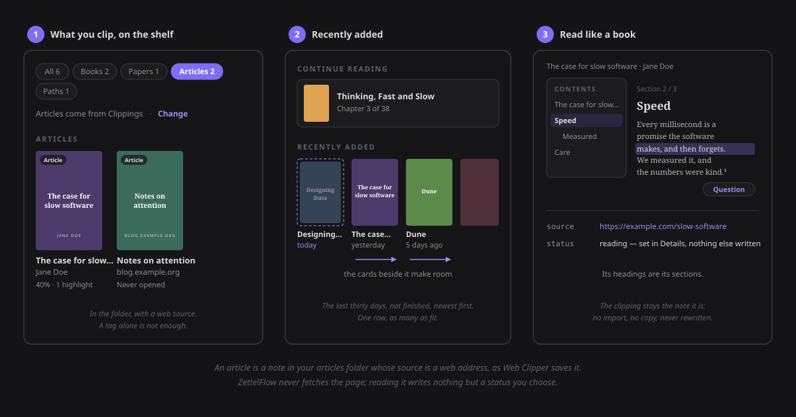
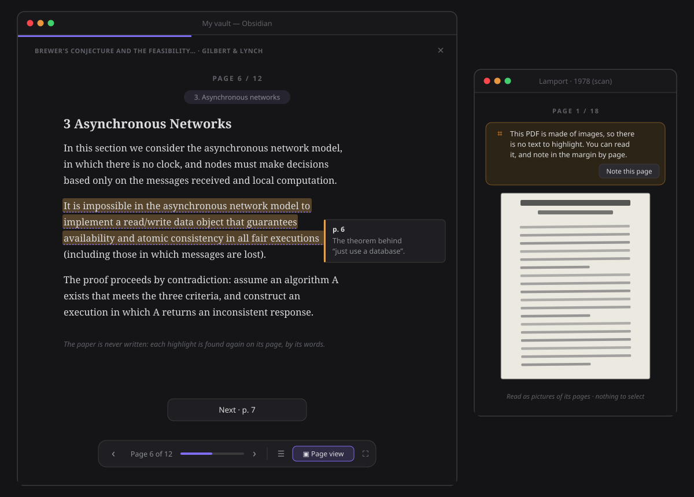
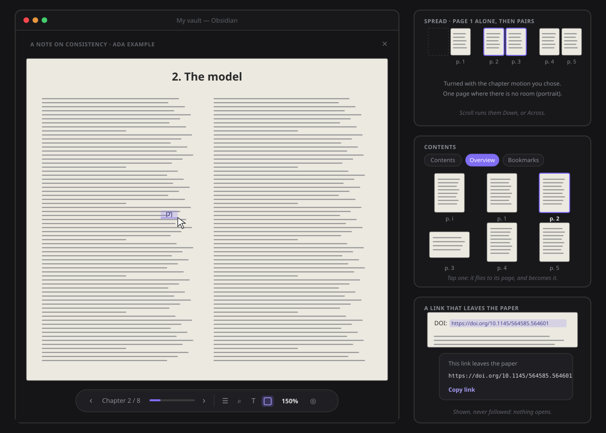
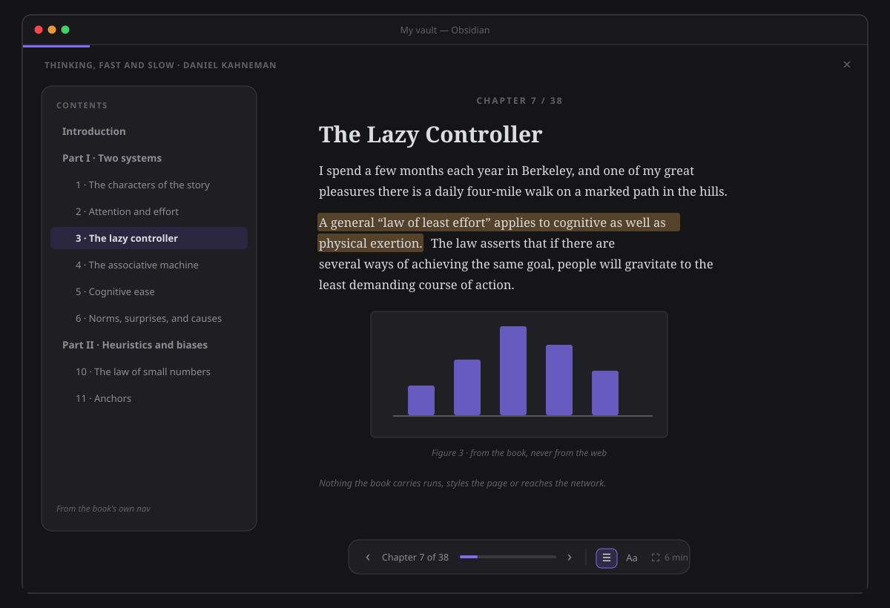
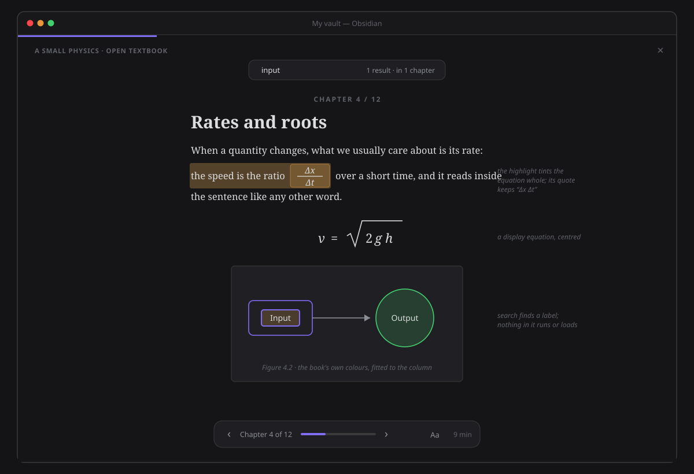
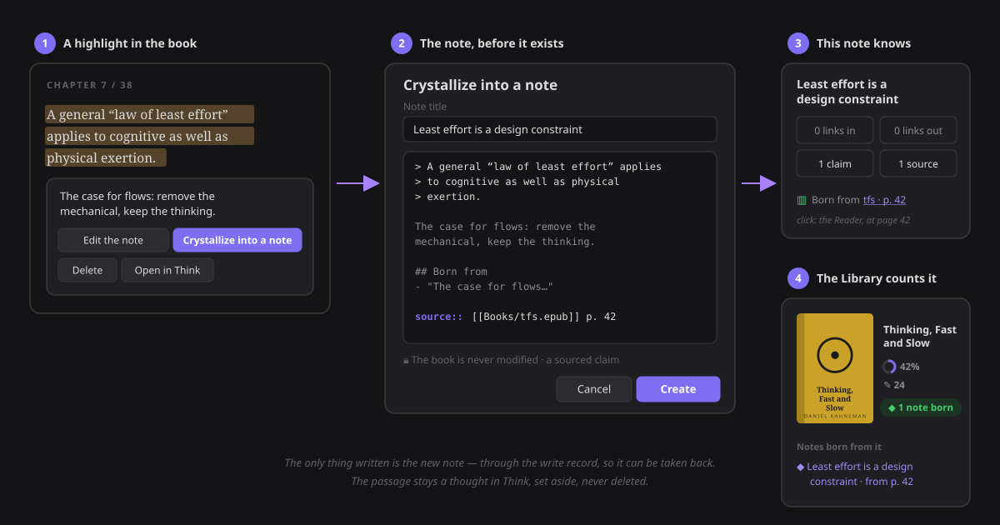
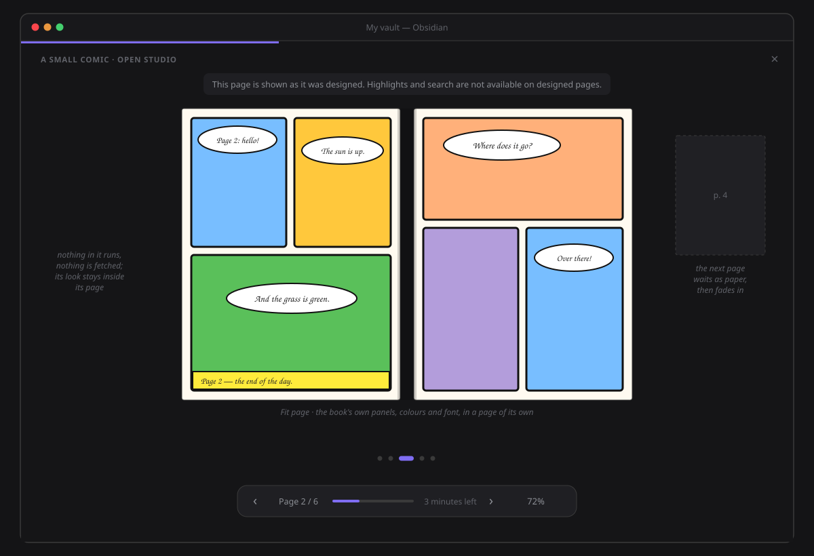

# Your Library

**The sources your ideas come from.** Ideas rarely start in a note: they start in what you read — a
paper, a book, a long article saved as a PDF. The Library puts those sources on one shelf, beside
the reading paths you saved across your own notes, and says what came of each one: how far you are,
what you marked, and the notes born from it.



## Open it

- **The ribbon menu → Library.** The door that is always there, whatever you have open.
- **Right-click a PDF or an EPUB → Read in the reader** opens it in the [Reader](reader.md) where you
  left it.
- **Right-click a PDF or an EPUB → Show in the library** opens the Library on that source's detail.
- **Command palette → "Open the library"**, which you can bind to a hotkey.

The Library opens in the main area, like any tab. It is laid out to work as well in a narrow pane or
a sidebar: the shelf narrows, the cards get smaller and *Continue reading* stacks.

## The shelf

Four kinds of things share the shelf:

| Kind | What it is | Its cover |
|---|---|---|
| **Books** | the EPUBs in your vault, and any PDF longer than sixty pages | the book's own cover |
| **Papers** | the PDFs in your vault up to sixty pages | the PDF's first page |
| **Articles** | the pages you saved with Obsidian Web Clipper (see [Articles from Web Clipper](#articles-from-web-clipper)) | drawn, in one of your theme's colours |
| **Paths** | the [reading paths](reader.md) you saved at the end of one | a constellation of its notes |

**Nothing is imported.** A source is a file that is already in your vault, in any folder: drop a book
in and it is on the shelf; delete it and it is gone. Nothing is uploaded and nothing leaves the vault.

Until a cover has been read, a book is drawn with its title on one of your theme's colours, so a new
shelf is never a wall of grey boxes. Covers are read as they scroll into view.

Each card says **what came of it**:

- **how far you are** — a ring, and a percentage;
- **how many passages you highlighted** in it;
- **how many notes were born from it** — the notes that cite it as their source (see
  [From passage to note](#from-passage-to-note));
- **when you last read it**, or *Never opened* — or, once it has one, where it stands for you:
  *Want to read* or *Finished* (see [A book's note](#a-books-note)).

**Continue reading** leads the shelf: the two things you were last in and have not finished, with
where you are (*Page 8 of 12*, *Chapter 3 of 38*, *Note 2 of 7*) and **Resume**. A book you marked
*Finished*, or put back to *Want to read*, is not offered there. **Want to read** follows it, only
when something is in it, and the rest of the shelf comes after.

**Recently added** follows *Continue reading*: what came into the vault in the last thirty days and
is not finished, newest first — one row, as many as fit. A book you dropped in yesterday is found
the day it lands, not among five hundred. *Added* is when the file came into the vault, or an
article's `created` when Web Clipper wrote one. The row is hidden when nothing came in, and while
the shelf is filtered or searched. A file that arrives while the Library is open settles into the
row — a touch smaller and clear, to itself — and the cards beside it make room; nothing moves when
the shelf is first drawn, and under reduced motion it is simply there.

Above the shelf: **All · Books · Papers · Articles · Paths**, each with its count; a search over titles,
authors, series and collections (*sonke* finds *Sönke*); and the order — **Recently read**
(never-opened things come last, by title), **Most highlighted**, **Title** or **Recently added**. Under them, a second
row: **All · Reading · Want to read · Finished** — each status once something stands there — and
**Every collection** with each collection in use. The Library remembers the filters and the order.

### A scanned PDF says so before you open it

Some PDFs are pictures of pages: a scan has no text, so there is nothing to select and nothing to
highlight. When the Library reads a PDF's cover it also looks for text on its first pages, and a PDF
without any is marked **Scanned · read only** on its card and in its detail. You can still open it
and read it.

## A source in detail

**⋯** on a card opens its detail, over the shelf: the cover, the title and author, the file, and three
facts — how far you have read and when, your highlights, and the notes born from it. Below them,
[**what it produced in your vault**](#what-a-book-produced-in-your-vault), and **your highlights,
by chapter** — every passage with your note under it, each one opening the source at that passage.
**Esc** or **Close** puts the detail away. However far down the shelf you are, the detail and its
dim cover the pane where you are, and the shelf waits under them: closing the detail leaves you
exactly where you were.

The detail also holds the book's **Details** — see [A book's note](#a-books-note).

### Cite this book

**Cite this book**, beside **Open** in a source's detail, opens the Reader's
[cite panel](reader.md#cite-a-passage) for the whole book, with no passage: Markdown, inline, a
citation key, BibTeX or CSL JSON, drawn from the book's note (or an article's own properties). It
grows from the button. Esc puts it away and the detail stays. If a form lacks something, **Add it**
puts the cursor in that field of the Details below. Cite writes nothing; **Copy** puts the citation
on your clipboard.

## What a book produced in your vault

A source's detail answers *what did this book do to my thinking?* — as **lists, never a score**.
Under **What it produced in your vault**, each list is shown only when it has something in it:



| List | What it is built from |
|---|---|
| **Notes born from it** | the notes whose `source` links the book (the list the detail always had) |
| **Ideas it led to** | notes a note born links to, made after you first read the book — your first highlight, or the first note born, whichever came first — that do not cite it themselves |
| **Links you made** | the links and typed relations from a note born, or from one of the book's highlights, to a note of yours not born from it: *A ↔ B*, with the relation's name when it has one |
| **Tensions** | `contradicts` with a note born at either end, and the book's highlights you answered with a challenge in Think |
| **Open questions** | questions a note born asks that nothing answers yet (the vault's open questions, narrowed to this book) |
| **Still unresolved** | the book's highlights still on your bench in Think: not crystallized into a note and not set aside — a *Question* highlight among them until you do either |

- **Nothing is inferred.** Every list is read off what the vault already holds — links, typed
  relations, `source` citations, dates and Think's thoughts. Nothing is classified by its text and
  nothing is proposed.
- **No numbers.** A list has a heading and its items: no count, no total, no percentage, no bar. Past
  five items, **Show all** shows the rest in place.
- **The book's note is the book** ([A book's note](#a-books-note)): it is in none of the lists,
  wherever it is kept, and its own links — collections, tags — are not links you made.
- **Each item opens what it names.** A note opens in the editor (Ctrl/Cmd-hover previews it); a pair
  opens in a split beside the Library, A above B, while the detail stays where it is; a highlight
  opens the Reader at its passage; a challenge opens Think on the book.
- **The same for a paper and an article.** A saved path shows only *Still unresolved*, about its
  notes.
- **While your vault is still being read** the section says *Reading your vault…* and fills in when
  it is ready; the rest of the detail works meanwhile. A book nothing came of yet says *Nothing yet.
  What you make from this book shows here.*
- **Motion.** The first time you open a book's detail, the items rise into place a few milliseconds
  apart; the next time they are simply there. Under reduced motion everything appears at once.
- **It writes nothing.** Opening the detail adds nothing to *What ZettelFlow changed*.

*Ideas it led to* uses a note's creation date as Obsidian knows it, which a sync or a copy can reset.
Computing the lists over a 10,000-note vault takes about 2 ms, so they cost nothing to open.

## A book's note

**Every book and paper can have a note of its own**: an ordinary Markdown note whose properties say
what the book is — its title, author, series, publisher, year, language, ISBN, citation key and tags — and what
it is *to you*: a **status** and its **collections**. You never write it by hand: it is edited from
the book's detail, and the vault keeps it, so Bases, Dataview and search see your library as data.



**Details**, in a source's detail (**⋯** on its card), shows the fields as quiet inline fields —
already filled with the title and author the file declares. Change one and leave the field (or press
**Enter**): it is saved, and a small check beside it fades in and out by itself. No dialog, no
notice; if a write fails, your text stays in the field and a line under it says so.

- **Status** is one of three: **Want to read**, **Reading**, **Finished** — stored as `to-read`,
  `reading`, `finished`, whatever language the plugin speaks. While you have set none it is read
  from your reading and nothing is written: *Finished* once you reached the end, *Reading* once you
  opened it. One you set wins.
- **Collections** are names you give — *Planning*, *Software design* — and a book can be in several.
  **+ Collection** suggests the names you already use; **×** takes a book out of one. They are a list
  of their own, never tags, so they do not mix with the tags you file the book under.
- **Citation key** is the key a [citation](reader.md#cite-a-passage) cites the book by, saved as
  `citekey` (the name Pandoc and Better BibTeX use). Until you set one, the field shows the key a
  citation proposes, such as `kahneman2011thinking`. A key starts with a letter, a digit or `_` and
  has no spaces.
- **Saved in Library/…** says where the note is and opens it. Right after a change, **Undo** beside it
  takes the last one back — the whole note, if that change created it.

**Nothing is written until you change something.** Opening, reading, highlighting or finishing a
book creates no note. The first change creates one, named after the book, in the **Book notes
folder** — **Settings → Reading → Book notes folder**, `Library` until you choose — and fills it
with what the file declares (an EPUB's creator, publisher, date, language, ISBN and series; a PDF's
title and author), plus your change. The folder is made then, with the first note, if it is missing;
a note is never written over a file that is already there (`Thinking, Fast and Slow 1.md`). Every
later change edits only the property you changed. Each write is on the write record, so it can be
taken back.

**A book's note is found by its link to the book, never by where it is kept.** Its `book` property
links the book file — for a paper too:

```yaml
---
book: "[[Books/Thinking, Fast and Slow.epub]]"
author:
  - "Daniel Kahneman"
publisher: "Farrar, Straus and Giroux"
year: 2011
status: "to-read"
collections:
  - "Planning"
---
```

Rename or move the book and Obsidian updates the link; move the note and it is still the book's
note. **Changing the Book notes folder moves nothing**: new notes go to the new folder, the ones you
have stay where they are and are still found. If two notes link the same book, the first by path is
the one the Library shows, and *Saved in* names it.

**Use a note you already have**, under Details while a book has no note, picks one of your notes and
adds only the `book` link to it — its text and its other properties stay as they are. (Obsidian
rewrites the properties block when any property changes, so the block's own layout may be tidied;
the values and the note's body are untouched.)

A book's note **is the book, not something that came of it**: it never counts among the *notes
born* from the book — not on the card, not in the detail, not in *This note* — even when it also
cites the book in a `source` property.

Your library, as a Base — every book you want to read, by collection:

```yaml
filters:
  and:
    - note.status == "to-read"
views:
  - type: table
    name: Want to read
    groupBy: collections
    order: [file.name, author, year]
```

## Articles from Web Clipper

**What you clip joins what you read.** A long read saved from the web with
[Obsidian Web Clipper](https://obsidian.md/clipper) is an ordinary note in your vault. The Library
shelves it as an **Article**, beside the books, and the Reader reads it like one — its column, your
type, highlights with meanings, search, footnotes, time left and bookmarks — with no import and no
copy: the clipping stays the note it is.



**What is an article.** A note in the **articles folder** — or any folder inside it — whose `source`
property is a web address (`https://…`). That is exactly what Web Clipper's default template
writes, into its default folder, `Clippings`. A `clippings` tag alone is not enough: a note outside
the folder is never an article, whatever it carries, and neither is a note in it whose `source` is a
`[[link]]` or plain text.

**Where articles come from** is one setting, in two places: under the **Articles** chip on the shelf
(*Articles come from Clippings · Change*) and in **Settings → Reading → Articles folder**. Both edit
the same value. Empty it to turn articles off (*Articles are off*). The Library reads articles from
the metadata cache — it never opens a clipping to put it on the shelf.

**On the shelf**, an article's card shows its `title`, its author — Web Clipper writes a list of
links (`[[Jane Doe]]`), and their names are shown — or, when nobody signed it, the site it came from
(`example.com`), and the year it was `published`. Its cover is drawn in one of your theme's colours,
as a book's is before its cover is read.

**Reading one.** Click it, or **Resume**: the camera pushes into its drawn cover and it opens in the
Reader, in the Library's tab, as [one continuous shot](reader.md#one-continuous-shot) — closing plays
it back onto its card. Its **sections are its headings** at the shallowest level it uses (its H1s,
or its H2s when it has no H1), and the text before the first one is a section of its own, named
after the article. **Contents** lists every heading. The corner says *Section 2 / 5*. The Library
remembers where you are, like a book's place, and reaching the last section makes it *Finished* —
read, not written. A footnote is read where it is referenced. A link to the web or to another note
is not followed from the page, as in a book.

**Notes born from it.** A note that cites the clipping — `source:: [[Clippings/The case for slow
software]]` — is born from it, counted on its card and listed in its detail. Crystallizing a
passage writes exactly that, with the section after it.

**Its status and collections are its own properties.** An article has no separate
[book's note](#a-books-note): its own frontmatter is its note. **Details** offers its **Status** and
**Collections** only, and writes those keys into the clipping — through the same recorded write,
with **Undo** — and nothing else in it. (Obsidian rewrites the properties block when a property
changes, so its layout may be tidied; the values and the body are untouched.)

**Reading never writes it.** No highlight, no place, nothing reaches the clipping's body or
properties — only a status or a collection you set. Highlights are thoughts in Think, the place is
plugin data.

**Network.** None of ZettelFlow's own: Web Clipper saved the page, and ZettelFlow never fetches a
URL. A remote picture inside a clipping is loaded by Obsidian's own Markdown renderer, exactly as it
is in the editor.

## Reading a PDF

Click a paper or a PDF book on the shelf — or **Resume** — and it opens in the same
[Reader](reader.md) as your notes: the same keys (**← →**, **Space**, **Esc**), the same bar, the
same themes and type. Its **pages are the chapters**.

Reading happens **in the Library's own tab**, as [one continuous shot](reader.md#one-continuous-shot):
the camera pushes into the book and its cover opens on the page you were on — no new tab opens. Leave the Reader and the same tab is
the Library again, exactly as you left it: the same filter, the same sort, the shelf scrolled where
it was. (Opened from anywhere else — a note, Home, Think — the Reader keeps its own tab.)



- **Reading view** (the default) reflows each page into the Reader's own column — your font, your
  size, your theme. Lines are put back into paragraphs, a heading set larger stays a heading, a word
  broken across two lines with a hyphen is mended, a lone page number is left out, and a page in two
  columns is read one column, then the other. A page that is a figure is shown as its picture.
  Reading view follows the Reader's **Layout** — Scroll, Page or Spread
  ([pages or scroll](reader.md#pages-or-scroll)), and so does Page view.
- **Page view** (the bar's **Page view**, or **V**) draws the page as it was laid out, for a paper
  whose figures and tables matter. It is read-only, and it says so: *highlight in the reading view*.
  It zooms, scrolls, turns and rotates its pages, and its links work — see [Page view](#page-view).
  A figure or a table is kept with **Snapshot**, beside Page view in the bar: drag around it, and it
  becomes a note, a fleeting note or part of a note you have, with its page — see
  [Snapshot a figure or a table](reader.md#snapshot-a-figure-or-a-table).
- **The paper's own contents.** **Contents** lists the PDF's outline, each entry with its page; a PDF
  without one lists its pages. The section you are in is shown above the page.
- **Highlights and margin notes**, exactly as in a note: select words, **Highlight** or **Highlight and
  note** (or **H** / **Shift+H**). Each one is a thought in [Think](../architecture/thought-lab.md),
  about the PDF, carrying the passage and **its page** (`p. 6`). It is found again on that page, by
  its words, every time you open the paper. Think shows where it came from — *cap.pdf › p. 6* — and
  **Open in the Reader** lands on that page.
- **Resume.** The Library remembers the page you were on; the shelf's **Resume**, the PDF's own menu
  and *Continue reading* all open it there. Reaching the last page marks it read.
- **The end** of a paper says what the reading added up to, and offers **Think on what you marked**,
  **See it in the library** or **Read it again**.

### Page view



Page view is the paper as printed, made into a place you can read it — at a desk, and with a pinch on
an iPad (#767):

- **Zoom.** It opens at **Fit width**. **Ctrl/⌘ + wheel**, a trackpad pinch, a two-finger pinch on
  touch, **Ctrl/⌘ +** and **Ctrl/⌘ −** zoom from 50 % to 400 %; **Ctrl/⌘ 0**, the level in the bar
  and a double tap go back to **Fit width** (a double tap at Fit width goes to twice it). The page grows
  around the point under the pointer or between the fingers, and follows them 1:1; past 400 % it
  resists and springs back. While you zoom nothing is drawn again; when you stop, the pages on screen
  are drawn sharp and only the blur clears. In Page view these keys are the paper's, and Obsidian's
  own app zoom gives way (walked on Obsidian 1.14.4); anywhere else they stay Obsidian's.
- **Fit page** shows the whole page. *Fit width*, *Fit page* and the bar's level are camera moves,
  never cuts. At Fit width a landscape page in a portrait paper is fitted on its own.
- **The same Layout as the text** (**Type → Layout**): *Scroll* is one continuous run of pages —
  **Down**, or **Across** in a horizontal strip, where a plain wheel scrolls sideways; *Page* is one
  page at a time, turned with the chapter motion you chose; *Spread* is two pages side by side, page 1
  alone on the right as a printed book opens, and one page where the reading is not clearly wider than
  it is tall (an iPad in portrait).
- **Rotate page** (in **Type**) turns the page most on screen a quarter, into its new place, and draws
  it upright.
- **The overview**, one tap on the bar's pages-grid button — in Page view and in the reading view
  alike — and a tab of **Contents**: every page as a small picture, the current one marked, each with
  the paper's own label (*p. iv*). Pictures are drawn as they scroll into view. Tapping one flies it to
  its page, which it becomes, in the view you are in; the place you left is kept in *Where you've
  been*. See [the overview](reader.md#the-overview).
- **Links.** A link to a place in the paper — a reference, a citation, its own contents — shows as a
  link under the pointer and jumps there, with the back pill and **Alt+←**. A link that leaves the
  paper (a web address, a DOI) is never followed: clicking it shows its address with **Copy link**.
- **Only what is near is drawn.** However long the paper, at most seven pages are drawn at once and
  pages far away are let go, so a 600-page PDF scrolls without the app holding 600 pictures. A page not
  drawn yet is a blank sheet with its number, and its picture fades in. A fling draws nothing until it
  slows, so it keeps its frames.
- **Kept with the paper.** The zoom (or the fit), Down or Across and the turned pages are kept beside
  its place, in plugin data. The PDF is never written.

The Type panel's **Page view** group holds *Fit width · Fit page*, the zoom (−, the level, +), *Down ·
Across* (in Scroll), *Rotate page* and *Crop margins*; in Reading view none of it is shown. Under
reduced motion every move is instant and nothing fades; a pinch still follows the fingers.

### Crop margins


A printed page is mostly margin, and at *Fit width* that margin is drawn at full size, so the text is
smaller than it has to be — on an iPad in portrait, too small to read without zooming. **Type → Page
view → Crop margins** frames each page on what is printed on it, and *Fit width* fits that (#769):

- **Nothing printed is cut.** The frame holds the page's text, its pictures **and its drawn shapes**
  (a plot is lines, not a picture): the running head, the page number, a footnote, a note in the
  margin and every figure stay. A small, even border is left around them. A page whose drawing the
  Reader cannot read for sure is shown whole rather than guessed at.
- **The same size from page to page.** A paper gets one frame for its right-hand pages and one for its
  left-hand pages, taken across its pages, so a printed book's alternating margins are followed and
  the text never changes size as you turn. A title page or a short last page uses its side's frame,
  never blown up. A page with more on it than its side's frame (a wide table) keeps all of it, and is
  shown a little smaller than its neighbours — never cut wins over the same size.
- **Measured once.** The first time it is turned on for a paper, the Reader reads up to 24 of its pages
  (every page of a short paper): the switch says *Measuring the margins…* and the page does not move.
  Then the camera moves in, once — the page grows from its sheet into its frame, the line you were
  reading staying under your eyes. Turning it off is the same move backwards. Under reduced motion the
  page is simply shown cropped (or whole), the line kept.
- **Everything else still works**: *Scroll*, *Page* and *Spread*, the zoom, *Rotate page* (the frame
  turns with the page), links (they stay on their words), the overview (its pictures show the
  cropped page) and every jump, which lands on the same line as without crop.
- **A scan is not cropped.** It has no text to frame a page on; the switch says *Cropping needs a
  page's text, and this PDF has none.* A page that is a picture in an otherwise printed paper is shown
  whole.
- **Kept with the paper.** The switch and the frames are kept beside its place, in plugin data, with
  the file's size and date: a new copy of the PDF is measured again. The PDF is never written. If the
  margins cannot be measured, the switch turns back off and says so once.

### A scan

A scanned PDF has no text, so every page is shown as its picture, and a quiet banner says so before
you try: *This PDF is made of images, so there is no text to highlight. You can read it, and note in
the margin by page.* **Note this page** writes a note in the margin of the page you are on — a thought
in Think with the page and no passage — listed under **Notes on this page**.

A scan is read in Page view, its only view, so it zooms, scrolls, turns, rotates and has its
overview like any paper. A scanned PDF that another tool has already made searchable (OCR'd) carries a text
layer, and the Reader reads it as text today: Reading view, search and highlights work on it. A scan
without one stays pictures, with notes by page.

### Where you left off, to the line

The Library keeps the chapter or page you were on **and how far into it you were**. **Resume** opens
there, not at the chapter's top, which matters in an EPUB whose chapters are long. It is kept a moment
after you stop scrolling, and it lands on the same share of the chapter even if you changed the type
size. A deep link to a highlight lands on the highlight instead.

## Reading an EPUB

A book opens in the same Reader. Its **chapters are the book's spine**, named from the book's own
contents — the EPUB 3 `nav`, or the `toc.ncx` of an older book — and **Contents** shows those
contents, nested as the book nests them.



- **It opens on its text.** A book you have never opened starts where the book says its text begins —
  the EPUB 3 nav's `bodymatter` landmark, or the `text` entry of an older book's `<guide>` — not on
  its cover, title page or credits. A book that says neither opens on its first chapter, as before.
  The cover and the front matter are still there: **Contents** and **Home** reach them, and a book
  you have read before always opens where you left it.
- **A cover is one page.** A chapter that is only a picture — the cover — is shown as one page, the
  picture fitted to it and centred (alone across both pages in *Spread*). A heading with no words in
  it, which many covers carry, never takes a page of its own.
- **An untitled chapter is named by its heading.** A chapter the contents never name reads as
  *Chapter n* until it is drawn; from then on it goes by its first heading (*Dedicatoria*) wherever the
  Reader names it. A highlight's place keeps the chapter's own label, so it is always found again.
- **In your type and your theme.** Each chapter is rebuilt in the Reader's own column: the book's
  headings, paragraphs, lists, tables, quotes and figures — not its fonts, colours or layout.
- **Safe by construction.** A chapter is never inserted as HTML. It is parsed as data and rebuilt one
  allowed element at a time, so nothing the book carries can run: no scripts, no event handlers, no
  embedded frames or forms, no styles. Its images are read from the book itself; nothing is ever
  loaded from the web, and a link that leaves the book is shown as plain text.
- **Footnotes are read in place.** Click a footnote mark and the note floats over the page, at the
  mark. That works for a note in the chapter and for an endnote at the back of the book. The page
  does not move; Esc or a click elsewhere puts it away, and **Go to note** goes there.
- **Search inside the book.** **Ctrl/Cmd+F** (or the bar's search) opens a slim bar under the top.
  It searches every chapter or page, ignoring case and accents, and says *N results · in M chapters*,
  each with its snippet and its page or chapter. **Enter** and **Shift+Enter** step through them; the
  matches are tinted in the page and the current one is outlined. A match in another chapter is a
  jump, with its way back. **Esc** closes the search and takes every tint away. A scan says it has
  no text to search.
- **Every jump has a way back.** A cross-reference, **Go to note**, a **Contents** entry, a search, a
  bookmark or a passage opened from Think moves you — the camera travels there, it never cuts — and a
  **← Back to …** pill shows where you came from. Click it, or press **Alt+←** (two fingers swept
  right on a touch screen), to return to the very line. The pill fades by itself after a few seconds;
  the way back stays in **Contents → Where you've been**, through page turns, until you close the
  book. In a PDF the pill follows Contents jumps.
- **Bookmarks.** The ribbon at the pane's top-right corner, or **B**, keeps a place without highlighting
  anything; **Contents → Bookmarks** lists them. See
  [Bookmarks and where you've been](reader.md#bookmarks-and-where-youve-been).
- **Highlights, notes, resume and the end** work as in a PDF. A highlight carries its chapter
  (*Thinking, Fast and Slow.epub › 3 · The lazy controller*) and is found again in that chapter.

### Equations and drawings

An EPUB 3 may write its **equations in MathML** and its **diagrams in inline SVG**. Both are drawn by
the platform itself (Chromium on the desktop, WebKit on an iPad), so they follow your reading size
and stay sharp at any zoom.



- **An equation is an equation.** Presentation MathML is kept — fractions, roots, scripts,
  under/over, tables, fences and spacing — inline in a sentence or as a display equation on its own
  line, centred, in your theme's text colour. Content MathML and every annotation (the TeX source a
  converter leaves behind) are dropped; an equation that is only Content MathML is shown as its
  alternative text, or else its words — never as an empty gap. The `alttext` is kept for screen
  readers.
- **A drawing is there.** Inline SVG is kept and scaled to the column, never wider than it, with its
  own proportions. Shapes, paths, labels, groups, gradients, patterns, clip paths, markers and
  pictures *from inside the book* are kept, with the drawing's own colours (a chart's legend means
  something); a drawing that uses the current colour takes your theme's text colour. Colours an
  editor wrote in a `style` attribute are kept as the drawing's colours; the `style` itself is not.
- **Nothing in it runs, moves or reaches the network.** Scripts, `foreignObject`, event handlers,
  `style` elements, filters, masks and animation are dropped with everything inside them — the page
  is still, as a page should be. A reference may only name something inside the same drawing; a
  `use`, a picture or a paint that points anywhere else is dropped. A link to a place in the book
  is followed like any link in the book; one that leaves the book is its text and nothing else.
- **The cover keeps working.** A cover drawn as `<svg><image/></svg>` (with at most a title, a
  description or empty definitions beside it) is still shown as a plain picture.
- **Search and highlights see their words.** Search finds a word in a diagram's label and tints the
  drawing. A highlight across an inline equation keeps the equation's characters in its quote and
  tints the whole equation — no mark is drawn inside one. Selecting part of a drawing, or part of an
  equation, is not supported. A highlight made before this release whose quote held an equation's
  TeX source may now be listed as *detached*: it is never drawn in the wrong place.

## The book notebook

Everything you marked in one book, in one place. Open it from the book's detail (**⋯ → Notebook**)
or from the Reader (**Contents → Notebook**). It takes the shelf's place: **← Library** or **Esc**
brings the shelf back.

- **In reading order.** Your highlights and margin notes, by chapter or page, each with its
  meaning's colour, the passage, your note and its place. **Open in reader** goes to that passage;
  **To note** makes a note of it, through the usual preview.
- **Narrow it.** Chips by meaning (**Idea**, **Question**, **Quote**, **To discuss**, with counts)
  and **With notes only**.
- **Export as a reading note.** A preview of exactly what will be written, for what the filter
  shows: a title, `Source:: [[the book]]`, and per chapter the quotes (with the page, in a paper)
  and your notes as bullets. Pages are written as text, never as block ids. Pick a folder (the last
  one is remembered) and **Create note**. Nothing is written before that. The note never goes over
  an existing file, and its creation can be undone.

## From passage to note

What you mark in a book is where your own ideas start. Click a highlight in a PDF or an EPUB and
choose **Crystallize into a note**: the same preview [Think](../architecture/thought-lab.md) uses
opens, with the note before it exists.



- **It quotes the passage and cites the page.** The proposed note carries the passage as a quote,
  your margin note under it, and a citation line the knowledge model reads — `source:: [[Books/Thinking,
  Fast and Slow.epub]] p. 42`, or the chapter's name for a book without pages. Change the title and
  the text before you create it; **Cancel** writes nothing.
- **It is a sourced note.** Because it cites the book, the note's claim counts as sourced in Health,
  Cultivate and This note — the same way a `source::` you write by hand does.
- **This note knows where it came from — to the paragraph.** Open the new note with
  [This note](this-note.md) beside it: under its counts, **Born from** names the book and the page;
  click it and the Reader opens on the passage itself. The note keeps a `source` property with the
  chapter and the passage's opening words, so the way back survives the highlight leaving Think — see
  [Every note goes back to its paragraph](reader.md#every-note-goes-back-to-its-paragraph).
- **The Library counts it.** The book's card says **1 note born**, and its detail lists the notes
  born from it, each one a click away.
- **The book is never written.** The note is the only thing created — through the
  [write record](../architecture/reversibility.md), so it can be taken back. A PDF or an EPUB is
  never offered as a place to append to. The highlight stays a thought in Think, set aside rather
  than deleted, so it does not wait on your bench for a note you already made.

You can also crystallize a book's highlights from Think and from the review of
[a few things you marked](highlights-review.md): they cite their page the same way.

With a canvas in the **Crystallizes thoughts** role, the note does not land at the vault root: the
preview's button reads **Continue in «flow»** and that flow builds it, with the quote, the margin
note and the `source::` line already at the top, and the passage's `source` property added once the
note exists — see
[Think → through your crystallize flow](../architecture/thought-lab.md#through-your-crystallize-flow).

## What it keeps, and where

**Your book files are never modified.** Not a byte of a PDF or an EPUB is written: no annotation
layer, nothing next to it. When you say something about a book, it gets an ordinary note in your
Book notes folder ([A book's note](#a-books-note)) — the only thing the Library ever writes, and only
then. What the Library remembers about a source is kept in the plugin's settings:
the title, author and length the file declares, whether a PDF is only images, and where you are in
it — each with the size and date of the file it was read from, so a replaced file is read again.
An article's place is kept the same way, under the clipping's path; a status or a collection you
set on an article is the one thing written into it.
Covers are kept for the session only, in memory: never in your vault, never in the settings.
**A book renamed or moved in the vault keeps all of it** (#810): its place, bookmarks, layers, ink
and highlights follow the new path, with the Library open or closed — see
[Where ink is kept](reader.md#where-ink-is-kept).

What you *mark* — highlights and margin notes — is not kept by the Library at all: those are
[thoughts in Think](../architecture/thought-lab.md), files you can open.

### Designed pages: comics, picture books and cookbooks

Some books are not text that flows: a comic, a picture book, a cookbook or a magazine places every
word and picture where its designer put it. EPUB 3 calls them **fixed layout** — the book (or one of
its pages) says it is *pre-paginated*, and gives its page size. The Reader shows those pages **as they
were made**: their positions, their pictures, their colours and their own fonts, at the size they
declare.



- **Known by what the book says.** A book declared fixed layout is read as its pages; a page declared
  on its own in a flowing book is shown as itself, fitted to the column, between chapters in your type.
  A book that declares nothing reads exactly as before.
- **Fitted, then zoomed.** A page opens whole (*Fit page*). It zooms as a PDF in Page view does — pinch,
  **Ctrl/⌘ + wheel**, **Ctrl/⌘ +** **−**, a double tap — about the point you look at; **Ctrl/⌘ 0** is a
  camera move back to the whole page. A page is drawn once and only ever scaled, so it stays sharp.
- **Page, Spread, Scroll** — the Reader's own **Layout**. *Spread* pairs the pages the way the book
  says (`page-spread-left` / `-right`, a first page alone when it says so, a centred page alone), and
  never pairs a book that says `rendition:spread none`. If you never chose a layout, a designed book
  reads as a spread in landscape and a page in portrait; a layout you chose wins.
- **Right to left.** A book whose spine says `page-progression-direction="rtl"` (most manga) turns
  the other way: **←** is next, the left edge and a swipe to the right turn on, and a spread's first
  page sits on the right of the spine.
- **Read-only, and said so once.** Highlights and search are not available on a designed page, and
  the first one of a reading says so in one quiet line. Contents, bookmarks, the trail, resume and the
  end card work as in any book, and so does [the overview](reader.md#the-overview): each designed page
  is its own small picture, drawn inside its own boundary as the page is; the time left is counted in **pages**, at this reading's own pace
  (half a minute a page until you have read three).
- **Light on memory.** Only the pages on screen and two either side are held; a page further away
  lets its pictures go. A page waits as a blank sheet of its size and fades in when it is drawn.
- **A page that cannot be drawn** says *This page could not be drawn.* in its place, and the next one
  still turns.

**Nothing in it runs, and nothing is fetched.** A designed page is rebuilt node by node, like every
chapter, inside a **shadow root** of its own — so its look stays inside its page and reaches nothing
of the Reader's or of your theme's. Its style sheets are read from the book and **cleaned** first: a
closed list of CSS functions, no CSS escapes, no `@import`, and every `url()` only to a file inside
the book, read from the archive and shown through a `blob:` URL the Reader made itself; then the sheet
the platform parsed is checked a second time. Its fonts are read from the archive and loaded under a
name of the Reader's own (`zf-fxl-…`), so a book's *Inter* can never replace the app's, and they are
let go when the book closes. Its own animations never play; `position: fixed` stays inside its page.
No `<style>`, `<link>` or `<script>` element is ever made. A book's `!important` rule can beat what a
page wrote inline — rare in fixed layout, and the designer's own choice.

What a note made from a passage *writes* is in the note: its `source` property — a list of
citations, each the book's link with the chapter in its subpath, the print page when there is one,
the chapter's name and the passage's opening words — and the `source::` line under its text, as
before. See [Every note goes back to its paragraph](reader.md#every-note-goes-back-to-its-paragraph).

## How to verify

| Command | Proves |
|---|---|
| `npx jest test/application/library` | the shelf (kinds, filters, accent-blind search, orders, *Continue reading*), what is remembered about a source, the notes born from it, the unzip and the EPUB package; a book's note read (string or list, an unknown status ignored), its status read from the reading, its first write and file name, found by its link, never born from its book |
| `npx jest test/architecture/components/core/library/bookNoteWriter test/architecture/components/core/library/libraryDetails test/architecture/components/core/library/libraryBookNotes` | a book's note created at a free path in the Book notes folder with what the file declares, edited key by key, adopted with only its link (body to the byte), each one undone; Details saving on leaving a field or Enter, the status, collections, the check's fade and reduced motion; the status and collection chips, *Want to read*, a card carried to its new row, nothing written by opening |
| `npx jest test/application/library/article test/application/library/shelf test/application/library/passageToNote` | what an article is (the folder and a web `source`, never a tag alone, none when the folder is empty), its fields (authors' names from links, the year, the site), its sections (H1s, else H2s, a lede, code blocks, footnotes carried), its kind, byline and count on the shelf; *Recently added* (30 days, unfinished, newest first, one row) and its order; a note citing an article born from it |
| `npx jest test/architecture/components/core/library/libraryArticles test/architecture/components/core/reader/readerArticle test/architecture/components/core/library/bookNoteWriter` | the *Articles* chip and *Change* writing the same setting as Settings → Reading, articles off; an article opened with the shot from its drawn cover; a clipping in the Reader (its sections, Contents, no Page view, highlights at their section, its place kept, the note never written); its status written alone into its own frontmatter, recorded, undone; *Recently added* and its fourth order, a card settling in, nothing at the first draw, reduced motion |
| `npx jest test/config/settings/bookNotesFolder` | the *Book notes folder* row under Reading: `Library` by default, saved on leaving it, a reset, no folder made; shown, not edited, in *Folders ZettelFlow uses*; the *Articles folder* row: `Clippings` by default, emptied to turn articles off, a reset |
| `npx jest test/architecture/components/core/library` | the Library view: empty state, the shelf, filters with counts, search, sort, the detail and Esc, a rename; covers and what a source declares, a scan detected |
| `npx jest test/architecture/plugin/library/sourceRenameFollow` | a renamed book keeps its place, bookmarks, layers, ink and thoughts, with the shelf closed; a book with nothing of yours writes nothing (#810) |
| `npx jest test/application/library/produced test/architecture/components/core/library/libraryProduced` | what a book produced: the six lists over a hand-built vault, each deduplicated and stable, the book's note in none of them; an empty source, highlights only, notes only, an article, a saved path; no digit in a heading, five then *Show all*, the empty message, *Reading your vault…* filled when ready; each item opening its note, its pair in a split, its passage, Think; nothing written; the rise in turn, none the second time, *Show all* by translate, reduced motion |
| `npx jest test/application/library/pdfText test/architecture/components/core/reader/readerSource` | a PDF page reflowed (paragraphs, headings, hyphens, page numbers, two columns); a PDF in the Reader: pages as chapters, page view, a scan's banner, landing on a highlight's page, the end card, a file that cannot be read |
| `npx jest test/application/library/epubSanitize test/architecture/components/core/reader/readerEpub` | the sanitizer against hostile XHTML (scripts, `on*` handlers, `javascript:` and `data:` URLs, iframes, forms, `meta`/`base`, remote images, runaway nesting); presentation MathML kept and Content MathML shown as its text; inline SVG against hostile drawings (script, `foreignObject`, `javascript:`/`data:`/remote references on links, `use`, pictures and paints, `style` promoted to colours only, CSS-escape bypasses, filters, animation, nested `use`, scoped ids); the SVG cover still a picture; the element budget through both; an EPUB in the Reader: spine as chapters, contents from the nav, links inside the book, images from the archive let go on the next chapter, an equation and a drawing in their namespaces, a drawing's label found by search |
| `npx jest test/application/library/passageToNote` | a book's passage cited as `[[book.epub]] p. 42`, the crystallized note read as a sourced claim and counted as born from the book, a source never offered as a place to append to, a note's origin read off its own lines |
| `npx jest test/architecture/components/core/reader/readerHighlights` | a source's highlights found only on their own page, kept with their page; a note by page with Undo |
| `npx jest test/architecture/components/core/library/sources/pdfPageView` | Page view's arithmetic: Fit width, Fit page and a level, clamped to 50–400 % and resisting past it; the point under the pointer kept; a turned page's sides; the drawing capped at the device's limit and never blank; Scroll Down and Across, Page, Spread (page 1 alone, then pairs; one page without room); at most seven pages drawn anywhere in 600; the page most on screen; a link's destination; a malformed stored view |
| `npx jest test/architecture/components/core/reader/readerPageView` | Page view in the Reader: Ctrl+wheel follows without drawing, then redraws sharp; Ctrl/⌘ + − 0 and the bar's level; the spring back from 400 %; blank sheets, a first draw's fade and none on a redraw; native scrolling; the Page view group only in Page view; Across; Page and Spread turns; a rotation kept, the PDF and the vault never written; the overview and its flight, in both views, and a pinch past the smallest zoom; links in and out; a scan; reduced motion |
| `npx jest test/application/library/pdfCrop test/architecture/components/core/reader/readerCrop` | Crop margins: what is printed on a page (text, pictures and drawn shapes, a background left out, an unknown operator never trusted), the paper's right and left frames, no run and no mark of a sample paper outside its frame, Fit width on the wider frame and a turned frame; the switch only in Page view and unavailable in a scan, measuring with nothing moving, one camera move with the line kept and its way back, reduced motion, a failure said once, kept per paper and never measured twice, nothing written; offsets, layouts, links, jumps, thumbnails and rotation on a cropped page |
| `npx jest test/application/library/epubPackage test/application/library/epubFixedLayout` | fixed layout read from the book and from each page, a page's size (its viewport however written, an SVG page's box, the package's, 768 × 1024 when none), spreads paired as the book says (first page alone, centred, right to left, `none`, `landscape`, an explicit Spread over the orientation); the CSS cleaner against hostile sheets (`@import`, remote, `//`, `data:` and `javascript:` URLs, a remote font, CSS escapes, `image-set`, `src()`, `attr()`, `env()`, custom properties with a URL, `:host` and `::part`, `position: fixed`, animation) and the second check after parsing; the designed policy of the one sanitiser |
| `npx jest test/architecture/components/core/reader/readerDesigned` | a designed book in the Reader: each page in its own shadow root with its own sheet, no `style`, `link` or `script` anywhere, only minted `blob:` URLs, nothing fetched, fonts under our name and let go on close, no loose styles where the platform cannot keep them inside; Fit page, zoom, Page, Spread and Scroll; the hint once; no search, no rotate or crop; the overview's cards inside their own boundaries, nothing fetched; time left by pages; right to left; resume; at most six pages held; a 120 ms fade and nothing under reduced motion; a designed page among flowing chapters |
| `npm run test:perf -- library` | the shelf of 500 sources, each with its book's note, and 200 articles read off the cache, builds, orders, filters and searches in budget; a dense two-column page reflows in budget; a 5 MB EPUB opens in budget; a 600-page paper scrolls in Page view in budget, with at most seven pages drawn; a paper's crop frames are found in budget; a 300-page comic turns with at most six pages held; a 200 KB designed stylesheet cleans in budget |

In a vault (a test vault with a PDF paper, a scanned PDF and an EPUB):

1. **Empty state.** In a vault with no PDF, no EPUB and no saved path, open **ribbon menu → Library**.
   Expect *Your shelf is empty, for now* and, with a note open, **Read a path across your notes**.
2. **The shelf.** Add the three files to any folder. Expect them on the shelf at once; each cover is
   drawn, then replaced by the real one as it scrolls into view. The EPUB is a book, the short PDF a
   paper.
3. **A scan.** Expect **Scanned · read only** on the scanned PDF's card once its cover has been read,
   and in its detail.
4. **Filters and search.** Click **Papers**: only PDFs. Type an author's name without its accents:
   it is found. Change the order to **Title**; close and reopen the Library: the order is kept.
5. **Detail.** **⋯** on a card: the detail slides in. **Esc** closes it; a second **Esc** does nothing
   to the Library.
6. **From the file.** Right-click the EPUB in the file explorer → **Show in the library**: the Library
   opens on its detail.
7. **A paper.** Click the paper on the shelf. Expect the Reader with *Page 1 / n*, the text in your
   reading font, no chapter dots for a long PDF. **→** turns the page; **V** switches to Page view (the
   page as laid out at the width of the screen, *100%* in the bar, *Highlight in the reading view*).
   **Ctrl/⌘ + wheel** over a word grows the page around it; **Ctrl/⌘ 0** comes back. A reference link
   jumps with the back pill; a DOI shows its address with *Copy link* and opens nothing. **V** again
   comes back.
   **Crop margins** (**Type → Page view**): the switch says it is measuring, the page waits, then moves
   in on its printed area with your line kept; the running head and the page number are still there,
   and the text is the same size on every page. Off is the same move back. Close and reopen the paper:
   still cropped, at once.
8. **Highlight.** Select a sentence → **Note**: the sentence stays marked while you
   type. Write a note, **Save**. Expect it in the
   margin. Leave with **Esc**, open the paper again from **Continue reading**: you are on that page,
   and the highlight is there. In Think the thought shows the passage and *› p. n*.
9. **The scan.** Open the scanned PDF. Expect the banner and the page as a picture; selecting does
   nothing. **Note this page** → a note → **Save**: it is listed under *Notes on this page*.
10. **A book.** Open the EPUB. A book never opened before opens where its text begins (a book with
    a cover, a title page and credits opens past them); **Home** goes back to its cover, drawn as one
    page with nothing on a second. Expect its title and author on the top line;
    **Contents** lists the book's own chapters. Click a footnote mark: the note floats over the page and
    the page does not move. Click a cross-reference: the Reader goes there, and **← Back to …** (or
    Alt+←) returns you to the line you left. Highlight a sentence; it shows in Think with the chapter's name.
    In a book with MathML and inline SVG: a fraction is drawn as a fraction inside its sentence, a
    display equation sits centred on its own line, and a diagram is drawn no wider than the column, in
    your theme's text colour where it uses the current colour. Search for a diagram's label: it is
    found and the drawing is tinted. Highlight a sentence holding an inline equation: the equation is
    tinted whole and its characters are in the quote. A book whose chapter holds a script or a
    `foreignObject` inside an SVG shows neither, and the developer tools' network panel shows nothing
    fetched.
11. **From passage to note.** Click a highlight in the book → **Crystallize into a note** → change
    the title → **Create**. Expect a new note quoting the passage, ending with
    `source:: [[…epub]] <chapter or page>`. Open This note on it: **Born from** names the book; click
    it and the Reader opens there. Back in the Library, the book's card says **1 note born**.
12. **A comic.** Open a fixed-layout EPUB (a free comic or picture book; or build one: a package
    declaring `rendition:layout` *pre-paginated*, pages with a `viewport` of 600 × 800 and absolutely
    placed panels and captions). Expect the first page whole, its balloons where they were drawn, in the
    book's own font, and one quiet line saying highlights and search are not available. **→** turns a
    page with your chapter motion. In **Type → Layout → Spread** two pages sit side by side, the first
    alone if the book says so, and **→** turns the whole spread. **Ctrl/⌘ + wheel** over a panel grows it
    around the pointer, still sharp; **Ctrl/⌘ 0** flies back to the whole page. The bar says
    *Page n / N* and a time left; the Reader's bar and top line are in your theme, not the comic's.
    A right-to-left sample turns with **←**. On an iPad (landscape) a spread, (portrait) one page; a
    pinch follows your fingers, a swipe the page. Close halfway and open again: the same page.
13. **A book's note.** In the Library, a book's **⋯** → **Details**: the title and author are filled
    in. Set **Status → Want to read**: a check fades beside it, a `Library` folder appears holding a
    note named after the book with `status: to-read` and `book:` linking it, and on the shelf a
    *Want to read* section holds the book. **+ Collection** → *Planning* → **Enter**: a *Planning*
    chip appears over the shelf; click it — only that book. Change **Settings → Reading → Book notes
    folder** to `Reading notes`: no folder appears; give another book a status: its note is in
    `Reading notes`, the first one still in `Library`, and both details say where. **Undo** on the
    *Saved in* line takes the last change back.
14. **An article.** Clip a long page with Web Clipper (or put a note in `Clippings` with
    `source: https://example.com/slow-software`, `author: ["[[Jane Doe]]"]`, a few paragraphs and two
    headings). Expect it in **Recently added** and under **Articles**, by *Jane Doe*. Open it: the
    camera pushes into its cover; **Contents** lists its headings; highlight a sentence; close it: the
    camera pulls back onto its card, which says *1 highlight*. Its file is unchanged. Set its
    **Status → Finished** in Details: only `status` is added to it. A note in `Clippings` whose
    `source` is `[[Some note]]` is not on the shelf.
15. **What it produced.** In a book with three highlights (one marked *Question*), crystallize one
    into *Note A*; in it link an older note (*Planning fallacy*) and a new one (*Risk window*); in an
    older note write `contradicts:: [[Note A]]`. Open the book's **⋯**. Expect **What it produced in
    your vault**: *Notes born from it* lists Note A, *Ideas it led to* Risk window (not Planning
    fallacy), *Links you made* Note A ↔ Planning fallacy, *Tensions* the older note ↔ Note A, *Still
    unresolved* the two other highlights. No heading carries a number. Click the *Question* highlight:
    the Reader opens at it. Click the pair: a split opens beside the Library, which stays as it was.
    A book you never opened says *Nothing yet. What you make from this book shows here.* Home →
    Recent shows no entry for any of it.
16. **Negative.** Compare each source file before and after (size and modification date): unchanged.
    Opening and reading a book created no note; only changing its Details did. A hostile fixed-layout
    page (a style sheet that imports, loads a font and a picture from `https://example.com`, a
    `<script>`, a `position: fixed` overlay): with the developer tools' network panel open, nothing is
    fetched, nothing runs, the overlay stays inside its page, and the Reader's bar is unchanged.
