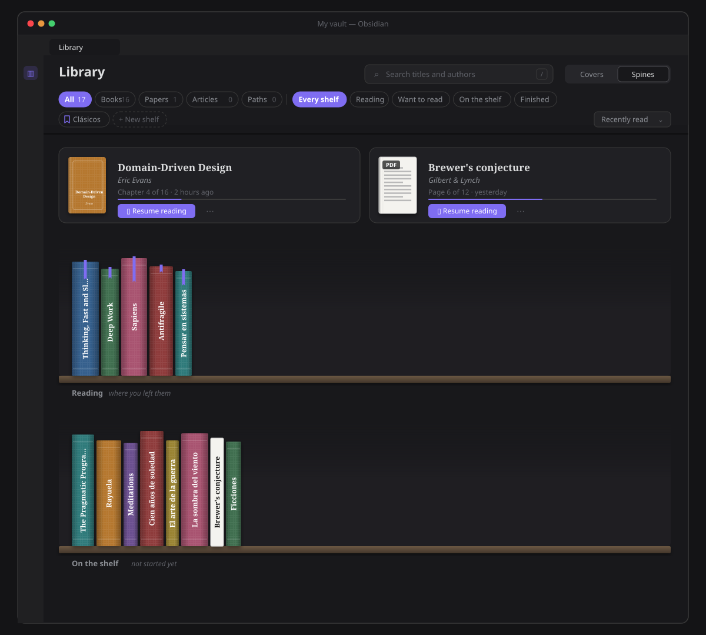
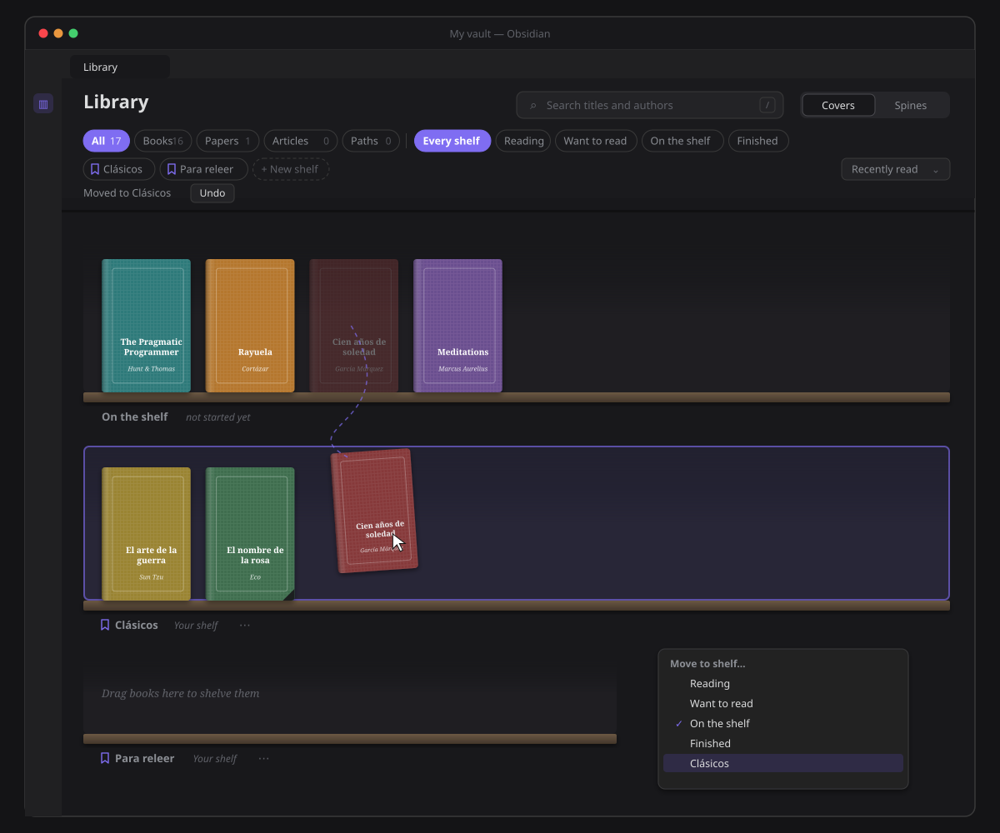
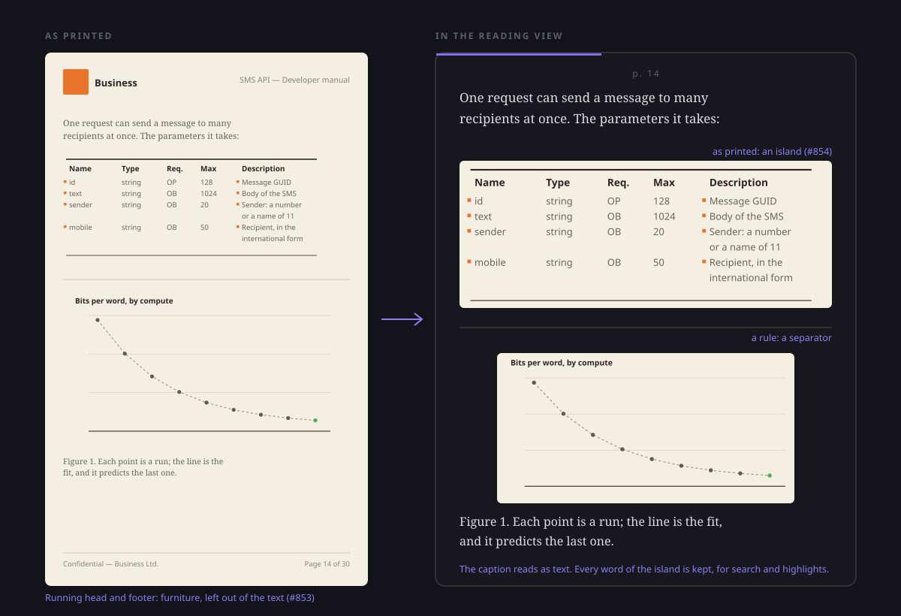

# Your Library

**The sources your ideas come from.** Ideas rarely start in a note: they start in what you read — a
paper, a book, a long article saved as a PDF. The Library puts those sources on one shelf, beside
the reading paths you saved across your own notes, and says what came of each one: how far you are,
what you marked, and the notes born from it.


## Open it

- **The ribbon menu → Library.** The door that is always there, whatever you have open.
- **Right-click a PDF or an EPUB → Read in the reader** opens it in the [Reader](reader.md) where you
  left it.
- **Right-click a PDF or an EPUB → Show in the library** opens the Library on that source's detail.
- **Command palette → "Open the library"**, which you can bind to a hotkey.

The Library opens in the main area, like any tab. It is laid out to work as well in a narrow pane, a
sidebar or an iPad: the books get a little smaller, the desk stacks, and the row of chips scrolls
sideways instead of wrapping into three lines.

## What is on it

Four kinds of things share the Library:

| Kind | What it is | Its cover |
|---|---|---|
| **Books** | the EPUBs in your vault, and any PDF longer than sixty pages | the book's own cover |
| **Papers** | the PDFs in your vault up to sixty pages | the PDF's first page |
| **Articles** | the pages you saved with Obsidian Web Clipper (see [Articles from Web Clipper](#articles-from-web-clipper)) | drawn, in one of your theme's colours |
| **Paths** | the [reading paths](reader.md) you saved at the end of one | a constellation of its notes |

**Nothing is imported.** A source is a file that is already in your vault, in any folder: drop a book
in and it is on a shelf; delete it and it is gone. Nothing is uploaded and nothing leaves the vault.

## The bar that stays

Everything you search, filter and order by sits in **one bar at the top**, and it stays there however
far down the shelves you scroll: translucent over the books, with a fine line under it once something
passes beneath.

- **The search** finds titles, authors, series and shelves, accent-blind (*sonke* finds *Sönke*).
  **/** puts the cursor in it from anywhere in the Library — never while you are typing elsewhere.
- **One row of chips.** First the kind — **All · Books · Papers · Articles · Paths**, each with its
  count; then the shelf — **Every shelf · Reading · Want to read · On the shelf · Finished** (a status
  shelf's chip is there once something stands on it), then **your shelves**, each with a small
  bookmark, and **+ New shelf**. Shelf chips carry no counts.
- **The order** — **Recently read** (never-opened things last, by title), **Most highlighted**,
  **Title** or **Recently added**. After a change of chip or order, a result you were scrolled past
  starts right under the bar; at the top, nothing moves.
- **Covers | Spines** — how the books stand (see [Spines](#spines)). It is the same value as
  **Settings → Reading → Library shows books as**: change it in either place.

The Library remembers the chips and the order across sessions, and the control you pressed keeps the
focus while the shelves redraw.

## The desk and the shelves { #the-shelf }

**The desk** comes first: the books you are reading now, open in front of the shelves — up to two,
the one you were in last first. Each is a small card with its cover, title and author, where you are
and when (*Chapter 4 of 16 · 2 hours ago*), a thin thread for how far, never a number — and
**Resume reading**. A book you marked *Finished*, or put back to *Want to read*, is not on the desk.
The desk is there only while every shelf is shown: pick one shelf and it steps aside. Back from the
Reader, the book you were in breathes once.

**The shelves** follow, each on a plank with its name on the plank's edge, the way a library labels
them:

| Shelf | What stands there |
|---|---|
| **Reading** | *where you left them* — books you opened and have not finished, beyond the two on the desk; and a book you set to *Reading* before opening it, with the shortest ribbon |
| **Want to read** | *next on the pile* — what you said you want to read |
| **On the shelf** | *not started yet* — a book nothing is said of: never opened, no status |
| **Finished** | *read to the end* |
| **Your shelves** | after the four, A→Z — see [Your shelves](#your-shelves) |

**A book stands in one place.** On the desk, or on its first shelf of yours, or else on the shelf of
its status. A shelf with nothing on it is not drawn (a shelf of yours is: it waits for books). A
shelf longer than the pane is **one row that scrolls sideways**, with momentum on a trackpad and a
finger, and the Library keeps where you were along each shelf through every redraw and back from the
Reader.

**Books at a real size.** A cover is the size of a book on a shelf, not a poster: about six to a
row on a laptop, the shelf's own scroll for the rest. **Nothing is written under a cover** — the
cover is the book. Its title, author and where it stands are said once to a screen reader (*Open
Deep Work, Cal Newport, Chapter 2 of 9 · 3 days ago*) and shown on **the card that rises** when you
point at a book or reach it with **Tab**. Its state shows on the book itself:

- **a ribbon** hangs from a book you are reading — longer the further you are, never a percentage;
- **a folded corner** marks a book you finished, so it still says so on a shelf of yours;
- **PDF**, small in the corner, marks a paper.

**Drawn covers look cloth-bound.** Until a cover has been read — and for an article, always — a book
is drawn in one of your theme's colours with a hinge down its left edge, a fine weave and a
blind-stamped frame, its title in a serif and its author in italic, said once. Covers are read as
they come into view, along a shelf too.

**⋯** on a book opens its menu: **Details**, and **Move to shelf…** (see
[Your shelves](#your-shelves)). Under them are the file's own actions, in Obsidian's words (#856):
**Open in default app**, **Reveal file in navigation** (it is shown and selected in the file explorer)
and **Show in system explorer**. Each appears only where it can work: the last on desktop only,
*Reveal* while the core file explorer is on, and none for a reading path. A right click opens the same
menu.

**Arrivals.** A file that arrives while the Library is open settles onto its shelf — a touch smaller
and clear, to itself — and the books beside it make room; nothing moves when the Library is first
drawn, and under reduced motion it is simply there.

### Spines

**Covers | Spines** in the bar turns every book on the shelves spine-out — the desk keeps its cards.
A spine is as **thick as the book is long** (its pages, its chapters, an article's sections, a
path's notes — never its file size), and of its own height, a little under a cover's, the same every
time; the title runs up it. The ribbon and the folded corner are on spines too. The choice is one
value with **Settings → Reading → Library shows books as** (*Covers* until you choose).



### A scanned PDF says so before you open it

Some PDFs are pictures of pages: a scan has no text, so there is nothing to select and nothing to
highlight. When the Library reads a PDF's cover it also looks for text on its first pages, and a PDF
without any says **Scanned · read only** on the card that rises over it, to a screen reader, and in
its detail. You can still open it and read it.

## Your shelves

**Collections are shelves.** The names you gave books — *Planning*, *Clásicos* — are shelves of your
own, beside the Library's four: one idea, not two. Nothing already in a collection is lost: a shelf
of yours is read from the same `collections` property of a [book's note](#a-books-note) (or an
article's own frontmatter), and written to it.



- **Make one.** **+ New shelf**, at the end of the chips: name it where it will stand and press
  **Enter** (**Esc** lets it go). An empty shelf stands with *Drag books here to shelve them* on it.
  A name you already have, an empty one, or one of the Library's own — *Reading*, *Leyendo*, in any
  language the plugin speaks — is refused beside the field, saying why. Making a shelf writes nothing
  to your vault: the shelves you made are remembered in the plugin's settings (`libraryShelves`).
- **Put a book on it.** **Drag** a book onto a shelf on a desktop: it lifts out of its place, its
  cover goes with the pointer, and only a shelf that can take it lights up — the rest say *not
  allowed*. On an **iPad**, **press and hold** a book until it lifts, then drag it: a quick swipe is
  still the shelf's own scroll. **Esc**, or letting go anywhere else, puts it back with nothing
  written. Or, without dragging: **⋯ → Move to shelf…**, which lists every shelf it can go to, the
  one it stands on checked — from the keyboard too. You can drop where every shelf is shown; *Move
  to shelf…* works everywhere.
- **Filter by it.** Its chip in the bar shows every book on it — first shelf or not.
- **Rename or delete it** from **⋯** on its label: *Rename shelf* edits the name in place, across
  every note that has it; *Delete shelf* takes it off every note — **its books stay**, on their next
  shelf. A saved reading path is never put on a shelf.

**What a move writes**, into the book's note (made in the Book notes folder if the book has none
yet) or an article's own properties — `collections` and `status`, nothing else:

| You put the book on… | `collections` | `status` |
|---|---|---|
| **your shelf X** | X first, the others kept (`[X, …]`) | unchanged |
| **Reading**, **Want to read** or **Finished** | removed — it stands where you put it | set to that status (unchanged if it already was) |
| **On the shelf** — only a book never opened | removed | removed |
| renaming shelf A to B | A becomes B where it was in each list | unchanged |
| deleting shelf A | A removed from each list | unchanged |

Every change — one book, or a shelf renamed across forty notes — is **one recorded write**: **Undo**
sits on a line in the bar (*Moved to Clásicos · Undo*) for half a minute, and *What ZettelFlow
changed* lists it too. A write that fails says so on that line and moves nothing. The book is
carried to its new shelf by a translate; under reduced motion it is simply there.

## The archive { #the-archive }

**Put away, never lost.** A framework manual three versions old, a report read once, an article
clipped years ago: the Library keeps a **filing cabinet** at the end of the stacks for what no longer
earns shelf space. What you archive leaves the shelves, the counts in the chips and the search — and
waits in a drawer until you take it back.


- **Archive a book, paper or article** three ways, wherever you already are: **drag** it onto the
  cabinet (on an iPad, press and hold, then drag — near the bottom edge the shelves scroll down to
  meet the cabinet), **⋯ → Archive** in its menu, or **Archive** in its detail. While a book is
  carried the cabinet says it will take it — *Drop it in the cabinet to archive it*. The book flies
  into the cabinet (under reduced motion it is simply gone from the shelf), and a line beside the
  cabinet says *Archived “…”* with **Undo**. A saved reading path is never archived.
- **Open a drawer.** Click **Books**, **Papers** or **Articles** on the cabinet: the drawer unfolds
  below it, in the same view, into index cards — the title, who wrote it (or the site), the format,
  the day it was archived and the folder it was in. The drawer has its own search and chips to switch
  drawers; **Close the drawer** (or click it again) pushes it back.
- **Return to shelf** moves the file back where it came from — the vault root if that folder is gone,
  a free name if its own is taken; an article goes back inside the articles folder, so it is an
  article on the shelf again. **Open** reads it in the Reader straight from the archive; it stays
  archived.
- **A search** that finds something put away says so under the bar — *1 more in the archive* —
  with **Look in the archive**, which opens that drawer with your search in it.

**What archiving does.** It **moves the file** into the archive folder — one recorded write, taken
back by **Undo** or in *What ZettelFlow changed* — and never changes it. The book's note stays where it
is and keeps pointing at the book: with *Automatically update internal links* off, Obsidian asks
whether to update the links — and whatever you answer, if the note's `book` link no longer names where
the book is, ZettelFlow rewrites that one property in the same write. Your place,
bookmarks, layers, highlights and shelves follow the file there and back. Anything you drop into the
archive folder by hand is archived too; its card says it does not know where it came from.

**The archive folder** is set in **Settings → Reading → Archive folder** — `Library archive` until you
choose. It must be a folder of its own: it cannot be, sit inside, or hold the Book notes, Articles or
Dictionaries folder, and those refuse the archive's folder the same way; the field says why while you
type and keeps the last valid folder. **Empty turns the archive off**: no cabinet, no *Archive* in
any menu, and what is in the old folder is an ordinary folder again. Change the folder while things
are archived and the row offers, in place, to **move them** to the new one or **leave them** — books
and papers left behind go back on the shelves; articles stay there as ordinary notes, outside the
Library. Where each archived thing came from is kept in the plugin's settings (`libraryArchive`).

## A source in detail

**⋯ → Details** on a book opens its detail, over the shelves: the cover, the title and author, the
file, and **one sentence** of what came of it — *13% read, 4 hours ago · 3 highlights · 1 note born*.
Only what is there is said: a book never opened says nothing there, no count of none is written, and
a book opened but under one per cent is *Started*. Below it,
[**what it produced in your vault**](#what-a-book-produced-in-your-vault), and **your highlights,
by chapter** — every passage with your note under it, each one opening the source at that passage.
A section with nothing in it is not drawn at all; when neither has anything, one quiet line says
*Nothing marked or made from it yet. Open it and select a passage.*
**Esc** or **Close** puts the detail away. However far down the shelf you are, the detail and its
dim cover the pane where you are, and the shelf waits under them: closing the detail leaves you
exactly where you were.

The detail also holds the book's **Details** — see [A book's note](#a-books-note).

### Cite this book

**Cite this book**, beside **Open** in a source's detail, opens the Reader's
[cite panel](reader.md#cite-a-passage) for the whole book, with no passage: Markdown, inline, a
citation key, BibTeX or CSL JSON, drawn from the book's note (or an article's own properties). It
grows from the button. Esc puts it away and the detail stays. If a form lacks something, **Add it**
puts the cursor in that field of the Details below. Cite writes nothing; **Copy** puts the citation
on your clipboard.

## What a book produced in your vault

A source's detail answers *what did this book do to my thinking?* — as **lists, never a score**.
Under **What it produced in your vault**, each list is shown only when it has something in it:


| List | What it is built from |
|---|---|
| **Notes born from it** | the notes whose `source` links the book (the list the detail always had) |
| **Ideas it led to** | notes a note born links to, made after you first read the book — your first highlight, or the first note born, whichever came first — that do not cite it themselves |
| **Links you made** | the links and typed relations from a note born, or from one of the book's highlights, to a note of yours not born from it: *A ↔ B*, with the relation's name when it has one |
| **Tensions** | `contradicts` with a note born at either end, and the book's highlights you answered with a challenge in Think |
| **Open questions** | questions a note born asks that nothing answers yet (the vault's open questions, narrowed to this book) |
| **Still unresolved** | the book's highlights still on your bench in Think: not crystallized into a note and not set aside — a *Question* highlight among them until you do either |

- **Nothing is inferred.** Every list is read off what the vault already holds — links, typed
  relations, `source` citations, dates and Think's thoughts. Nothing is classified by its text and
  nothing is proposed.
- **No numbers.** A list has a heading and its items: no count, no total, no percentage, no bar. Past
  five items, **Show all** shows the rest in place.
- **The book's note is the book** ([A book's note](#a-books-note)): it is in none of the lists,
  wherever it is kept, and its own links — collections, tags — are not links you made.
- **Each item opens what it names.** A note opens in the editor (Ctrl/Cmd-hover previews it); a pair
  opens in a split beside the Library, A above B, while the detail stays where it is; a highlight
  opens the Reader at its passage; a challenge opens Think on the book.
- **The same for a paper and an article.** A saved path shows only *Still unresolved*, about its
  notes.
- **While your vault is still being read** the section waits, unseen, and appears when it has
  something; the rest of the detail works meanwhile. A book nothing came of yet has no section — the
  detail's one quiet line says so.
- **Motion.** The first time you open a book's detail, the items rise into place a few milliseconds
  apart; the next time they are simply there. Under reduced motion everything appears at once.
- **It writes nothing.** Opening the detail adds nothing to *What ZettelFlow changed*.

*Ideas it led to* uses a note's creation date as Obsidian knows it, which a sync or a copy can reset.
Computing the lists over a 10,000-note vault takes about 2 ms, so they cost nothing to open.

## A book's note

**Every book and paper can have a note of its own**: an ordinary Markdown note whose properties say
what the book is — its title, author, series, publisher, year, language, ISBN, citation key and tags — and what
it is *to you*: a **status** and its **shelves** (`collections`). You never write it by hand: it is edited from
the book's detail, and the vault keeps it, so Bases, Dataview and search see your library as data.


**Details**, in a source's detail (**⋯ → Details**), shows the fields as quiet inline fields —
already filled with the title and author the file declares. Only the title and the fields that hold
something are shown; the rest wait behind **Add details…**, which brings them all out at once — the
others glide down to make room — with the cursor in the first. A field Cite's *Add it* sends you to is
shown, empty or not. Change one and leave the field (or press
**Enter**): it is saved, and a small check beside it fades in and out by itself. No dialog, no
notice; if a write fails, your text stays in the field and a line under it says so.

- **Status** is one of three: **Want to read**, **Reading**, **Finished** — stored as `to-read`,
  `reading`, `finished`, whatever language the plugin speaks. While you have set none it is read
  from your reading and nothing is written: *Finished* once you reached the end, *Reading* once you
  opened it. One you set wins — with one exception, below.
- **Shelves** are [your shelves](#your-shelves) — *Planning*, *Clásicos* — and a book can be on
  several; the first is where it stands. **+ Shelf** suggests the shelves you have, the empty ones
  too; **×** takes a book off one. They are kept in `collections`, a list of their own, never tags, so
  they do not mix with the tags you file the book under.
- **Citation key** is the key a [citation](reader.md#cite-a-passage) cites the book by, saved as
  `citekey` (the name Pandoc and Better BibTeX use). Until you set one, the field shows the key a
  citation proposes, such as `kahneman2011thinking`. A key starts with a letter, a digit or `_` and
  has no spaces.
- **Saved in Library/…** says where the note is and opens it. Right after a change, **Undo** beside it
  takes the last one back — the whole note, if that change created it.

**Want to read, then opened.** A book whose note says *Want to read* and that stands on a status
shelf becomes **Reading** the first time you open it from the Library — its book, **Resume
reading**, or the file menu's **Read in the reader**: `status: reading` is written once, recorded,
with **Undo** on the line in the bar; after that the note says *Reading* and nothing fires again. A
book on a shelf of yours keeps the status you set, and a *Finished* book opened again stays
*Finished*. The Reader itself still writes no note.

**Nothing else is written until you change something.** Opening, reading, highlighting or finishing a
book creates no note. The first change creates one, named after the book, in the **Book notes
folder** — **Settings → Reading → Book notes folder**, `Library` until you choose — and fills it
with what the file declares (an EPUB's creator, publisher, date, language, ISBN and series; a PDF's
title and author), plus your change. The folder is made then, with the first note, if it is missing;
a note is never written over a file that is already there (`Thinking, Fast and Slow 1.md`). Every
later change edits only the property you changed. Each write is on the write record, so it can be
taken back.

**A book's note is found by its link to the book, never by where it is kept.** Its `book` property
links the book file — for a paper too:

```yaml
---
book: "[[Books/Thinking, Fast and Slow.epub]]"
author:
  - "Daniel Kahneman"
publisher: "Farrar, Straus and Giroux"
year: 2011
status: "to-read"
collections:
  - "Planning"
---
```

Rename or move the book and Obsidian updates the link; move the note and it is still the book's
note. **Changing the Book notes folder moves nothing**: new notes go to the new folder, the ones you
have stay where they are and are still found. If two notes link the same book, the first by path is
the one the Library shows, and *Saved in* names it.

**Use a note you already have**, under Details while a book has no note, picks one of your notes and
adds only the `book` link to it — its text and its other properties stay as they are. (Obsidian
rewrites the properties block when any property changes, so the block's own layout may be tidied;
the values and the note's body are untouched.)

A book's note **is the book, not something that came of it**: it never counts among the *notes
born* from the book — not on the card, not in the detail, not in *This note* — even when it also
cites the book in a `source` property.

Your library, as a Base — every book you want to read, by shelf of yours:

```yaml
filters:
  and:
    - note.status == "to-read"
views:
  - type: table
    name: Want to read
    groupBy: collections
    order: [file.name, author, year]
```

## Articles from Web Clipper

**What you clip joins what you read.** A long read saved from the web with
[Obsidian Web Clipper](https://obsidian.md/clipper) is an ordinary note in your vault. The Library
shelves it as an **Article**, beside the books, and the Reader reads it like one — its column, your
type, highlights with meanings, search, footnotes, time left and bookmarks — with no import and no
copy: the clipping stays the note it is.


**What is an article.** A note in the **articles folder** — or any folder inside it — whose `source`
property is a web address (`https://…`). That is exactly what Web Clipper's default template
writes, into its default folder, `Clippings`. A `clippings` tag alone is not enough: a note outside
the folder is never an article, whatever it carries, and neither is a note in it whose `source` is a
`[[link]]` or plain text.

**Where articles come from** is one setting, in two places: under the **Articles** chip on the shelf
(*Articles come from Clippings · Change*) and in **Settings → Reading → Articles folder**. Both edit
the same value. Empty it to turn articles off (*Articles are off*). The Library reads articles from
the metadata cache — it never opens a clipping to put it on the shelf.

**On the shelves**, an article stands like a book: its cover drawn in one of your theme's colours,
cloth-bound, with its `title` and its author — Web Clipper writes a list of links (`[[Jane Doe]]`),
and their names are shown — or, when nobody signed it, the site it came from (`example.com`).

**Reading one.** Click it, or **Resume reading**: the camera pushes into its drawn cover and it opens in the
Reader, in the Library's tab, as [one continuous shot](reader.md#one-continuous-shot) — closing plays
it back onto its place on the shelf. Its **sections are its headings** at the shallowest level it uses (its H1s,
or its H2s when it has no H1), and the text before the first one is a section of its own, named
after the article. **Contents** lists every heading. The corner says *Section 2 / 5*. The Library
remembers where you are, like a book's place, and reaching the last section makes it *Finished* —
read, not written. A footnote is read where it is referenced. A link to the web or to another note
is not followed from the page, as in a book.

**Notes born from it.** A note that cites the clipping — `source:: [[Clippings/The case for slow
software]]` — is born from it, said in its detail's sentence and listed there. Crystallizing a
passage writes exactly that, with the section after it.

**Its status and shelves are its own properties.** An article has no separate
[book's note](#a-books-note): its own frontmatter is its note. **Details** offers its **Status** and
**Shelves** only, and writes those keys into the clipping — through the same recorded write,
with **Undo** — and nothing else in it. (Obsidian rewrites the properties block when a property
changes, so its layout may be tidied; the values and the body are untouched.)

**Reading never writes it.** No highlight, no place, nothing reaches the clipping's body or
properties — only a status or a shelf you set. Highlights are thoughts in Think, the place is
plugin data.

**Network.** None of ZettelFlow's own: Web Clipper saved the page, and ZettelFlow never fetches a
URL. A remote picture inside a clipping is loaded by Obsidian's own Markdown renderer, exactly as it
is in the editor.

## Reading a PDF

Click a paper or a PDF book on the shelf — or **Resume** — and it opens in the same
[Reader](reader.md) as your notes: the same keys (**← →**, **Space**, **Esc**), the same bar, the
same themes and type. Its **pages are the chapters**.

Reading happens **in the Library's own tab**, as [one continuous shot](reader.md#one-continuous-shot):
the camera pushes into the book and its cover opens on the page you were on — no new tab opens. Leave the Reader and the same tab is
the Library again, exactly as you left it: the same filter, the same sort, the shelf scrolled where
it was. (Opened from anywhere else — a note, Home, Think — the Reader keeps its own tab.)


- **Reading view** (the default) reflows each page into the Reader's own column — your font, your
  size, your theme. Lines are put back into paragraphs, a heading set larger stays a heading, a word
  broken across two lines with a hyphen is mended, a lone page number is left out, and a page in two
  columns is read one column, then the other. A page that is a figure is shown as its picture.
  Reading view follows the Reader's **Layout** — Scroll, Page or Spread
  ([pages or scroll](reader.md#pages-or-scroll)), and so does Page view.
- **Page view** (the bar's **Page view**, or **V**) draws the page as it was laid out, for a paper
  whose figures and tables matter. Select words on it with the mouse or the pen to highlight them —
  the same four meanings, *Note* and *Copy* as in the reading view — and it is where the **pen**
  draws on a PDF: on the page as printed, the only place a drawing can be handed back from.
  It zooms, scrolls, turns and rotates its pages, and its links work — see [Page view](#page-view).
  A figure or a table is kept with **Snapshot**, beside Page view in the bar: drag around it, and it
  becomes a note, a fleeting note or part of a note you have, with its page — see
  [Snapshot a figure or a table](reader.md#snapshot-a-figure-or-a-table).
- **The paper's own contents.** **Contents** lists the PDF's outline, each entry with its page; a PDF
  without one lists its pages. The section you are in is shown above the page.
- **Highlights and margin notes**, exactly as in a note: select words, **Highlight** or **Highlight and
  note** (or **H** / **Shift+H**). Each one is a thought in [Think](../architecture/thought-lab.md),
  about the PDF, carrying the passage and **its page** (`p. 6`). It is found again on that page, by
  its words, every time you open the paper. Think shows where it came from — *cap.pdf › p. 6* — and
  **Open in the Reader** lands on that page.
- **Resume.** The Library remembers the page you were on; the shelf's **Resume**, the PDF's own menu
  and the desk's *Resume reading* all open it there. Reaching the last page marks it read.
- **The end** of a paper says what the reading added up to, and offers **Think on what you marked**,
  **See it in the library** or **Read it again**.

### What a page keeps

The reading view rebuilds more than paragraphs: the formats a paper is set in come back, read off the
page itself. Only the clear cases are taken; when in doubt a block stays a paragraph, as before.




- **Code keeps its lines.** Lines set in a monospace face read as one listing, with their
  indentation, in the same box as a book's code ([code in technical books](reader.md#code-in-technical-books)):
  whole on its page, *Code lines* in the Type panel, and kept to Think as a fenced block. A name in a
  sentence set in monospace reads as inline code. No language is guessed, so a PDF's code is not
  coloured. A paper typed entirely in a typewriter face reads as prose.
- **Lists keep their items.** Each item starts its own line, its marker hanging in the margin as
  printed — the page's own `•`, `1.` or `a)`, never renumbered — and a line set under an item's words
  goes on with it. A nested item sits further in. Only a clear list is a list: a bullet, or two
  numbered (or dashed) lines in a row, in sequence; a lone *1. Introduction* stays what it was.
- **Bold and italic** come back where they stand out: a defined term, a book's title, an emphasis.
  They are read off the name of the font each word is set in (*Times-Bold*, *MinionPro-It*, the faces
  LaTeX uses), so a PDF that names its fonts plainly shows nothing. A heading, or a paragraph set
  wholly in one face, is left as it is — that is its font, not an emphasis.
- **Footnotes and quotes.** A small mark raised after a word reads as a footnote marker, and the
  small text at the foot of the page that starts with that mark reads as its footnote — still where it
  was printed, set apart from the text. Click the marker and the footnote opens over the page, as a
  book's does ([links, detours and context](reader.md#links-detours-and-context)). A footer that starts
  with a page number is not a footnote: its mark must be raised somewhere on the page. Two lines or
  more set in from both margins, at one place, read as a block quote.
- **Hand it back with your notes.** A PDF's Notebook offers **Share a copy with your notes**, beside
  *Export as a reading note*: a new PDF beside the original with your highlights and notes on it
  ([hand back a marked copy](reader.md#hand-back-a-marked-copy)).
- **Links you can follow.** The words under a link are a link, the same words Page view links. A
  citation or a *see section 3* goes to its page, with the way back on the trail; a link out of the
  paper shows its address with **Copy link**, and is never opened.
- **Tables and figures as printed** (#854). What is not running text is not rebuilt: it is shown as
  the page prints it, cropped from the page, in its place in the reading — the way the state of the art
  reads a paper. A **table** is found by its shape: three rows or more of three cells or more that start
  on the same columns, a wrapped cell's further lines with their row, one column short (an id, a type);
  a ruled table takes its rules, and the header set under its top rule. A **figure** is a picture of 8 %
  of the page or more, or that much of drawn shapes (a plot is vector paths): its gridlines, its title
  and its axis labels come with it, and its caption stays text. A logo is never one. The crop stops
  short of a line of text that runs past its sides, so no word is cut in two. Every word of an island
  is still the page's — kept under it, out of sight — so search, highlights and Page view find it.
  It holds its place at its final shape, so nothing moves when its picture arrives, and is drawn once
  it nears the screen; a page turned back to draws it from what was kept. Its tables are no longer
  read as two columns, so the text after one reads after it.
- **A rule is a separator.** A long line the page draws between two blocks of text is drawn as the
  theme's own separator — not the box a manual draws round its code, which the listing already has,
  and not a footer's line.
- **No running heads or footers** (#853). A line printed at the top or foot of the page, page after
  page — *Acme SMS API - Developer guide*, *Confidential … Page 14 of 30* — is the page's
  furniture, not its text, and is left out, as a lone page number always was. It must come back at
  the same height on three of the pages read when the paper first opens (its first three, and three
  further in), its numbers taken as any number; a title at the top of one page is kept, and a line in
  the middle of a page never is. Page view still shows it, as printed, and its word index leaves out
  exactly what the reading view does. What was found is kept with the paper, so it is read once.
- **What it leaves out, said** (#852). A reflowed page that had pictures or a ruled table on it says
  so in one quiet line under its label — *Leaves out 2 pictures, its tables and the page's layout* —
  with **Page view** beside it, which opens on the same page. Only what is true of that page is said:
  an icon is not a picture, a frame drawn around a screenshot is the screenshot's, and a page of prose
  says nothing. It is read off the page's own operators, the list pdf.js already makes for its fonts,
  and the next page's is read before you turn to it.

**The page's text never changes.** A format only cuts the page into blocks and marks words inside
them — every character stays where it was. A highlight made before a paper read its formats is found
where it was, in both views, and Page view indexes exactly the text the reading view draws. The one
exception is inside a listing, whose lines are lines: each starts on its own, with its indentation.

### Page view


Page view is the paper as printed, made into a place you can read it — at a desk, and with a pinch on
an iPad (#767):

- **The view it opens in.** A paper you have never turned Page view on or off for opens in the view
  it reads best in: a form, a poster or a page of figures — where most of what its first pages hold
  are short fragments, or there is little text at all — opens **as printed**; prose opens reflowed.
  The Reader decides from the text of the first three pages, once per copy of the file (a new copy is
  sampled again), and keeps it beside the paper's place — the PDF itself is never written. Opening a
  copy it has read already reads none of those pages again (#851). A **designed document** opens as
  printed too (#852): one with the same picture in the same place on most of its first pages (a
  letterhead, a vendor's logo), or a page that is mostly one picture (a cover). A ruled table alone
  does not make a document designed — papers have them too. **The view
  you choose wins from then on**: turn Page view on or off (**V**, or its button) and the paper opens
  that way next time. A tab you left open opens as you left it.

- **Zoom.** It opens at **Fit width**. **Ctrl/⌘ + wheel**, a trackpad pinch, a two-finger pinch on
  touch, **Ctrl/⌘ +** and **Ctrl/⌘ −** zoom from 50 % to 400 %; **Ctrl/⌘ 0**, the level in the bar
  and a double tap go back to **Fit width** (a double tap at Fit width goes to twice it). The page grows
  around the point under the pointer or between the fingers, and follows them 1:1; past 400 % it
  resists and springs back. While you zoom nothing is drawn again; when you stop, the pages on screen
  are drawn sharp and only the blur clears. In Page view these keys are the paper's, and Obsidian's
  own app zoom gives way (walked on Obsidian 1.14.4); anywhere else they stay Obsidian's.
- **Fit page** shows the whole page. *Fit width*, *Fit page* and the bar's level are camera moves,
  never cuts. At Fit width a landscape page in a portrait paper is fitted on its own.
- **The same Layout as the text** (**Type → Layout**): *Scroll* is one continuous run of pages —
  **Down**, or **Across** in a horizontal strip, where a plain wheel scrolls sideways; *Page* is one
  page at a time, turned with the chapter motion you chose; *Spread* is two pages side by side, page 1
  alone on the right as a printed book opens, and one page where the reading is not clearly wider than
  it is tall (an iPad in portrait).
- **Rotate page** (in **Type**) turns the page most on screen a quarter, into its new place, and draws
  it upright.
- **The overview**, one tap on the bar's pages-grid button — in Page view and in the reading view
  alike — and a tab of **Contents**: every page as a small picture, the current one marked, each with
  the paper's own label (*p. iv*). Pictures are drawn as they scroll into view. Tapping one flies it to
  its page, which it becomes, in the view you are in; the place you left is kept in *Where you've
  been*. See [the overview](reader.md#the-overview).
- **Links.** A link to a place in the paper — a reference, a citation, its own contents — shows as a
  link under the pointer and jumps there, with the back pill and **Alt+←**. A link that leaves the
  paper (a web address, a DOI) is never followed: clicking it shows its address with **Copy link**.
- **Only what is near is drawn.** However long the paper, at most seven pages are drawn at once and
  pages far away are let go, so a 600-page PDF scrolls without the app holding 600 pictures. A page not
  drawn yet is a blank sheet with its number, and its picture fades in. A fling draws nothing until it
  slows, so it keeps its frames.
- **Drawn ahead of you** (#851). Once the pages on screen are drawn, and no thumbnail is waiting, the
  next two pages in the direction you are reading are drawn too — down the paper, or back up it — so a
  page of photographs is already there when you reach it. A page's first drawing is mostly decoding its
  pictures, which no lower resolution makes cheaper; drawing it early does. Nothing ahead is drawn
  while you zoom or fling, and no more pages are held than before: the two kept either side of the
  window are the ones drawn ahead.
- **Kept with the paper.** The zoom (or the fit), Down or Across and the turned pages are kept beside
  its place, in plugin data. The PDF is never written.

The Type panel's **Page view** group holds *Fit width · Fit page*, the zoom (−, the level, +), *Down ·
Across* (in Scroll), *Rotate page* and *Crop margins*; in Reading view none of it is shown. Under
reduced motion every move is instant and nothing fades; a pinch still follows the fingers.

### Crop margins


A printed page is mostly margin, and at *Fit width* that margin is drawn at full size, so the text is
smaller than it has to be — on an iPad in portrait, too small to read without zooming. **Type → Page
view → Crop margins** frames each page on what is printed on it, and *Fit width* fits that (#769):

- **Nothing printed is cut.** The frame holds the page's text, its pictures **and its drawn shapes**
  (a plot is lines, not a picture): the running head, the page number, a footnote, a note in the
  margin and every figure stay. A small, even border is left around them. A page whose drawing the
  Reader cannot read for sure is shown whole rather than guessed at.
- **The same size from page to page.** A paper gets one frame for its right-hand pages and one for its
  left-hand pages, taken across its pages, so a printed book's alternating margins are followed and
  the text never changes size as you turn. A title page or a short last page uses its side's frame,
  never blown up. A page with more on it than its side's frame (a wide table) keeps all of it, and is
  shown a little smaller than its neighbours — never cut wins over the same size.
- **Measured once.** The first time it is turned on for a paper, the Reader reads up to 24 of its pages
  (every page of a short paper): the switch says *Measuring the margins…* and the page does not move.
  Then the camera moves in, once — the page grows from its sheet into its frame, the line you were
  reading staying under your eyes. Turning it off is the same move backwards. Under reduced motion the
  page is simply shown cropped (or whole), the line kept.
- **Everything else still works**: *Scroll*, *Page* and *Spread*, the zoom, *Rotate page* (the frame
  turns with the page), links (they stay on their words), the overview (its pictures show the
  cropped page) and every jump, which lands on the same line as without crop.
- **A scan is not cropped.** It has no text to frame a page on; the switch says *Cropping needs a
  page's text, and this PDF has none.* A page that is a picture in an otherwise printed paper is shown
  whole.
- **Kept with the paper.** The switch and the frames are kept beside its place, in plugin data, with
  the file's size and date: a new copy of the PDF is measured again. The PDF is never written. If the
  margins cannot be measured, the switch turns back off and says so once.

### A scan

A scanned PDF has no text, so every page is shown as its picture, and a quiet banner says so before
you try: *This PDF is made of images, so there is no text to highlight. You can read it, and note in
the margin by page.* **Note this page** writes a note in the margin of the page you are on — a thought
in Think with the page and no passage — listed under **Notes on this page**.

A scan is read in Page view, its only view, so it zooms, scrolls, turns, rotates and has its
overview like any paper. A scanned PDF that another tool has already made searchable (OCR'd) carries a text
layer, and the Reader reads it as text today: Reading view, search and highlights work on it. A scan
without one stays pictures, with notes by page.

### Where you left off, to the line

The Library keeps the chapter or page you were on **and how far into it you were**. **Resume** opens
there, not at the chapter's top, which matters in an EPUB whose chapters are long. It is kept a moment
after you stop scrolling, and it lands on the same share of the chapter even if you changed the type
size. A deep link to a highlight lands on the highlight instead.

## Reading an EPUB

A book opens in the same Reader. Its **chapters are the book's spine**, named from the book's own
contents — the EPUB 3 `nav`, or the `toc.ncx` of an older book — and **Contents** shows those
contents, nested as the book nests them.


- **It opens on its text.** A book you have never opened starts where the book says its text begins —
  the EPUB 3 nav's `bodymatter` landmark, or the `text` entry of an older book's `<guide>` — not on
  its cover, title page or credits. A book that says neither opens on its first chapter, as before.
  The cover and the front matter are still there: **Contents** and **Home** reach them, and a book
  you have read before always opens where you left it.
- **A cover is one page.** A chapter that is only a picture — the cover — is shown as one page, the
  picture fitted to it and centred (alone across both pages in *Spread*). A heading with no words in
  it, which many covers carry, never takes a page of its own.
- **An untitled chapter is named by its heading.** A chapter the contents never name reads as
  *Chapter n* until it is drawn; from then on it goes by its first heading (*Dedicatoria*) wherever the
  Reader names it. A highlight's place keeps the chapter's own label, so it is always found again.
- **In your type and your theme.** Each chapter is rebuilt in the Reader's own column: the book's
  headings, paragraphs, lists, tables, quotes and figures — not its fonts, colours or layout.
- **Safe by construction.** A chapter is never inserted as HTML. It is parsed as data and rebuilt one
  allowed element at a time, so nothing the book carries can run: no scripts, no event handlers, no
  embedded frames or forms, no styles. Its images are read from the book itself; nothing is ever
  loaded from the web, and a link that leaves the book is shown as plain text.
- **Footnotes are read in place.** Click a footnote mark and the note floats over the page, at the
  mark. That works for a note in the chapter and for an endnote at the back of the book. The page
  does not move; Esc or a click elsewhere puts it away, and **Go to note** goes there.
- **Search inside the book.** **Ctrl/Cmd+F** (or the bar's search) opens it in the Reader's drawer,
  beside the page; its field keeps your words through every jump, and opening another panel there
  puts the search away, tints and all.
  It searches every chapter or page, ignoring case and accents, and says *N results · in M chapters*,
  each with its snippet and its page or chapter. **Enter** and **Shift+Enter** step through them; the
  matches are tinted in the page and the current one is outlined. A match in another chapter is a
  jump, with its way back. **Esc** closes the search and takes every tint away. A scan says it has
  no text to search.
- **Every jump has a way back.** A cross-reference, **Go to note**, a **Contents** entry, a search, a
  bookmark or a passage opened from Think moves you — the camera travels there, it never cuts — and a
  **← Back to …** pill shows where you came from. Click it, or press **Alt+←** (two fingers swept
  right on a touch screen), to return to the very line. The pill fades by itself after a few seconds;
  the way back stays in **Contents → Where you've been**, through page turns, until you close the
  book. In a PDF the pill follows Contents jumps.
- **Bookmarks.** The ribbon at the pane's top-right corner, or **B**, keeps a place without highlighting
  anything; **Contents → Bookmarks** lists them. See
  [Bookmarks and where you've been](reader.md#bookmarks-and-where-youve-been).
- **Highlights, notes, resume and the end** work as in a PDF. A highlight carries its chapter
  (*Thinking, Fast and Slow.epub › 3 · The lazy controller*) and is found again in that chapter.

### Equations and drawings

An EPUB 3 may write its **equations in MathML** and its **diagrams in inline SVG**. Both are drawn by
the platform itself (Chromium on the desktop, WebKit on an iPad), so they follow your reading size
and stay sharp at any zoom.


- **An equation is an equation.** Presentation MathML is kept — fractions, roots, scripts,
  under/over, tables, fences and spacing — inline in a sentence or as a display equation on its own
  line, centred, in your theme's text colour. Content MathML and every annotation (the TeX source a
  converter leaves behind) are dropped; an equation that is only Content MathML is shown as its
  alternative text, or else its words — never as an empty gap. The `alttext` is kept for screen
  readers.
- **A drawing is there.** Inline SVG is kept and scaled to the column, never wider than it, with its
  own proportions. Shapes, paths, labels, groups, gradients, patterns, clip paths, markers and
  pictures *from inside the book* are kept, with the drawing's own colours (a chart's legend means
  something); a drawing that uses the current colour takes your theme's text colour. Colours an
  editor wrote in a `style` attribute are kept as the drawing's colours; the `style` itself is not.
- **Nothing in it runs, moves or reaches the network.** Scripts, `foreignObject`, event handlers,
  `style` elements, filters, masks and animation are dropped with everything inside them — the page
  is still, as a page should be. A reference may only name something inside the same drawing; a
  `use`, a picture or a paint that points anywhere else is dropped. A link to a place in the book
  is followed like any link in the book; one that leaves the book is its text and nothing else.
- **The cover keeps working.** A cover drawn as `<svg><image/></svg>` (with at most a title, a
  description or empty definitions beside it) is still shown as a plain picture.
- **Search and highlights see their words.** Search finds a word in a diagram's label and tints the
  drawing. A highlight across an inline equation keeps the equation's characters in its quote and
  tints the whole equation — no mark is drawn inside one. Selecting part of a drawing, or part of an
  equation, is not supported. A highlight made before this release whose quote held an equation's
  TeX source may now be listed as *detached*: it is never drawn in the wrong place.

## The book notebook

Everything you marked in one book, in one place. Open it from the book's detail (**⋯ → Notebook**)
or from the Reader (**Contents → Notebook**). It takes the shelf's place: **← Library** or **Esc**
brings the shelf back.

- **In reading order.** Your highlights and margin notes, by chapter or page, each with its
  meaning's colour, the passage, your note and its place. **Open in reader** goes to that passage;
  **To note** makes a note of it, through the usual preview.
- **Narrow it.** Chips by meaning (**Idea**, **Question**, **Quote**, **To discuss**, with counts)
  and **With notes only**.
- **Export as a reading note.** A preview of exactly what will be written, for what the filter
  shows: a title, `Source:: [[the book]]`, and per chapter the quotes (with the page, in a paper)
  and your notes as bullets. Pages are written as text, never as block ids. Pick a folder (the last
  one is remembered) and **Create note**. Nothing is written before that. The note never goes over
  an existing file, and its creation can be undone.

## From passage to note

What you mark in a book is where your own ideas start. Click a highlight in a PDF or an EPUB and
choose **Crystallize into a note**: the same preview [Think](../architecture/thought-lab.md) uses
opens, with the note before it exists.


- **It quotes the passage and cites the page.** The proposed note carries the passage as a quote,
  your margin note under it, and a citation line the knowledge model reads — `source:: [[Books/Thinking,
  Fast and Slow.epub]] p. 42`, or the chapter's name for a book without pages. Change the title and
  the text before you create it; **Cancel** writes nothing.
- **It is a sourced note.** Because it cites the book, the note's claim counts as sourced in Health,
  Cultivate and This note — the same way a `source::` you write by hand does.
- **This note knows where it came from — to the paragraph.** Open the new note with
  [This note](this-note.md) beside it: under its counts, **Born from** names the book and the page;
  click it and the Reader opens on the passage itself. The note keeps a `source` property with the
  chapter and the passage's opening words, so the way back survives the highlight leaving Think — see
  [Every note goes back to its paragraph](reader.md#every-note-goes-back-to-its-paragraph).
- **The Library counts it.** The book's card says **1 note born**, and its detail lists the notes
  born from it, each one a click away.
- **The book is never written.** The note is the only thing created — through the
  [write record](../architecture/reversibility.md), so it can be taken back. A PDF or an EPUB is
  never offered as a place to append to. The highlight stays a thought in Think, set aside rather
  than deleted, so it does not wait on your bench for a note you already made.

You can also crystallize a book's highlights from Think and from the review of
[a few things you marked](highlights-review.md): they cite their page the same way.

With a canvas in the **Crystallizes thoughts** role, the note does not land at the vault root: the
preview's button reads **Continue in «flow»** and that flow builds it, with the quote, the margin
note and the `source::` line already at the top, and the passage's `source` property added once the
note exists — see
[Think → through your crystallize flow](../architecture/thought-lab.md#through-your-crystallize-flow).

## What it keeps, and where

**Your book files are never changed.** Not a byte of a PDF or an EPUB is written: no annotation
layer, nothing next to it. When you say something about a book, it gets an ordinary note in your
Book notes folder ([A book's note](#a-books-note)) — the only thing the Library ever writes, and only
then. What the Library remembers about a source is kept in the plugin's settings:
the title, author and length the file declares, whether a PDF is only images, and where you are in
it — each with the size and date of the file it was read from, so a replaced file is read again.
An article's place is kept the same way, under the clipping's path; a status or a shelf you
set on an article is the one thing written into it. The shelves you made, empty ones too, and
*Library shows books as* are kept in the plugin's settings (`libraryShelves`, `libraryBookView`).
Covers are kept for the session only, in memory: never in your vault, never in the settings.
**A book renamed or moved in the vault keeps all of it** (#810): its place, bookmarks, layers, ink
and highlights follow the new path, with the Library open or closed — see
[Where ink is kept](reader.md#where-ink-is-kept).

What you *mark* — highlights and margin notes — is not kept by the Library at all: those are
[thoughts in Think](../architecture/thought-lab.md), files you can open.

### Designed pages: comics, picture books and cookbooks

Some books are not text that flows: a comic, a picture book, a cookbook or a magazine places every
word and picture where its designer put it. EPUB 3 calls them **fixed layout** — the book (or one of
its pages) says it is *pre-paginated*, and gives its page size. The Reader shows those pages **as they
were made**: their positions, their pictures, their colours and their own fonts, at the size they
declare.


- **Known by what the book says.** A book declared fixed layout is read as its pages; a page declared
  on its own in a flowing book is shown as itself, fitted to the column, between chapters in your type.
  A book that declares nothing reads exactly as before.
- **Fitted, then zoomed.** A page opens whole (*Fit page*). It zooms as a PDF in Page view does — pinch,
  **Ctrl/⌘ + wheel**, **Ctrl/⌘ +** **−**, a double tap — about the point you look at; **Ctrl/⌘ 0** is a
  camera move back to the whole page. A page is drawn once and only ever scaled, so it stays sharp.
- **Page, Spread, Scroll** — the Reader's own **Layout**. *Spread* pairs the pages the way the book
  says (`page-spread-left` / `-right`, a first page alone when it says so, a centred page alone), and
  never pairs a book that says `rendition:spread none`. If you never chose a layout, a designed book
  reads as a spread in landscape and a page in portrait; a layout you chose wins.
- **Right to left.** A book whose spine says `page-progression-direction="rtl"` (most manga) turns
  the other way: **←** is next, the left edge and a swipe to the right turn on, and a spread's first
  page sits on the right of the spine.
- **Read-only, and said so once.** Highlights and search are not available on a designed page, and
  the first one of a reading says so in one quiet line. Contents, bookmarks, the trail, resume and the
  end card work as in any book, and so does [the overview](reader.md#the-overview): each designed page
  is its own small picture, drawn inside its own boundary as the page is; the time left is counted in **pages**, at this reading's own pace
  (half a minute a page until you have read three).
- **Light on memory.** Only the pages on screen and two either side are held; a page further away
  lets its pictures go. A page waits as a blank sheet of its size and fades in when it is drawn.
- **A page that cannot be drawn** says *This page could not be drawn.* in its place, and the next one
  still turns.

**Nothing in it runs, and nothing is fetched.** A designed page is rebuilt node by node, like every
chapter, inside a **shadow root** of its own — so its look stays inside its page and reaches nothing
of the Reader's or of your theme's. Its style sheets are read from the book and **cleaned** first: a
closed list of CSS functions, no CSS escapes, no `@import`, and every `url()` only to a file inside
the book, read from the archive and shown through a `blob:` URL the Reader made itself; then the sheet
the platform parsed is checked a second time. Its fonts are read from the archive and loaded under a
name of the Reader's own (`zf-fxl-…`), so a book's *Inter* can never replace the app's, and they are
let go when the book closes. Its own animations never play; `position: fixed` stays inside its page.
No `<style>`, `<link>` or `<script>` element is ever made. A book's `!important` rule can beat what a
page wrote inline — rare in fixed layout, and the designer's own choice.

What a note made from a passage *writes* is in the note: its `source` property — a list of
citations, each the book's link with the chapter in its subpath, the print page when there is one,
the chapter's name and the passage's opening words — and the `source::` line under its text, as
before. See [Every note goes back to its paragraph](reader.md#every-note-goes-back-to-its-paragraph).

## How to verify

| Command | Proves |
|---|---|
| `npx jest test/application/library/shelf test/application/library/shelves test/application/library/spine` | the shelf (kinds, filters, accent-blind search, orders); where every book stands — the desk (two, most recent, never *Want to read* or *Finished*, none once a shelf is chosen), the status shelves in order, *On the shelf* for a book nothing is said of, your shelves A→Z with the empty ones while nothing narrows the view, every book in one place for every combination; what each move writes (your shelf first, a status shelf taking every shelf of yours away, *On the shelf* only for a book never opened, nothing where it already stands); rename and delete across notes; a shelf's name refused when empty, taken or the Library's own in English or Spanish; a spine's thickness from the book's length, clamped, and its height the same every time; the detail's one sentence, never a zero |
| `npx jest test/application/library/bookNote` | a book's note read (string or list, an unknown status ignored), its status read from the reading, its first write and file name, found by its link, never born from its book; which details show and which fold; *Want to read* becoming *Reading* once, never on a shelf of yours |
| `npx jest test/architecture/components/core/library/libraryBar test/architecture/components/core/library/libraryView` | the bar that stays: one bar, one row of chips, *All* once, no counts on shelf chips, **/** to the search and never while typing, a saved collection opening on every shelf, Covers \| Spines writing the setting; the desk's cards, nothing under a cover, one card that rises outside every shelf, labels on the planks, every book once in the DOM, a shelf's sideways scroll kept through a redraw, spines for every shelf book while the desk keeps cards |
| `npx jest test/architecture/components/core/library/libraryYourShelves` | *+ New shelf* named in place, refused with its reason, Esc keeping nothing, nothing written to the vault; *Move to shelf…* listing where a book can go with its shelf checked and *On the shelf* only for a book never opened; one write, the book carried, the line with Undo, a failure said there; a drag lighting only the shelf that takes it, refused over *On the shelf* for an opened book, no drop while one shelf is chosen; rename and delete from the label's menu across notes, Undo; a path never moved; *Want to read* becoming *Reading* on opening, nothing for a book on your shelf |
| `npx jest test/architecture/components/core/library/bookNoteWriter test/architecture/components/core/library/libraryDetails test/architecture/components/core/library/libraryBookNotes` | a book's note created at a free path in the Book notes folder with what the file declares, edited key by key, adopted with only its link (body to the byte), each one undone; Details saving on leaving a field or Enter, the empty fields folded behind *Add details…* and brought out at once with the cursor in the first, a field Cite sends you to shown; the status and shelves; a book carried to its new shelf, nothing written by opening |
| `npx jest test/application/library/article test/application/library/passageToNote test/architecture/components/core/library/libraryArticles test/architecture/components/core/reader/readerArticle` | what an article is, its fields and sections, its kind and count; the *Articles* chip and *Change* writing the same setting as Settings → Reading; an article opened with the shot from its drawn cover; a clipping in the Reader, the note never written; its status written alone into its own frontmatter; a book that arrives settling onto its shelf, nothing at the first draw, reduced motion |
| `npx jest test/config/readingSettingsGroup test/config/settings/bookNotesFolder` | *Library shows books as* — Covers until you choose, the same value as the bar's switch; the *Book notes folder* and *Articles folder* rows |
| `npx jest test/application/library/produced test/architecture/components/core/library/libraryProduced` | what a book produced: the six lists, each item opening what it names, nothing written; the section unseen until it has something, the rise in turn, reduced motion |
| `npx jest test/architecture/plugin/library/sourceRenameFollow` | a renamed book keeps its place, bookmarks, layers, ink and thoughts (#810); an archived thing's record follows a rename inside the archive and is forgotten when it leaves (#865) |
| `npx jest test/application/library/archive test/architecture/plugin/library/archiveWrites test/architecture/components/core/library/libraryArchive test/architecture/components/core/library/libraryDrag test/config/settings/archiveFolder` | the archive (#865): which folders clash; where a file goes and comes back, never over another; the book note's link rewritten only when it no longer finds the book, in the same batch; the cabinet, its drawers and cards, its three doors, *1 more in the archive*; the edge scroll while a book is carried; the *Archive folder* row, its refusals and the move offer |
| `npx jest test/styles` | every colour of the shelves, planks, cloth, ribbon and drop light is the theme's; the grid; only transform and opacity move, nothing under reduced motion |
| `npx jest test/application/library/pdfText test/architecture/components/core/reader/readerSource test/application/library/epubSanitize test/architecture/components/core/reader/readerEpub test/architecture/components/core/reader/readerHighlights test/architecture/components/core/library/sources/pdfPageView test/architecture/components/core/reader/readerPageView test/application/library/pdfCrop test/architecture/components/core/reader/readerCrop test/application/library/epubPackage test/application/library/epubFixedLayout test/architecture/components/core/reader/readerDesigned` | reading a PDF (reflow, Page view, crop, a scan) and an EPUB (the sanitizer, equations and drawings, designed pages) — see the sections above |
| `npm run test:perf -- library` | the shelf of 500 sources and 200 articles builds, lays out its desk and shelves, filters and searches in budget; the PDF and EPUB budgets |

In a vault (a test vault with a PDF paper, a scanned PDF, an EPUB you have opened and a few you have
not):

1. **Empty state.** In a vault with no PDF, no EPUB and no saved path, open **ribbon menu → Library**.
   Expect *Your shelf is empty, for now* and, with a note open, **Read a path across your notes** —
   and no bar: nothing to search.
2. **The desk and the shelves.** Add the files. Expect the book you opened on **the desk** with
   **Resume reading** and a thread, no percentage anywhere; the books you never opened on a plank
   labelled **On the shelf** — *not started yet*; nothing written under any cover. Each cover is
   drawn cloth-bound, then replaced by the real one as it comes into view.
3. **The card that rises.** Point at a book (or **Tab** to it): a small card rises over it with its
   title, author and *Not started* (or where you are). Scroll the shelf sideways: the card goes.
4. **The bar stays.** Scroll down: the bar stays, with a fine line under it. Press **/**: the cursor
   is in the search. Type an author without accents: found. Click **Papers**: only PDFs, the result
   starting under the bar.
5. **Spines.** Press **Spines**: every book on the shelves turns spine-out, thicker the longer it is;
   the desk keeps its cards. Open **Settings → Reading**: *Library shows books as* says *Spines*. Set
   it back to *Covers* there: the Library follows.
6. **A shelf of yours.** **+ New shelf** → *Clásicos* → **Enter**: an empty shelf stands with *Drag
   books here to shelve them*, and a *Clásicos* chip with a bookmark. Try *Leyendo*: refused, saying
   why; nothing is made.
7. **Drag.** Drag a book from *On the shelf* onto *Clásicos*: only *Clásicos* lights; drop it. It is
   carried there, and the bar says *Moved to Clásicos · Undo*. Its note (in `Library`) has
   `collections: [Clásicos]`. **Undo**: the book is back and the note is gone. Drag a book you have
   opened over *On the shelf*: it does not light, and letting go there writes nothing.
8. **On an iPad.** Swipe along a shelf: it scrolls. Press and hold a book: it lifts; drag it onto
   *Clásicos* and let go: the same as step 7.
9. **Move to shelf….** **⋯** on a book → **Move to shelf…**: its shelf is checked; *On the shelf*
   is offered only for a book never opened. Pick **Finished**: it stands on *Finished* with a folded
   corner, and its note has `status: finished` and no `collections`.
10. **Rename and delete.** **⋯** on *Clásicos*'s label → **Rename shelf** → *Clásicos españoles*:
    the label, the chip and every note on it follow, in one write. **Delete shelf**: its books stay,
    on their status shelves; **Undo** brings it back.
11. **A calm detail.** **⋯ → Details** on a book you never opened and never marked: no sentence, the
    title and author, **Add details…**, and one line — *Nothing marked or made from it yet*. No
    boxed counts, no empty headings. **Add details…**: the other fields come out, the cursor in
    *Series*.
12. **Want to read, then opened.** Set a book on *On the shelf* to **Want to read**: it moves to that
    shelf. Click it: the Reader opens, and back in the Library it stands on **Reading**, with *Moved to
    Reading · Undo* in the bar; its note says `status: reading`. Put a book on *Clásicos*, set it to
    *Want to read*, open it: it stays *Want to read*.
13. **A paper, a book, an article, a comic.** As before: a paper reflowed with Page view and crop, a
    scan's banner, an EPUB with its contents, equations and drawings, a clipping read in the Reader, a
    fixed-layout comic's spreads — see the sections above. Closing each plays the camera back onto
    its place on its shelf, even far along a shelf that scrolls.
14. **The archive.** At the end of the stacks: a cabinet, *Books — empty*, *Papers — empty*,
    *Articles — empty*, *Nothing put away yet.* Drag a paper onto it: the cabinet lights, the cue
    reads *Drop it in the cabinet to archive it*; drop it. The paper flies in, *Papers* reads *1 item*,
    *Archived “…” · Undo* beside the cabinet, and the file is in `Library archive/`. **Undo**: it is
    back on its shelf and in its folder. **⋯ → Archive** on a book, then search its title: no book on
    the shelves, *1 more in the archive · Look in the archive*, which opens the *Books* drawer holding
    one card — *was in …/*. **Return to shelf**: it stands where it stood, its ribbon unchanged. In
    **Settings → Reading → Archive folder** type `Library`: refused, saying it is the Book notes
    folder; leave the field — `Library archive` is kept. Empty it: the cabinet is gone.
15. **Reduced motion.** With reduced motion on, every move above happens at once: no lift, no glide,
    no rising card motion, no flight into the cabinet — the same result.
16. **Negative.** Compare each source file before and after (size and modification date): unchanged —
    archiving only moved one. Opening, reading and highlighting created no note; only a move, a status
    or a field you changed did, each listed in *What ZettelFlow changed*. No toast appeared for any of
    it.
