# The Reader

**Follow ideas, not files.** The Reader turns a handful of related notes into something you read
from start to finish, the way you read a book. It takes the whole window, gives you one chapter at a
time, and steps out of the way while you read.

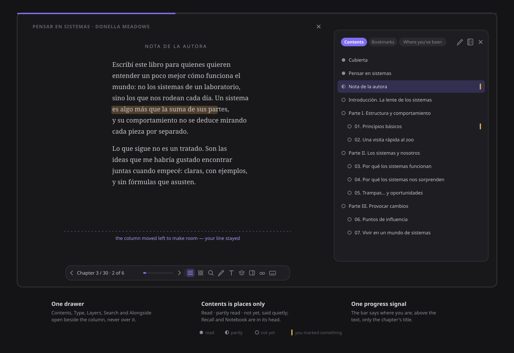

## Open it

The Reader also reads your **PDFs and EPUBs** — a paper's pages reflowed into the same column, a
book's chapters rebuilt in your type, with the same highlights — from the [Library](library.md).

- **Right-click any note → Read from here.** That is the whole setup. You don't need a map of
  content or a list of relations: the note you right-click is where the reading starts.
- **This note → ⋯ → Read around this note**, from the note you are on.
- **Right-click several notes → Read these**, or **right-click a folder → Read this folder**.
- **Explore → Read these**, beside *Copy as links*, reads what your question selected.
- **Command palette → "Read from the active note"**, which you can bind to a hotkey.

None of these is offered on a note or folder in an **excluded folder**: it is outside ZettelFlow
(see [This note](this-note.md#a-note-in-an-excluded-folder)), and *Read these* leaves such notes out.

The sidebars fold away and the Reader takes the window. When you leave, with **Esc**, the **×** or
the command **Reader: exit**, the page fades out, the reader's tab closes, and your workspace comes
back exactly as it was: the sidebars that were open open again, and you return to the tab you were
in, where you left it. Closing the tab any other way gives everything back too, and so does a reader
left open across a restart.

A book opened from the [Library](library.md) is read in the Library's own tab, so leaving it does not
close anything: the tab becomes the Library again, with its filter, sort and scroll as they were.

## Choosing what to read

When there is more than one good way through a note, *Read from here* asks **how do you want to
read it?** Each way shows its shape, what it promises and the chapters it would read, so you choose
on what you will actually read.

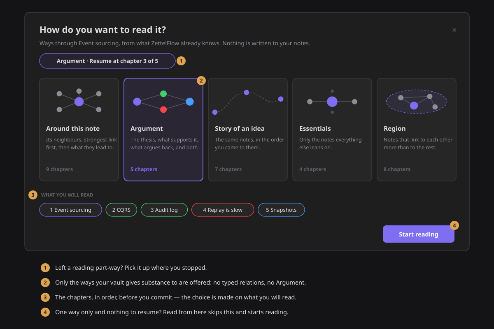

| Way | Reads | Offered when |
|---|---|---|
| **Around this note** | the note, its neighbours strongest link first (counterpoints, supports, examples, other typed relations, plain links), then the notes two steps away that most of them touch, then notes near it you never linked | always — it is the default |
| **Argument** | the thesis, what supports it, what argues back, then the notes that speak to both sides | the note has typed `supports` / `contradicts` relations |
| **Story of an idea** | the same notes as *Around*, in the order you first worked on them (decisions, moves, creation date) | at least three chapters, on at least two different dates |
| **Essentials** | only the hubs around the note: the notes linked three times or more, most linked first, at most seven | it leaves something out |
| **Region** | the note's region of your graph: notes that link to each other more than to the rest, its hub first | the region has three notes or more, not all already its neighbours |

Every way reads at most twelve chapters, and only notes your vault actually has. A way that would
read exactly the same chapters as one already offered is not offered twice. When only one way
applies and there is nothing to resume, the chooser is skipped and the reading starts.

**Read these** and **Read this folder** read the notes you picked (up to sixty) in the order their
links suggest: each next chapter is the note most linked to the ones already read.

### Resume

Leave a reading part-way and the Reader remembers the chapter. Next time, the chooser offers
**Resume at chapter n**; a picked set or a folder reopens where you left that same set. Reaching the
last chapter, or going back to the first, forgets the place. The Reader keeps the forty most recent
places, in the plugin's settings — a picked set is kept as a fingerprint, not a list of your notes.

## Chapters and roles

Every reading starts with the note you started from (a picked set starts with its first note). A
note joined both ways comes before one joined one way, and a typed relation before a plain link. No
unresolved links, attachments or self-links are read.

Each chapter carries its **role** relative to the note you started from, read off your typed
relations:

| Role | When |
|---|---|
| **Thesis** | the note you started from, when something supports it or argues with it |
| **Support** | a note joined to it by `supports` |
| **Counterpoint** | a note joined to it by `contradicts` |
| **Synthesis** | in an *Argument*, a note that speaks to both sides |
| **Context** | anything else |

## Reading

| Key | Does |
|---|---|
| **→**, **Page down** | next chapter — in *Page* or *Spread*, the next page, then the next chapter |
| **←**, **Page up** | previous chapter — in *Page* or *Spread*, the previous page, then the previous chapter's last page |
| **Space** / **Shift+Space** | a screen down (up) the chapter, and the next (previous) chapter once you reach its end — in pages, a page on (back) |
| **↓** / **↑** | scroll the chapter a little (nothing in pages: there is no scroll) |
| **Home** / **End** | first / last chapter |
| **F** | deep reading: the page and nothing else, in and out (see [Deep reading](#deep-reading)) |
| **H** / **Shift+H** | highlight the selected words / highlight them and write a note |
| **B** | bookmark the place you are reading, or take away the bookmark on this screen (a book or a paper) |
| **Alt+←** | back to where your last jump left from (a book or a paper) |
| **Ctrl/⌘ +** / **−** / **0** | in a PDF's Page view: zoom in, zoom out, back to Fit width ([Page view](library.md#page-view)); elsewhere they stay Obsidian's |
| **?** | the keyboard shortcuts, on the page (also a button in the bar) |
| **Esc** | one thing at a time, nearest first: close the shortcuts, the highlight popover, a peek, step back from a detour, close a panel, leave deep reading, then leave the Reader |

The keys work whenever the Reader is the active tab, wherever the focus is: they are registered the
way Obsidian's own views register theirs, so they never fight a hotkey of yours. **Ctrl**, **Cmd**
and **Alt** combinations are always Obsidian's, and a key typed into a margin note or a name is
never taken.

Three **commands** do the same from the palette, and you can bind them to hotkeys of your own. They
appear only while a reading is the active tab, and none has a default hotkey:

| Command | Does |
|---|---|
| **Reader: next chapter** | the next chapter (the end card after the last) |
| **Reader: previous chapter** | the previous chapter |
| **Reader: exit** | leave the Reader and get the workspace back |

The **bar** at the bottom appears when you move the mouse and fades after two seconds, and the
pointer fades with it. On a touch screen a tap in the middle of the page shows it, and the next one
hides it. It holds:

- the chapter you are on, your progress through the path, and **about how many minutes are left**
  in this chapter (at 220 words a minute, counted down as you scroll);
- **Contents**, the chapters with their roles (in a book or a paper, with its **Bookmarks** and
  **Where you've been** beside them);
- **Type**;
- **Alongside**, the panel-on-the-right icon: your own notes near the paragraph you are reading,
  through six lenses (see [Alongside](#alongside-your-vault-beside-the-page));
- **Deep reading**, the page and nothing else (**F**);
- **Keyboard shortcuts**.

**A panel closes from the panel.** *Contents*, *Type* and *Alongside* each carry their own **×** at
the end of their head (*Close contents*, *Close type*, *Close Alongside*). It closes the panel in the
same move as **Esc**, and the Reader stays open. While the [claim sheet](#make-it-a-claim-or-link-it-to-an-idea)
is open, the first press closes the sheet, as Esc does. The bar's button of an open panel shows as
pressed, so the way back is always where you opened it.

**The × at the top right is the Reader's own exit** (*Close the reader*, said on hover). It always
sits over the column: while Alongside lies beside the page, the top line ends where the column ends,
so the × above the panel is the panel's, never the Reader's.

A **hairline** across the very top fills as you scroll through the chapter. At the end of it, the
way on lights up: **Next · *its name* · *how long it is***.

### Deep reading

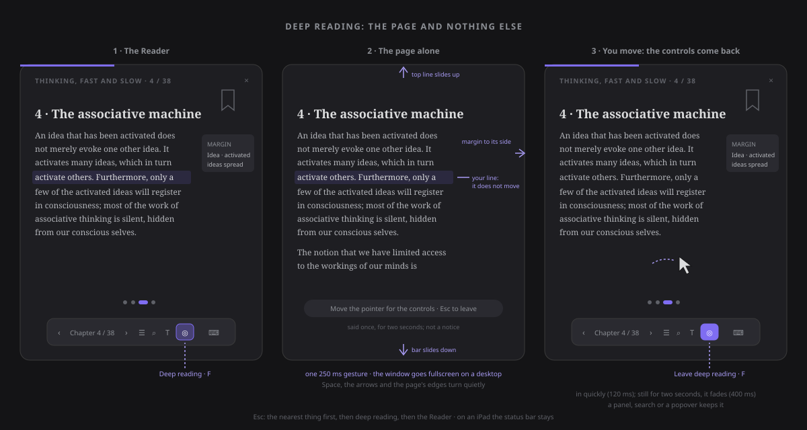

**Deep reading** is the page and nothing else. Press **F**, or the *Deep reading* button in the bar
(where *Fullscreen* used to be), and the top line slides up off the screen, the bar slides down,
the margin of highlights slides to its side, and the chapter dots, the hairline, the back pill and
the bookmark ribbon fade. The pointer hides. On a desktop the window also goes fullscreen. The line
you were reading does not move, not even while the window grows around it.

- **Said once.** For two seconds a line on the page says *Move the pointer for the controls · Esc to
  leave*, or *Tap the middle for the controls* on a touch screen. It is not a notice.
- **Everything comes back when you move.** Move the pointer (more than a jitter), tap the middle of
  the page, or press any key that does not read (**H**, **B**, **1–4**, **?**, **Ctrl/⌘+F**), and the
  controls slide back in, quickly. They fade again after two seconds of stillness, and they stay while
  a panel, search or a popover is open.
- **Reading keys stay quiet.** **Space**, **Shift+Space**, the arrows, **Page up/down**, **Home**,
  **End** and a tap on the page's edges turn without bringing anything back.
- **Nothing is lost.** Selecting and highlighting, footnotes, search, the panels, the end card and
  the way back (the pill through the controls, or **Alt+←**) all work as they do outside it.
- **Leaving.** **Esc** closes the nearest thing first, as always, then leaves deep reading, and only
  then the Reader. **F** or *Leave deep reading* (the same button) leave at once. The window is given
  back as it was: if it was fullscreen before, it stays fullscreen; if deep reading made it so, it
  is put back.
- **Beside focus mode.** *Focus mode* (in *Type*) is about the text, deep reading about the screen.
  Either works with or without the other, and deep reading never changes it.
- **Not remembered.** Every book opens in the ordinary Reader.
- **Reduce Motion** is honoured: the controls appear and go at once, and your line still stays.

On a desktop the window's fullscreen never takes **Esc** from the Reader: the Reader answers it
first, so the order above holds. If the window leaves fullscreen some other way (**F11**, the system),
the page stays in deep reading and is not put back into fullscreen when you leave.

On a desktop, Obsidian's own ribbon, tab bar and status bar slide away with the Reader's controls,
and come back as you leave.

**On an iPad** the app cannot make the window fullscreen, so deep reading covers Obsidian's own
toolbar instead (the Reader already does while you read) and takes the Reader's controls away too.
The iPadOS status bar, with the clock and the battery, stays: a plugin cannot hide it.

### One continuous shot

Opening a book from the [Library](library.md) never cuts to another view: the camera moves. The shelf
zooms with the book you clicked, the cover opens on its hinge **on the page you were on** (your
highlights already in their places), and that page lands exactly where the Reader's column is: it
*is* the Reader, with everything it has. Leaving plays the same shot backwards, until the book is on
its shelf again. Any key or click jumps a shot to its end, and with reduced motion, or
**Settings → Reading → Opening a book → Instant**, the same places are reached at once. This is
[constitution §XVI](constitution.md#xvi-one-continuous-shot) at work.

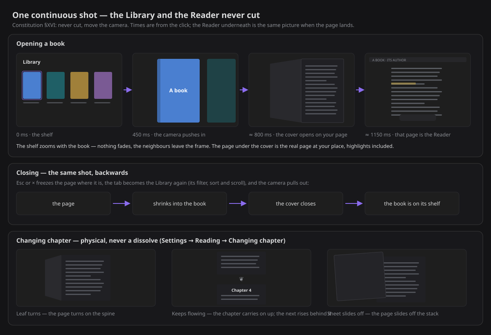

### A reader that feels good

- **The measure of a book.** About 68 characters to a line, with ragged edges evened out, long words
  hyphenated and generous leading, in your theme's font or a serif.
- **Pages that turn, physically.** Changing chapter never dissolves one into the next. The page you
  were on is laid on top like paper and leaves the way you choose in **Settings → Reading →
  Changing chapter**: a **leaf turns** on the spine, the text **keeps flowing** up into the next
  chapter (a small ❦ marks the seam), or the **sheet slides off** the stack. Going back plays it the
  other way. Arrows, keys, the contents and search jumps all turn the same page.
- **A marker, not a stamp.** A new highlight is swept across the words like a marker pen.
- **Time left, at your pace.** The bar says how long is left in the chapter and in the book,
  counted at **your** reading speed, learned from the chapters you read to the end and kept on this
  device only. It shows only while the bar does: move the pointer or press a key. **Type → Time
  left** turns it off.
- **Focus mode** (in **Type**): every paragraph but the one at your reading line steps back, so your
  eye stays where you are. It is remembered for next time.
- **Calm when you read.** Opening, the page rises out of the workspace; leaving, it sinks back.
- **Details that explain themselves.** A
  highlight you keep drifts into its card in the margin. Popovers grow from where you selected, and
  a chapter ends with a quiet ornament as you arrive. Day, sepia and night cross-fade instead of
  snapping, and the book you are reading breathes once when you come back to the Library. Each one
  moves only what the screen can move for free (transform and opacity), and none of them counts at
  you.
- **Less motion, if you asked for it.** With your system's *reduce motion* setting on, every one of
  these is instant: nothing slides, sweeps or fades.

Chapters are drawn by Obsidian's own Markdown renderer, so callouts, embeds, math and your theme look
as they do everywhere else.

## On iPad

The Reader is built to be read with a finger, a pen or a hardware keyboard. On a mouse or a trackpad
nothing below changes: a click never turns a page.

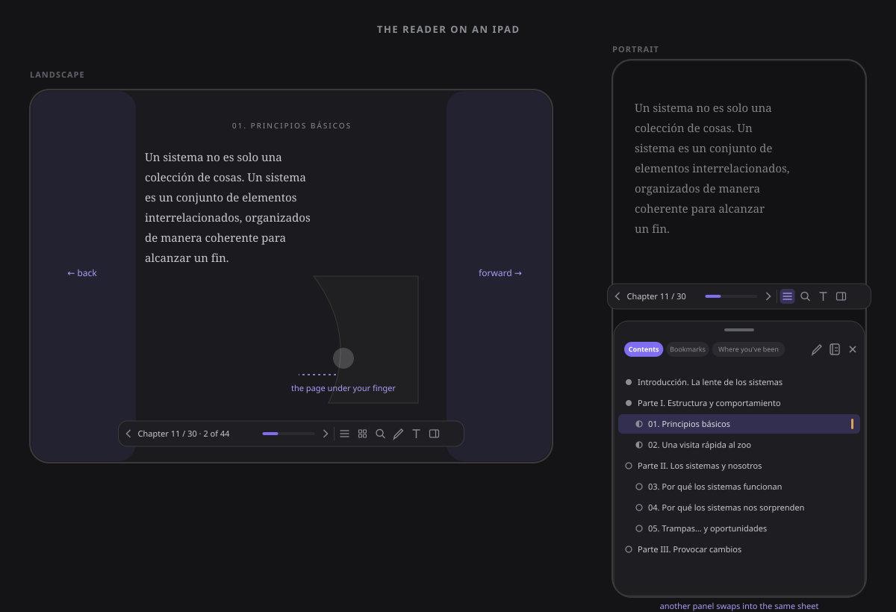

- **Tap the edges.** A tap in the outer fifth of the page turns a screen, the right edge forward
  (as **Space**) and the left edge back. A tap in the middle shows the bar, and the next one hides
  it. A tap on a link, a footnote, a highlight or a button is that thing, never a turn — and so is
  any tap while words are selected.
- **Swipe a chapter.** A sideways swipe holds the chapter's own turn — the leaf, the flowing text or
  the sheet you chose in **Settings → Reading** — under your finger. Let go past a third of the
  page, or with a flick, and it turns at the speed you let go; short of that it springs back. On the
  first or last chapter the page follows a third of your finger and comes back. A vertical drag
  scrolls, and a gesture is decided once: a diagonal drag never both scrolls and turns.
- **The very edge is not ours.** A swipe that starts within a finger's width of the screen's edge is
  left to iPadOS and to Obsidian, which opens its sidebars from there.
- **Back with two fingers.** Two fingers swept right anywhere on the page go back one step along
  [where you've been](#bookmarks-and-where-youve-been), as the back pill and Alt+← do. (The
  screen's left edge would be the obvious place, but it is Obsidian's.)
- **Pinch to the overview.** Two fingers drawn together on a flowing page shrink it into its card in
  the [overview](#the-overview); in Page view and a designed book, past the smallest zoom. Two
  fingers are decided once — drawn together, a pinch; swept sideways, back; lifted at once, ink's
  undo — so one never does another's work. The overview opens at the sheet's full height in
  portrait: a page of cards.
- **Selecting beside the system's menu.** A long press selects words as usual and iPadOS shows its
  own callout (Copy, Look Up, Translate). Once the selection has settled, the four meanings appear
  **below** it, clear of that callout, and without a second *Copy*.
- **Panels are a bottom sheet in portrait.** *Contents*, *Type* and *Alongside* rise from
  the bottom edge at half height over the dimmed page. Drag the handle up to nearly full height or
  down to close it, tap the page above it, or tap its **×**. The bar stays above the sheet, so the
  button that opened it closes it too, and the top line steps out under the dim, so the Reader's ×
  never sits over the sheet's head. In landscape they open as the usual card.
- **The whole screen is the page.** While a book is open, Obsidian's own toolbar slides away, and it
  slides back as you leave, exactly as it was. The top line, the back pill, the dots, the bar and the
  sheet stay inside the safe area — in both orientations and in a Split View window — and rotating
  keeps the line you were reading in view.
- **No dead control.** The app cannot make the window fullscreen on an iPad, so there is no
  *Fullscreen*; *Deep reading* is there instead and works (see below). The shortcuts sheet names
  **⌘** and **⌥** on Apple devices.
- **A big book opens, or says why not.** A whole book is held in memory while you read it. On an
  iPad or a phone, a PDF over 100 MB or an EPUB over 50 MB is not opened — not even read: the page
  says it is too large to open on this device, with the way back to the library, and nothing is
  written. Those limits are deliberately cautious until a device has measured them.
- **Reduce Motion** is honoured: taps and sheets are instant, and a swipe still follows your finger,
  because moving something with your finger is not an animation.

**What is proven so far.** All of the above is tested, and was walked in Obsidian with its mobile
layout emulated at iPad sizes with touch. The walk on a real iPad — the one that settles iPadOS's
own callout and Look Up, the Pencil, a hardware keyboard and the memory limits — is recorded on
[issue #750](https://github.com/RafaelGB/Obsidian-ZettelFlow/issues/750); until it is, those rows
are assumed, not claimed.

**What a plugin cannot do on iPad.** Hide the status bar; keep [reading aloud](#listen) in the background. These
are the app's, not a plugin's. The Pencil's native gestures are the same — a web view never hears them:

| On iPad | In the Reader | Instead |
|---|---|---|
| Pencil double-tap to switch tools | ✗ native only | the palette's pen and eraser |
| Pencil squeeze (Pencil Pro) for a palette | ✗ native only | the pencil in the reader bar |
| PencilKit's ink | ✗ native only | the Reader's own ink, drawn from the points |
| Apple's tool picker | ✗ native only | the palette: pen, highlighter, lasso, eraser, four inks, undo |
| Scribble's scratch-out and the lasso tool | ✗ native only | the palette's eraser, and the Reader's own [lasso](#keep-what-you-lasso), from the points |
| Undo from the Pencil | ✗ native only | a two-finger tap on the page |
| Speech in the background, or with the screen locked | ✗ a web view's limit | [Listen](#listen) pauses at its sentence; play goes on from there |

Ink is drawn from what WebKit reports (about 120–240 Hz, with no predicted points): good ink, honestly
not PencilKit ink.

**Still to prove on a device: the pinch to the overview.** Obsidian's iPad app never zooms the page
itself, so two fingers on the Reader reach it as two pointers — the same path Page view's zoom, the
two-finger *back* and ink's two-finger undo already use. Whether a real iPad's WKWebView keeps it so
for the pinch is recorded on [issue #776](https://github.com/RafaelGB/Obsidian-ZettelFlow/issues/776)
(rows P13–P16: the pinch reaches the Reader, does not fight *back* or ink's undo, and the card cap
holds); until it is, the pinch is ◐ to prove on a device, and the bar's button is the door.

**Still to prove on a device: Pencil hover.** An M2-or-later iPad senses an Apple Pencil 2 or a Pencil
Pro while it is still above the glass, and native apps show where it will land. Whether Obsidian's
web view passes that on to a plugin is not documented, so the Reader does not promise it:

| On iPad | In the Reader | Evidence |
|---|---|---|
| A nib shadow under the hovering Pencil (M2+ iPad, Pencil 2 or Pro) | ◐ to prove on a device | not yet measured on an iPad — [#749](https://github.com/RafaelGB/Obsidian-ZettelFlow/issues/749) |

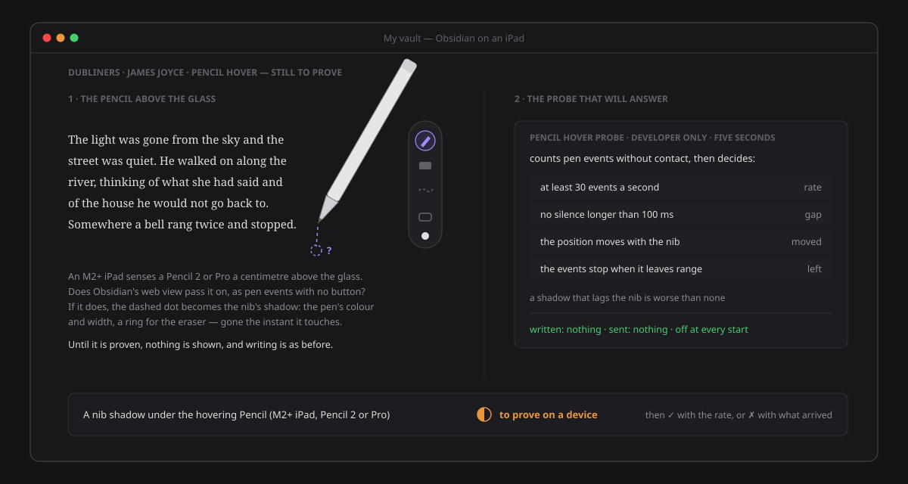

The question is measured, not guessed. A five-second developer probe counts the pen events the
Reader receives **without contact** (`pointerType: "pen"`, no button pressed) and decides by named
thresholds: at least 30 events a second, no gap over 100 ms, the position moving, and the events
stopping when the Pencil leaves range — a shadow that lags the nib is worse than none. In the desktop
app, fed trusted pen events, it read 120 events, position and tilt moving and the leave seen, and the
vault's files were unchanged. That proves the instrument, not the iPad: a desktop pen is not
WKWebView. The probe is not in the plugin; it is kept as a patch on the issue for the device run.
Until an iPad answers, there is no shadow, and writing is exactly as above. When it answers, the row
becomes ✓ (and the shadow is built) or ✗, with the device, the versions and the rate.

## Links, detours and context

Getting lost is the main way reading fails in a linked vault: you follow a link, then another, and
the thread is gone. So a link in the Reader is a **peek**, not a jump.

In a book or a paper it is the same idea. A **footnote** opens over the page, at its mark, and any
**jump** (a cross-reference, Contents, a search, *Go to note*, a bookmark, a passage opened from
Think) leaves a **← Back to …** pill, Alt+← and a row in **Where you've been** to return to the line
you left — see [Bookmarks and where you've been](#bookmarks-and-where-youve-been) and
[Your Library](library.md#reading-an-epub).

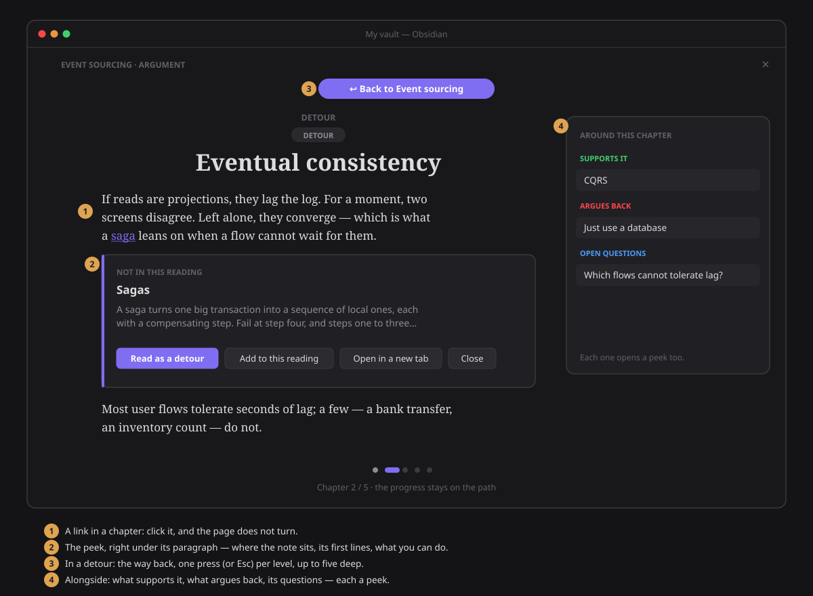

Click a link and a card opens right under the paragraph that holds it. It says where the note sits
(*Chapter 3 of this reading*, or *Not in this reading*), shows the note's first lines, and offers:

| Action | Does |
|---|---|
| **Read as a detour** | reads the note now, then brings you back. A pill at the top says *↩ Back to …*; one press, or **Esc**, steps back one level. Detours can nest five deep. |
| **Jump to the chapter** | when the note is already a chapter of this reading |
| **Add to this reading** | puts the note right after the chapter you are on, for this reading only |
| **Open in a new tab** | as Obsidian would |

- While you are in a detour the counter says *Detour* and the progress stays on the path. The arrow
  keys move along the path, leaving the detour behind.
- **Mod-click** a link to open it in a tab without a peek, and **Ctrl/Cmd-hover** it for Obsidian's
  own page preview.
- A link to a note that does not exist yet only says so: following it would create the note, and the
  Reader writes nothing.

The **Contents** panel lists the chapters with their roles, ticks the ones you have read and marks
where you are. What supports the chapter, what argues back and its open questions are in
[Alongside](#alongside-your-vault-beside-the-page), read from the same model as
[This note](this-note.md). Each of those is a peek too.

## Alongside — your vault beside the page

The book on the left, your notes on the right. **Alongside** is the Reader's context panel — the
same button in the bar, in the same place — for a book, a paper or a reading of notes. It shows
your highlights on this page first, as it always did, and under them what of yours is **near** the
passage you are reading, each card saying in one line why it is there.

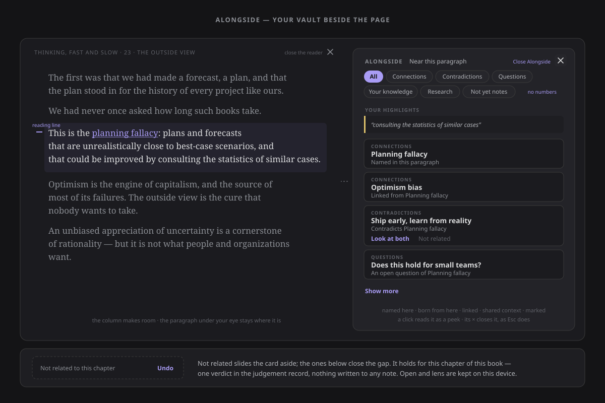

**Near what.** The paragraph at the reading line, a third of the way down the column, or, while
words are selected, the selection. In a PDF's Page view it is the page. The heading says which:
*Near this paragraph*, *Near your selection*, *Near this page*. Alongside follows your reading when
the scrolling **settles** (150 ms after you stop), never on every frame.

**What counts as near**, decided by your vault, the same way every time, with no AI:

- a note whose **title or alias is named** in the passage, as whole words, with case and accents
  folded (*Planning Bias* names a note aliased *planning bias*). A title made only of common words
  (*The end*, *People*) or a single word shorter than five letters (*Time*) never matches;
- a note **born from this book** (its `source` cites it, see
  [Every note goes back to its paragraph](#every-note-goes-back-to-its-paragraph)): from this
  chapter first (*Born from p. 143*), then from the rest of the book;
- a note one of **your highlights or margin notes** in this chapter links or names;
- in a reading of notes, the chapter's own note: what links to it and from it.

Only notes in your knowledge scope count — the one filter every reader honours — so an excluded
folder never appears.

**Six lenses over one list.** Chips across the top, each fed by something the vault already knows:

| Lens | Shows |
|---|---|
| **All** | each card once, tagged with its first lens below |
| **Connections** | the near notes, their neighbours (supports, expands, inspired-by, example, implements, plain links), and unlinked notes that share context with them |
| **Contradictions** | the `contradicts` relations you have typed on a near note: each offers **Look at both** and **Not related** |
| **Questions** | the open questions of a near note, and your *Question* highlights in this book |
| **Your knowledge** | the notes named here, and your highlights from **other** books that link or name them |
| **Research** | the claims of a near note and their sources; an unsourced claim says so |
| **Not yet notes** | thoughts in Think, not yet notes, that mention a near note |

Cards are ordered by **why** they are there — named here, born from here, linked, sharing context,
marked — then by title; five show, then **Show more**. **The chips carry no number** and an empty
lens is still offered: chosen, it says *Nothing of yours touches this passage through this lens.*
Alongside never counts at you. With nothing near at all it says *Nothing of yours is near this
paragraph yet. Mark it, link it, or keep reading.*, with your highlights still above it. While the
vault is being indexed it says *Reading your vault…*, in words, never a spinner.

**A click reads it.** A card opens as a [peek](#links-detours-and-context), and the page does not
move; on a desktop, hovering it shows Obsidian's page preview. Beside a book a peek offers **Open in
a new tab**: the book is read in its own pages, so a note met beside it is never a detour inside it.
**Look at both** opens the note right under the paragraph, so the two are read together.

**Not related** says that this note does not bear on **this chapter of this book**: it leaves
Alongside here and does not come back, while other chapters and other books still show it. It is one
verdict in the [judgement record](cognitive-agency.md) (*rejected*), and nothing is
written to any note; **Undo** stays in the card's place for five seconds.

**It moves like a margin.** Opening, it slides in from the column's edge while the column makes room,
and the paragraph under your eye stays where it is; closing is the same move backwards. On a narrow
pane it lies over the page's edge, and on an iPad in portrait it rises as the
[sheet](#on-ipad). **Close Alongside**, the × in its head, closes it in that same move — as **Esc**
or its button in the bar do — and never the Reader. Choosing a lens slides the chip's fill to it, and the cards that stay keep their
place while the others fade out or rise in. Reading on, a card still near never moves; new ones
arrive in their place. While the pointer is in the panel nothing moves under it. *Not related* slides
the card aside and the ones below close the gap. Under reduced motion every change is instant.

**Remembered on this device.** Whether Alongside is open and the lens you chose are kept on this
device, beside your reading pace — never synced, never in the vault.

**Fast on a big vault.** Finding what is near a paragraph is budgeted at 10,000 notes
(`reader.alongside.near.10k`, see [performance budgets](performance-budgets.md)): the names it
matches against are indexed once per change of the vault, so a settle costs milliseconds.

## Moves answered by your vault

Alongside shows what of yours is near a paragraph. Two moves take a stance on the passage you
selected: **Contradict** asks which of your notes stand against it, **Connect** asks which of your
ideas it belongs with. Both are answered **by your own vault, with no AI**, and both work with AI
turned off.


**The Think row.** Select words in a book or a paper, or click one of your highlights: under the
meanings, the popover has a second row, *Think*, with **Contradict** and **Connect**. A passage you
marked yesterday can be worked on today. A reading of notes has no Think row: Cultivate's moves own
notes.

**What each looks for**, decided by your vault, the same way every time:

- **Contradict** — the notes you have already typed as `contradicts` a note
  [near the passage](#alongside-your-vault-beside-the-page): your tensions, carried over to it. Each
  says why: *Ship early contradicts Planning fallacy, which this passage names.*
- **Connect** — the near notes themselves, then the notes that **support** or **expand** them, then
  unlinked notes that **share context** with them (discovery's own score). Each says why: *Named in
  this passage*, *Supports Planning fallacy*, *Shares context with Planning fallacy*.

At most three, in a fixed order. Left out: a note you said is *not related* to this chapter, a note
already in a tension with this passage, and a note that already cites it. Only notes in your
knowledge scope count.

**The answer is a proposal.** It arrives at the top of Alongside — which opens if it was closed —
under *Proposed. Nothing is written until you decide.*, with the move and where the answer came from
(*Contradict · from your vault*), the passage, and the candidates. Each candidate is the Reader's
proposal card, with its own **Accept**, **Modify** and **Reject**. When nothing is found, the answer
says so — *Nothing in your vault stands against this passage yet.* or *Nothing in your vault is close
to this passage yet.* — and offers nothing to accept; **Dismiss** takes it away. A tension needs a
[thinking space](../architecture/thought-lab.md): without one, the answer says how to choose it.

**What each verdict writes**, and what is recorded:

| Verdict | Written | Recorded |
|---|---|---|
| **Contradict**, accepted or modified | **one thought** in Think: its text is the line as you left it; it is *about* the book and *also about* the note, and quotes the passage with its [source](#every-note-goes-back-to-its-paragraph). On a highlight, it is threaded under it as a challenge, and the highlight gets a small tension tick on the page | the verdict, and the move *counterexample* (perturb) |
| **Connect**, accepted, or another idea picked | **one property**: the idea's `source` list gains the passage — the note is now sourced, and the passage is one of its sources. One recorded write in the [write record](../architecture/reversibility.md), taken back as one batch | the verdict, and the move *analogy* (explore) |
| **Reject** | nothing | *Not related* for this note and this chapter — the same verdict as Alongside's, so the note leaves Alongside too |
| **Dismiss** (Esc, or the card's ×) | nothing | nothing — a dismissal is not a judgement |

**Modify.** On a contradiction the line becomes editable where it is, and **Accept** reads **Keep my
version**. On a connection, **Modify** opens a search over your ideas — the near ones first, before
you type; ↑ ↓ and Enter pick, Esc goes back — so you are not stuck with the three offered.

**The tension is a thought, never a relation.** A passage is not a note, and a tension is thinking,
not yet knowledge: it is kept in Think, and once you crystallize it, the note it becomes can hold a
typed relation. It carries its passage, but it is your answer to a proposal, not a highlight: it is
never drawn on the page, counted on the shelf or brought back for review as one. Think shows it with
a *Contradict* ribbon.

**The book is never written.** A verdict records the note, a subject naming the move and the book,
and the origin `derived` — never the text ([judgement record](cognitive-agency.md)).

**The card outlives the selection.** Accept works after you have selected something else or turned
the page: the card holds its passage. Undecided cards are for this session only: closing Alongside
or the Reader drops them, and records nothing. **From this reading**, at the bottom of Alongside,
lists what you accepted while reading — *Tension with Ship early*, *Connected to Planning fallacy* —
and a click reads the note in a peek.

**It moves like the rest of the Reader.** The answer flies out of the button you pressed into its
place at the top of Alongside, in one 250 ms flight. If Alongside was closed, it slides in carrying
the answer already in its place, as one gesture. An accepted candidate travels down into *From this
reading*; a rejected one slides 16 px aside and fades, and the others close the gap by moving.
Modify changes nothing in the layout. A key or a click during a flight ends it. If the vault ever
takes longer than 150 ms, the card says *Looking in your vault…*, in words, never a spinner. Under
reduced motion everything is instant.

## Moves by your AI provider

Some questions about a passage your vault cannot answer, because they are about **the book's**
argument. Six moves put one of them to **your** AI provider, about one passage, when you click —
and the answer comes back as a proposal beside the page, never as a chat and never as a summary.


**Where they are.** In the same *Think* row as [Contradict and Connect](#moves-answered-by-your-vault),
after them — on a selection or on one of your highlights, in a book or a paper. They are there only
while AI is turned on in **Settings › AI**:

| AI in Settings › AI | The Think row |
|---|---|
| Turned off (the default) | *Contradict* and *Connect* only — the Reader is exactly as it was |
| On, not set up | the six are offered; a click shows *Your AI provider isn't set up yet* and **Open AI settings**, and sends nothing |
| On and set up | a click sends one request |

**The six**, each one question with a short, bounded answer:

| Move | It asks | It returns | Logged as |
|---|---|---|---|
| **Why?** | the author's reasoning for the passage | one short paragraph | *reframe* (transform) |
| **Challenge** | the assumption the passage rests on | one assumption, and why it might not hold | *challenge* (perturb) |
| **Question** | the question worth investigating | one question | *branch* (explore) |
| **What's the claim** | what is being claimed | one sentence, and its kind (causal, general, normative, descriptive or predictive) | *compress* (transform) |
| **Reflect** | what follows if it is true | one consequence, ending as a question to you | *branch* (explore) |
| **Explain** | what the selected words mean **here** | one short paragraph, in context | *reframe* (transform) |

The verbs are the [eleven of the move log](../architecture/thought-lab.md): there is no twelfth.

**What is sent — and nothing more.** The move's task, the selected words, the paragraph they sit in
and the one before it, the book's title and the chapter's title. **Nothing from your vault**: no
notes, no highlights, no thoughts — knowing your vault is the job of Contradict and Connect, which
use no AI. The content is capped by Settings › AI's input limit and marked as data, not instruction;
the provider is also sent the same short system guard as every AI action. The answer is cleaned
(template tokens neutralised, headings and lists taken off) and cut to the move's length before you
see it.

**The prompts, word for word.** Each request is the move's task, then one line asking for the
answer's language and length, then the passage:

```
<the move's task>
Answer in <your Obsidian language>, in at most N sentences, with no preamble.

<note-content>
Book: …
Chapter: …
Previous paragraph: …
Paragraph: …
Selected: …
</note-content>
```

The tasks are fixed in the code, in English; the answer is asked for in your Obsidian language,
named in English so every model reads it (*Spanish*). N is 4 for *Why?*, *Reflect* and *Explain*,
2 for *Challenge*, and 1 for *Question* and *What's the claim*.

- **Why?** — “Explain, in one short paragraph, the author's reasoning for the selected words, using only the passage given. Do not summarise the book.”
- **Challenge** — “Name the one assumption the selected words rest on, and say why it might not hold. Use only the passage given.”
- **Question** — “Ask the one question about the selected words that is most worth investigating. Reply with the question only.”
- **What's the claim** — “State exactly what the selected words claim, in one sentence, and the kind of claim it is. Reply in two lines: "Claim: <the claim>" and "Kind: <causal, general, normative, descriptive or predictive>", keeping the words Claim and Kind in English.”
- **Reflect** — “Say what follows if the selected words are true: one consequence, in a few sentences, ending with a question to the reader.”
- **Explain** — “Explain what the selected words mean here, in this passage and its context, in one short paragraph. Do not give a dictionary definition.”

There is no follow-up box: a move is one turn.

**The card.** It is there the moment you click — at the top of Alongside, which opens if it was
closed — with the move's name, *Proposed by your AI provider*, and the passage. Where the answer will
be, three faint lines breathe, like a pen about to write; there is no spinner. You keep reading: the
page scrolls and turns as normal, and the card waits in the margin. After 8 seconds a quiet line
says *Still waiting for your provider…*. Then the answer fades in where the lines were, and nothing
above it moves. If you closed Alongside meanwhile, the card is kept, and a small dot on Alongside's
button says the answer is there; opening Alongside clears it. There is no notice.

**What each verdict writes**, and what is recorded:

| Verdict | Written | Recorded |
|---|---|---|
| **Accept**, or **Modify** then **Keep my version** | **one thought** in Think: your text, *about* the book, quoting the passage with its [source](#every-note-goes-back-to-its-paragraph), marked as made by the move with AI. On a highlight, it is threaded under it — *Challenge* as a challenge, the other five as forks | the verdict with origin *ai* and a subject naming the move (`reader-ai:why`), never the text; and the move under its verb |
| **Reject** | nothing | the verdict *rejected* |
| **Dismiss**, **Cancel** while it waits, or closing the Reader | nothing | nothing — and whatever comes back later is dropped |

Think shows the thought with a chip, ***Why? · AI***, and *From this reading* at the bottom of
Alongside lists it the same way. Like a vault move's answer, it carries its passage but is not a
highlight: it is never drawn on the page.

**One request per click, and nothing on its own.** Clicking the same move on the same passage while
it waits does nothing. At most **two** requests wait at once, across the Reader; a third card opens
at once and says *Waiting for the one before it…* until a slot frees. **Cancel** discards the
answer — your provider cannot be interrupted, so the request finishes, and nothing is shown or
recorded. After your provider's 30-second time-out the card says *Your AI provider didn't answer.*;
an error shows its status (*The provider answered 429*); each offers **Try again**, which is a new
request. Nothing ever retries by itself, nothing is batched, and no AI move ever runs in an
automation. On a paid model each click is one request, bounded by the output cap in Settings › AI.

**It moves like the rest of the Reader.** The card flies out of the button you pressed into
Alongside in one 250 ms flight; the ink breathes on opacity alone (0.35 ↔ 0.7 over 1.2 s); the
answer's fade is 120 ms; Accept folds the card into *From this reading*, Modify edits in place,
Reject slides it aside. Under reduced motion the lines stand still, half-faint, and everything is
instant.

## Make it a claim, or link it to an idea

Two things a careful reader does all the time, each one gesture from the selection, each **your
own act** — not a proposal, so there is nothing to accept: a **claim**, one sentence you would
defend, sourced to its exact page; and a **link**, so an idea you already hold gains this passage
as a source.


**Where they are.** Select words in a book or a paper, or click one of your highlights: the first
row of the popover reads *Highlight and note*, **Claim**, **Link to an idea**. A reading of notes
has neither: a passage of a note has no page to be sourced to. *Claim* is also beside an accepted
[*What's the claim*](#moves-by-your-ai-provider) — on its row in *From this reading*, and on its card
in Think, which opens the Reader on the passage with the sheet already open. There is no command.

**Make it a claim.** *Claim* opens a sheet **beside the page, in Alongside's place** — never a
centred window — sliding in the way Alongside does while the selected words travel from the page
into its quote, as one gesture. It holds:

- **the claim** — *One sentence you would defend*, the words of the claim form. It starts as the
  words you selected, or as the sentence of the *What's the claim* you accepted: both are already
  yours. Blank, there is no *Create*.
- **the title** — the claim, until you write one of your own;
- **the passage**, quoted;
- **the source**, exactly as it will be written ([every note goes back to its
  paragraph](#every-note-goes-back-to-its-paragraph));
- **the folder** — the vault's root unless you choose one; the next claim starts where the last went;
- **Create** (Ctrl/Cmd-Enter), and **Cancel** (Esc).

Nothing is written before *Create*. The note it creates is **new** — create-only, never an append:

```markdown
---
claim: "Big projects fail by underestimating complexity"
source:
  - "[[Books/How Big Things Get Done.epub#OEBPS/ch02.xhtml|How Big Things Get Done]] p. 143 · 2 · Think slow, act fast · “…cases. ‹This is the planning fallacy›, or the planning…”"
---

> This is the planning fallacy, or the planning bias, as some call it.
```

You never write that YAML: the sheet does. The claim parser reads it at once, so the claim is under
*Research* in Alongside, in the evidence map and in [claim returns](claim-returns.md) — sourced to
the book. **A taken name is never overwritten**: *Create* says *A note with this name already
exists*, offers **Open it**, and writes nothing. The sheet folds into its row under *From this
reading* — *Claim: Big projects fail by underestimating complexity* — and a click reads the note in a
peek.

**Taken back where it is listed.** Each row you made yourself in *From this reading* — *Claim: …*,
*Linked to …* — has **Undo**: the claim note goes to Obsidian's trash (and the highlight stops
pointing at it), a link's source entry is removed, each as one batch of the
[write record](../architecture/reversibility.md). If the note changed since, it says *Could not take
it back — the note changed since.* and leaves it.

**The highlight is kept.** A claim is not a crystallization: made from one of your highlights, the
highlight stays a highlight — it is **not** set aside — takes a small claim tick on the page, and its
row in the margin says *Claim: …*. *Crystallize into a note* is still there, for a whole note from
the passage.

**Link to an idea.** The popover becomes a search box over your notes, growing from the button.
Before you type, it lists what [Alongside](#alongside-your-vault-beside-the-page) finds near this
passage; then it searches every note in your knowledge scope, by title or alias. ↑ ↓ and Enter pick,
Esc goes back. Choosing one makes the link with the very write an accepted
[*Connect*](#moves-answered-by-your-vault) makes: the idea's `source` list gains this passage — one
property write, in the [write record](../architecture/reversibility.md), the rest of the note
byte-identical. It is your choice, so there is no proposal and no verdict
to record. The idea's name flies to *From this reading* — *Linked to Optimism bias* — and Alongside's
*Connections* shows the idea with **You linked it to this passage**.

- **Already linked.** An idea that already cites this passage says *Already linked to this passage*,
  and nothing is written.
- **Nothing in scope.** *No notes yet. Make it a claim to create the first.*
- **No match.** *No note by that name.*, with **Make it a claim**, which opens the sheet with what you
  typed as the claim.

**One claim path, not two.** [*What's the claim*](#moves-by-your-ai-provider) asks your AI provider
what a passage claims, and keeps the answer as a thought only if you accept it. *Make it a claim* is
the one door from a passage to a **claim note**: an accepted *What's the claim* only prefills it.
There is no AI in either gesture — neither calls your provider — and no move is logged for them:
they are what you did, not a proposal you judged. *Make it a claim* records one verdict, a human
accepting the claim (subject `reader-claim`, no text), the way crystallizing does.

**The book is never written.** The claim writes one new note; the link writes one property of an
idea. The EPUB or the PDF is never touched.

**It moves like the rest of the Reader.** The sheet slides in at the base beat (250 ms) while the
words fly into its quote; if Alongside was closed, it slides in carrying the sheet. *Create* folds
the sheet into its row in *From this reading*, and the claim tick fades in over 120 ms. *Cancel*
slides the sheet back out the way it came, and the words fly back to the page; if Alongside opened
for the sheet, it goes with it. The picker grows from its button (0.96 → 1 and a fade, 120 ms) and
closes the way it came. In portrait on an iPad the sheet is the panel's bottom sheet. A key or a
click during a move ends it; under reduced motion everything is instant.

## Look up and translate

A word you do not know should not send you out of the book. **Look up** reads it in dictionaries
**you** keep in your vault — offline, on the device — and **Translate** puts a passage into your
language, by the system on iPad and by your own AI provider elsewhere. Both are in the selection's
popover, after *Copy*.


**Look up** is offered for a selection of one to three words. It reads the **StarDict**
dictionaries — the open format of KOReader and GoldenDict — in the folder chosen in **Settings →
Reading › Dictionaries folder** (`Dictionaries` by default; the plugin never creates it). The
dictionaries for the **book's language** answer, one after another, each under its own name:
monolingual first, then bilingual into Obsidian's language — the word's **translation**, offline, as
Kindle's translation dictionaries give — then any other bilingual. The word is matched ignoring
case, then against the dictionary's synonyms (in many builds, the inflected forms: *corrió* finds
*correr*). There is no guessing beyond that: no stemming, no fuzzy match.

- **No network, ever.** A look-up makes no request of any kind, with AI on or off, online or not.
- **Read when asked.** A dictionary is read on the first look-up that needs it — never when the plugin
  loads or a book opens — through the vault's own binary read, and kept for the session. That first
  one may take a moment: past 150 ms the card says *Opening Wiktionary (Spanish)…*, as text — and,
  once said, it stays a moment rather than flash — and the entry fades in where it was. Every later look-up answers at once.
- **Shown, never kept.** Text and phonetic entries are shown as text; HTML, XDXF and Pango entries keep
  their emphasis and their lists, and lose everything else (scripts, styles, outside links, pictures,
  sounds) — rebuilt element by element, never as HTML. **Copy** puts the answer on your clipboard; you
  can paste it into *Highlight and note*. Nothing is written: not the book, not the dictionary, not
  Think.
- **Honest when it cannot.** *No dictionaries yet: add StarDict dictionaries to your dictionaries
  folder* — with **Open settings** and **Where to find free dictionaries**. *No dictionary for Spanish
  in your dictionaries folder* when none is for the book's language. *No entry for "x" in …*, naming
  each dictionary it asked. On an iPad, *This dictionary is too large to open on this device*, and
  the others still answer.

How to install one, where free ones are, and how to set the languages of a dictionary that declares
none: **[Dictionaries for look up](reader-dictionaries.md)**.

**Translate** a passage, up to Settings › AI's input limit:

| Where you read | Translate |
|---|---|
| iPhone and iPad | the system's own, in its callout (offline once you have downloaded the iOS languages) — ours is hidden |
| Desktop and Android, AI off (the default) | hidden |
| Desktop and Android, AI on, not set up | a click says *Your AI provider isn't set up yet*, with **Open AI settings**, and sends nothing |
| Desktop and Android, AI on and set up | a click sends one request to **your** provider |

It translates into **Obsidian's language**, or the one chosen in **Settings → Reading › Translate
into**; when that is the book's own language, the card asks which, and keeps the answer in the same
setting. It sends **the passage and the target language, and nothing else** — no notes, no
highlights, no book title — capped by the input limit and marked as data, not instruction. This is
the whole task, word for word, with the language named in English:

> Translate the passage into &lt;the target language&gt;: a faithful translation, with no commentary, no notes and no preamble. Reply with the translation only.

```text
Translate the passage into <the target language>: a faithful translation, with no commentary, no notes and no preamble. Reply with the translation only.

<note-content>
Passage: <the passage you selected>
</note-content>
```

One request per click, never on selecting; the same passage clicked again while it waits sends
nothing more; a timeout or an error says so with **Try again**, and nothing retries by itself. It
waits in the same queue as [the AI moves](#moves-by-your-ai-provider). The translation is shown and
copied, never kept.

**It moves like the rest of the Reader.** The card grows from the selected word — 0.96 → 1 and a
fade, 120 ms, from the word's own point — and Esc, a click outside or a turn of the page takes it
back the same way; the line you were reading never moves. While a translation is on its way, three
faint lines breathe where it will be, and it fades in in their place. Under reduced motion the card
appears and goes at once, and the lines are still.

## Cite a passage

A quote you cannot trace back is a quote you cannot use. **Cite** turns a passage, a highlight or a
whole book into the citation you need, ready to paste. It is offered in three places: the selection's
popover, after *Copy*; a highlight's menu; and **Cite this book** in the book's detail in the
[Library](library.md#cite-this-book).


There are five forms, one at a time, chosen by a chip. The panel opens on the form you chose last.

| Form | Reads |
|---|---|
| **Markdown** | the passage as a quote, then `> — Daniel Kahneman, *Thinking, Fast and Slow* (2011), p. 42 · [[Books/Thinking, Fast and Slow.epub#OEBPS/ch03.xhtml\|Thinking, Fast and Slow]]` |
| **Inline** | `(Kahneman, 2011, p. 42)`; two authors are joined by `&`, three or more are *et al.* |
| **Citation key** | `[@kahneman2011thinking, p. 42]`, Pandoc's form |
| **BibTeX** | `@book` for a book, `@article` for a paper, `@online` for an article, with `url` and `urldate` |
| **CSL JSON** | an item of type `book`, `article` or `webpage`, for Zotero and Pandoc, with `page` when a page is cited |

The Markdown link back is the one a note's `source` gets when it is
[made from a passage](#every-note-goes-back-to-its-paragraph): the book file, with the chapter in
its subpath. It is never a block id. An article links to its note.

**Where it comes from.** A citation is drawn from what your vault holds, and from nothing else:

- for a book or a paper, its **[book's note](library.md#a-books-note)**, found by its link to the
  book wherever it is kept;
- for an [article](library.md#articles-from-web-clipper), its own frontmatter: the author, the year
  it was published, its `source` address, and the day it was saved (`created`);
- for the place, the passage's page (`p. 42`), or its chapter in a book without pages (`ch. 3`).

**What is not there is left out, never guessed.** No lookup by ISBN or DOI is made, and no network.
As citation styles do, *n.d.* stands for a missing year and the title stands where the author is
missing: `(Reference class forecasting, n.d., p. 6)`. One quiet line says what a form lacks: *No year
in this paper's details · Add it*. **Add it** opens the book's detail in the Library at that field.
An article's details live in its own properties, so its line names what is missing and offers
nothing more. `p.`, `ch.`, `n.d.` and *et al.* are written the English way whatever language the
plugin speaks, as the styles expect.

**Authors are read as written.** Write them *Family, Given* or *Given Family*, one per entry
(Details takes them separated by `;`), or joined by *and* / *&*. A name of one word is a family name.
Write `van Rossum, Guido` to keep a particle with the family name. A PDF with an ISBN in its details
is cited as a book.

**The citation key** is the book note's `citekey` when it has one. Otherwise one is proposed: the
first author's family name, the year, and the first word of the title that is not *a*, *an*, *the*,
*of*, *on*, *in*, *and*, *for* or *to*, all in lowercase ASCII (`kahneman2011thinking`). The **Citation
key** field in a book's Details shows the proposed key until you set your own.

**Copy** is all it does. It puts exactly the text the panel shows on your clipboard, only when you
press it, and says *Copied* with a check, in place, for a moment. There is no notice. Cite writes
nothing: not the book's note, not a note, not the book. The clipboard is never read.

**It moves like the rest of the Reader.** The panel grows from where you asked: 0.96 → 1 and a
fade, 120 ms, from the popover or the highlight. The page does not move. It is not a modal: Esc, a
click outside or a turn of the page put it away, and it shrinks back the same way. Changing the form
crossfades the text alone. The panel keeps its place and its width, so the chips never jump. Under
reduced motion it appears, changes and goes at once.

## Listen

Some reading is better heard: a long chapter on a walk round the room, a paper read with tired eyes,
a pencil in hand with nothing to hold the page. **Listen** reads the book aloud in your device's own
voices, and the page follows the voice.


- **Where it starts.** **Listen** in the Reader's bar offers **From here** — the paragraph at the top
  of the page, or the one you last tapped — and **This chapter**, from its start. The selection's
  popover offers **Read aloud**, after *Look up*, for just the selected words.
- **Sentence by sentence.** *From here* goes on through the following chapters, turning each one by
  your [chapter motion](#one-continuous-shot), and the voice goes on as the turn lands; *This chapter*
  stops at its end; *Read aloud* stops after the selection. [What survived?](#what-survived) never
  pauses while you listen.
- **The page follows.** The paragraph being read is softly tinted — a crossfade of the tint alone; the
  words never move or change weight. The column scrolls only when that paragraph nears the bottom of
  the view (past 85 %), and then by one smooth move that brings it to the upper third — never a
  scroll per sentence. In *Page* and *Spread*, the page being read is kept on screen. Scroll away
  yourself and the page stops following; **Back to the voice** in the listening bar brings it back in
  one move.
- **The listening bar** rises at the foot of the column while the voice reads: previous and next
  sentence, pause and play, the speed (0.75× to 2×), the voice, **Mark** and stop. Your voice and
  speed are kept **on this device** (voices differ from one device to another), never synced.
  Leaving the Reader stops listening.
- **Mark as you hear.** **Mark**, or **H** with nothing selected, keeps the sentence being read as a
  highlight — with the meaning you used last and the [layer new marks go to](#layers-and-read-it-clean),
  drawn with the marker's sweep. The voice does not stop. Ink with a pen works while you listen.
- **Keys**, only while listening: **K** pause or play, **[** and **]** the previous or next sentence,
  **H** mark, **Esc** stop (after anything open over the page). The shortcuts sheet names them.
- **Writes nothing.** Listening a chapter through leaves nothing behind: no note, no thought, no entry
  in Recent. Only a mark you make is kept, as any highlight is.

**Your device's voices only.** The voices are the operating system's, through the Web Speech API, and
only those the engine marks as speaking **on the device** are offered — a voice it marks as remote
(`localService: false`) is never used, not even as a fallback, so **no text leaves the device** and
listening works the same with the network off. The book's language picks the voice: its
[book's note](library.md)'s `language`, else the book's own (an EPUB's `dc:language`, a chapter's
`lang`), else an article's `lang`, else the system's default. Where the API is missing, or the device
has no voice of its own, **Listen is not offered** at all. Some engines list their natural voices as
remote (macOS may, for Siri's); those are left out, honestly, rather than used.

**A scanned PDF** has no text to read: **Listen** is shown disabled, and says *There is no text to read
aloud in a scanned PDF*. A designed book (a comic) and a paper in Page view have no Listen; switch the
paper to its Reading view to hear it.

**On iPad and iPhone, listening stops when the screen locks or you leave Obsidian.** This is a web
view's limit, not a setting: iPadOS stops a web page's speech in the background. The Listen menu says
so on those devices. Coming back, listening is **paused at the sentence it reached**, and play goes
on from there. On a desktop the voice goes on while Obsidian is behind another window.

**It moves like the rest of the Reader.** The tint crossfades in 120 ms; the bar rises 8 px with a fade
in 250 ms and sinks as it goes; the follow is one smooth scroll. Under reduced motion the tint and the
column jump and the bar simply appears; nothing glides.

## Snapshot a figure or a table

In a paper the argument is often a figure or a table, and a figure cannot be highlighted: it is not
text. **Snapshot** keeps it the way a highlight keeps words — with where it came from.


- **Where it is.** **Snapshot** in the bar, beside **Page view**, whenever a paper is shown as
  printed — [Page view](library.md#page-view), and every page of a scan. Press it and the next drag
  on a page is a capture: a mouse, a pen, or a finger on an iPad. In the mode a finger drags a
  rectangle instead of scrolling or turning, and no words are selected. **Esc** or **Snapshot** again
  leaves it without capturing, and one capture leaves it by itself. Snapshot and the
  [ink palette](#ink-in-the-margin) never share the page: opening one closes the other.
- **A picture in a book.** In an EPUB — and on a paper's page drawn as its picture in the Reading
  view — click the picture and the popover offers **Snapshot this image**: the picture **as the book
  holds it**, its own bytes and format, never re-encoded.
- **Sharp, never a screenshot.** A dragged region is drawn again by the PDF engine at **twice the size
  it has on screen**, up to 4,096 px on its long side (and 16 million pixels in all, which an iPad's
  memory allows). A rectangle smaller than about 20 px on a side captures nothing and says *Drag
  around a figure or a table*. Nothing in the image is read as text.
- **The card.** The capture flies to a card in the margin — *Figure · p. 4*, or *Image · chapter 3* —
  with the picture and **where it goes**:
    - **Add note** — a preview of a new note: the image embedded, a line for **your caption**, and
      `source:: [[the paper#page=4|its title]] p. 4`. **Create note** writes it, create-only, at a free
      path in Obsidian's *Default location for new notes*, and the Library counts it as a note
      [born from the paper](library.md).
    - **Fleeting note** — a thought in [Think](../architecture/thought-lab.md) about the source,
      carrying the image and its page, listed at once under *Notes on this page*, as its picture.
    - **Attach to a note** — Obsidian's own picker; the image and its `source::` line are added at the
      end of the note you pick, and the line says *Attached to «Note»* with **Open** and **Undo**.
    - **Cancel** (or **Esc**) — the card goes, and nothing was written.
- **Nothing is saved until you choose.** Choosing saves the image as an attachment — where your
  *Settings → Files and links → Default location for new attachments* puts it, named after the source
  and the place (`Reference class forecasting p. 4.png`), at a free path — and what refers to it, as
  **one recorded batch**: one **Undo**, on the card or in Home → Recent, takes both back. The book is
  never written, and a capture is never put on the clipboard.

### The snapshot flies to where it goes

While you drag, only the rectangle is drawn: nothing on the page moves and nothing is dimmed. On
release the region lifts off the page (scale 1 → 1.02) and travels to its card (`cover`, 400 ms, the
shared curve), **becoming** the card's picture — the same picture all the way, never a second one
fading in. A choice sends it on: the note's preview grows out of the card (0.96 → 1 and a fade); a
fleeting note's picture flies into its row under *Notes on this page*; an attached one goes off
towards the margin's edge, and the status line takes the card's place. **Cancel** lets the card sink
8 px and fade (`base`, 250 ms). Any key or touch during a flight lands it at once, and under reduced
motion the card is simply there, and simply goes.

## Bookmarks and where you've been

Two small tools every reading app has, made so that following a reference is never a risk to your
place. In a book or a paper (an EPUB or a PDF); a note reading keeps its place in the notes
themselves.


- **The ribbon.** At the pane's top-right corner, just inside the Reader's **×** — at the side in
  every view, never in the middle of the top band over a narrow column. Tap it — or press **B** — and it drops in: the
  place you are reading is kept, the chapter and the first line on screen. It shows filled on any
  screen that holds a bookmark; tap it there and it lifts out again. An empty ribbon steps back with
  the bar while you read; a filled one stays, as a ribbon in a book does.
- **A place, not a thought.** A bookmark writes nothing to Think, nothing to a note and never touches
  the book's file. It is kept in the plugin's data beside where the book resumes, for this vault, so
  it syncs only when your plugin settings do. Replacing the book's file with a new copy keeps its
  bookmarks, as it keeps its place.
- **Found by its words.** A bookmark keeps where it is in the text, and the words there — the way a
  highlight is found again — so a change of font, size, layout or device lands on the same line. In
  a PDF's Page view a bookmark is its page.
- **Contents · Bookmarks · Where you've been.** The Contents panel has three tabs; the
  [overview](#the-overview) is a panel of its own. **Bookmarks** lists
  the book's bookmarks in reading order: the chapter or page, the first words of the line and when it
  was made (*now*, *2 days ago*); tap one to go there, or remove it in place. Neither tab counts
  anything.
- **Where you've been.** Before any jump the Reader remembers where you were, and why you left: a
  link in the book (*Before a link*), a Contents entry, a search (once per search, in any chapter),
  *Go to note* in a footnote, a bookmark, and a passage opened from Think or *This note* while the book
  is open (*Before an opened passage*). The list is newest first; tap a row to go back there, and it
  leaves the trail.
- **One trail.** The back pill, **Alt+←** and, on a touch screen, two fingers swept right walk the
  same trail one step at a time. An ordinary page or chapter turn puts the pill away but keeps the
  trail. It lives for the reading in progress and is forgotten when you close the book (the last
  twenty places).

### Going to a place is a camera move

None of these moves cuts ([constitution §XVI](constitution.md#xvi-one-continuous-shot)). In the
chapter you are reading, in **Page** and **Spread** the strip travels to the page that holds the
place — in proportion to the distance, and a far page by its last three, faint at first, rather than
dozens of pages flashing past. In **Scroll** the column glides there, two screens at most. In another
chapter it is the chapter turn you chose in **Settings → Reading**, towards the place, and the way
back is its reverse. On landing, the line is marked for a moment by a quiet wash under the words —
*you are here* — and then nothing. Under reduced motion every move is instant, and the mark shows for
a moment without fading.

## The overview

Every page of a book or a paper at once, as cards — the page overview of a reMarkable, in the Reader.
It answers the question a paper reader answers by flicking through: *where was that picture, that
dense part, the chapter I marked all over?* It is never more than one tap away.


- **One tap from the bar.** The pages-grid button on the Reader's bar, named *Overview*, is there for
  every EPUB and every PDF, in the reading view and in Page view — no menu, no view to change first.
  It opens the **Overview** panel — its own head and **×**, no tabs — with the card you are on in the
  middle, marked as current, and the button stays pressed while it is open. The same button again,
  **Esc**, a tap outside the panel or the panel's **×** closes it, on the same page you left. A note reading has no overview: it has neither pages nor a
  book's chapters.
- **One door, not two.** The overview is reached from its bar button or a pinch, never from a tab of
  Contents (#784). *Contents* is the book's own table of contents, with its names and nesting; the
  overview is the book as you would see it, with your marks on it. Neither counts anything. A
  Contents tab remembered as *Overview* from an earlier version opens on Contents.
- **A page, or a chapter.** A PDF's pages are page cards — small pictures of the printed page, with
  the paper's own labels (*p. iv*), turned as you turned them in Page view — in **both** views: the
  overview never switches a paper to Page view or back. A comic's or a picture book's designed pages
  are page cards too, each drawn as it was made inside its own boundary, so nothing in it runs and
  nothing is fetched. A flowing book's pages change with your type, your layout and your window, so
  its unit is the **chapter**: one card each, named as Contents names it, showing how its page starts
  — in your face, size and theme, or its opening picture. A book that mixes the two shows each part
  as itself, in reading order; a right-to-left book reads from the right.
- **Your marks, never a number.** A highlight is a small tick in its meaning's colour along the card's
  edge, at its place in the chapter once the card is drawn; an ink note is a pen; a bookmark is the
  ribbon at the corner. Two highlights at one place are one tick, and a card with no marks shows
  nothing at all.
- **How far you read.** A chapter card has a hairline at its foot: filled to your place in the chapter
  you are in, filled in a chapter you read to its end, empty otherwise — never a percentage. A page
  is too small a unit for one: its card carries the current marker instead.
- **A card goes there.** Tap or click a card, or reach it with **Tab**, the arrow keys and **Enter**.
  A page card lands on that page, in the view you are in; a chapter card on the chapter's start —
  except the chapter you are in, which lands on your place, never back at its top. Each pick leaves a
  place on [where you've been](#bookmarks-and-where-youve-been), so you can go back.
- **Light on memory.** A card is a blank sheet of its shape, with its label, until it scrolls near;
  only then is it drawn, and a card far away gives its picture back. A 600-page paper, a 300-page
  comic or a 120-chapter book opens its overview at once.
- **It writes nothing.** Opening, browsing and picking change only your place and the trail. The
  chapters you read to their end are kept in the plugin's data beside your place, for the hairline —
  never in a note, never in the book.

### The camera pulls back

The overview is filmed in [one continuous shot](../manifesto.md#one-continuous-shot), never a panel
that swaps its contents. Opening it, the page you are reading shrinks into its own card while the
cards around it settle in from just behind it (400 ms). A card you pick flies from its slot to where
its page sits and *becomes* it — in another chapter the flight is the move, with no chapter turn on top
— and the overview steps aside; in the chapter you are in, your line is marked for a moment, *you
are here*. Closing without a pick is the same shot backwards: the card grows back into the page. A
card's picture fades in once when it is first drawn (120 ms). Any key, click or touch during a shot
jumps it to its end, and a second pick never queues behind the first. Under reduced motion every move
is instant, nothing fades, and your place is still continuous.

On an iPad, a **pinch inward** on a flowing page shrinks the page under your fingers, and let go small
enough it lands in its card in the overview; short of that it springs back. In Page view and in a
designed book a pinch zooms, as always — the overview opens only past the smallest zoom. A pinch
outward on a card pushes back into it. On a desktop a trackpad's pinch is Page view's zoom, so the
button is the door there.

## Highlights and notes in the margin

Reading well means stopping at the sentence that matters. Select some words in a chapter, as you
would on a Kindle — with the mouse, the keyboard, or a long-press on a phone — and a small popover
offers **Highlight**, **Highlight and note** or **Copy** (or press **H**, or **Shift+H** for the
note). A drag that ends past the text, in the margin or below the last line, still counts. While
you write the note, the passage stays marked; cancel and the mark goes.

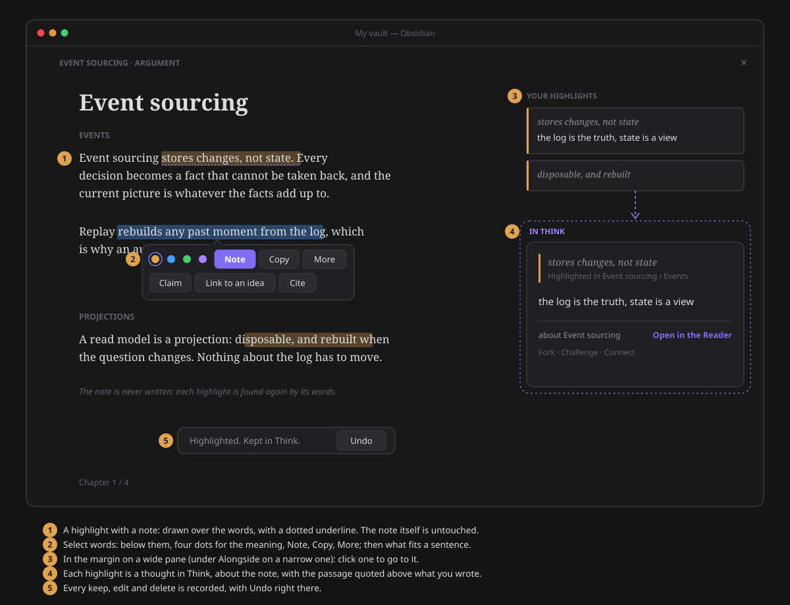

- **A highlight says what it is.** The popover offers four meanings: **Idea**, **Question**,
  **Quote** and **To discuss**, each in a colour of your theme. Click one (or press **1–4**) and the
  passage takes it; **H** keeps the next one with the meaning you used last. Click a highlight to
  change its meaning. With more than one meaning in a chapter, the margin can show one meaning at a
  time. A highlight made before meanings existed reads as an idea.
- **A highlight is a thought.** It lands in [Think](../architecture/thought-lab.md), about the note
  you were reading, carrying the passage you picked and the heading it sat under. Your note is the
  thought's text. Open Think on that note and the passage is there, quoted above what you wrote, with
  **Open in the Reader** to come back to the exact place.
- **The note is never touched.** Nothing is added to it: no marker, no block id, no property. The
  highlight is found again every time you read, by looking for the same words and the words around
  them, so it survives edits elsewhere in the note.
- **Detached, never lost.** If the passage was edited away, the highlight is listed under
  **Detached** with its note and a way to open it in Think.
- **Click a highlight** to see its note, add or edit one, delete it, or open it in Think. A
  highlight with a note has a dotted underline.
- **In the margin.** On a wide pane your highlights are listed beside the page, in reading order;
  click one to go to it. On a narrow pane, and while Alongside is open, the same list is the first
  thing in **Alongside**.
- **Everything can be undone.** Highlighting, editing and deleting are recorded writes of a thought,
  in the [write record](../architecture/reversibility.md), and each answer offers **Undo** in place. A
  deleted highlight goes to the trash, not away.
- **It comes back.** A few days later, what you marked returns as a card, with one question: do you
  still think so? See [A few things you marked](highlights-review.md).
- **Your story shows it.** In [This note](this-note.md), a highlight appears in the story as a thought
  with its passage quoted.

## Layers, and read it clean

A book read twice carries two readings on top of each other: what struck you the first time, what
you wrote back to it later, the references you chased for a project. **Layers** keep each pass in its
own ink, and **read it clean** puts every mark away so the page is just the book again — then gives
your thinking back, **in the order you had it**.


- **Three layers.** Every mark is on one: **Reading** (*what you mark the first time*),
  **Reflection** (*what you write after*) and **Research** (*sources, contradictions, references*). A
  highlight, a margin note, a page note and [ink](#ink-in-the-margin) all use the same three. A mark
  made before layers existed is on Reading, and nothing is rewritten for it.
- **The Layers panel.** **Layers** in the Reader's bar, beside *Contents* and *Type*, lists the three
  with a switch to show each, and **New marks go to** — Reading until you choose another. A layer
  with nothing in this chapter is dimmed; nothing in the panel counts.
- **Remembered per book.** Where new marks go and which layers are hidden are kept for each book,
  paper or article (or the note a reading began from). When new marks go anywhere but Reading, the
  layer's name sits quietly beside the button — on a narrow pane, a small dot — so a mark never lands
  where you did not expect. While a layer is hidden the button reads as active.
- **Hidden means hidden everywhere.** A hidden layer leaves the page, the margin's list, a PDF's
  notes on a page, Page view's highlights and ink. The margin's meaning chips narrow too: a mark is
  shown when its layer is shown *and* its meaning is chosen.
- **Change a mark's layer** from the menu you get by clicking it, under its meanings: one recorded
  write you can undo, like changing its meaning.
- **Hide my annotations** — *read it clean* — puts every mark of every layer away in one quiet fade,
  and a pill at the top of the column says **Reading clean · Reveal my thinking**. A mark you make
  while reading clean is shown. Clean lasts for the sitting: open the book again and your marks are
  there.
- **Reveal my thinking**, from the pill or the panel, brings them back: the marks of the page on
  screen return **one by one, in the order you made them**, each where it was, its note sliding in
  beside it; the rest are simply there.
- **Hiding never writes.** Hiding, showing and revealing change what is drawn, never what is kept:
  nothing is written to a thought, a book or the write record.

### The ink moves, never the text

A mark's tint is lifted for the move: the words keep their place and their colour, and only the
ink under them fades — in as each mark returns (250 ms, the next one 350 ms later, or sooner so a
whole chapter is back within four seconds), out all at once when you hide (120 ms). Showing or
hiding one layer fades just its ink. Any key, click or scroll during a reveal completes it at once,
and a reveal never staggers while you are selecting. Under reduced motion every mark simply
returns, or leaves, at once.

## Ink in the margin

With an Apple Pencil in hand, selecting words with a finger and typing is the wrong tool. Tap the
**pencil** in the reader bar (or press **P**) and the page takes ink: write in the margin beside the
paragraph, the way you would on paper or a reMarkable. What you write stays on the page, and only
what you choose to keep becomes a note.

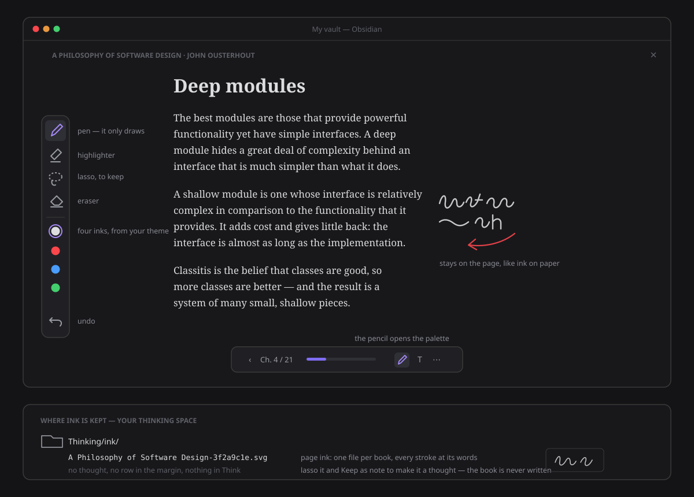

- **The palette.** A small strip at the edge of the reading column, never over the text: **pen**,
  **highlighter**, **lasso**, **eraser**, four inks (**pencil**, **red**, **blue**, **green**, each your theme's own colour) and
  **undo**. A marker glides to the tool in use. On a phone, an iPad in portrait or a paper in Page view
  — where there is no margin for it — the strip lies just above the reader bar. With
  [Alongside](#alongside-your-vault-beside-the-page) open the column moves over and its margin goes,
  so the strip lies above the bar too, centred under the column, clear of the panel. Whether it was open is
  remembered on this device, so an iPad you write on stays ready to write.
- **What draws.** A **pen** draws (an Apple Pencil, a Wacom or a Surface pen), and so does a
  **mouse**, so you can write a margin arrow at a desk. A **finger never draws**: it scrolls, turns the
  page and taps exactly as it does with the palette closed. While the palette is open the mouse writes
  instead of selecting words; close it to select again.
- **Your hand can rest on the glass.** While the pen is down, and for a moment after it lifts, a
  touch does nothing — no scroll, no turn, no tap.
- **The line follows the nib.** Each movement is drawn in the next frame, the newest piece always
  ending under the nib, smoothed only behind it. Press harder and the line is thicker; lean the pen and
  it widens a little, like a pencil on its side. Lift the pen and nothing moves: the stroke you see is
  the stroke that is kept.
- **Undo, three ways.** The palette's undo, **Ctrl/⌘+Z** while the palette is open, or a **two-finger
  tap** on the page take back the last stroke drawn or erased, newest first. A stroke undone before it
  was kept leaves nothing behind. A pinch or a two-finger scroll is never an undo, and a two-finger
  tap asks nothing: the stroke fading away is the answer.
- **The eraser takes whole strokes.** Drag it across your ink and every stroke it touches goes — and
  a highlight it passes over goes too, to the trash as removing one does, with **Undo** (it says
  *Erased*). Over nothing, it says so quietly.
- **What you write stays on the page.** Like ink on paper, or a document opened on a reMarkable: what
  the pen writes is the document's own **page ink**. It is not a note, it is not a thought, and it
  never appears in the margin's list or in Think. Strokes written together, soon after each other and
  close together, are kept as one, so a word you write never comes apart when the text re-flows.
  The page ink is saved when you pause, when you turn the page and when you close the Reader, never
  while you are writing. Nothing is said: no toast, no line.
- **Keeping it is a choice.** To turn some of it into knowledge, loop it with the
  [lasso](#keep-what-you-lasso) and press **Keep as note**. Until you do, it is only ink on the page.

### The highlighter

**The pen only draws.** A line under a sentence, a circle round a phrase, an arrow between two
marks or a scribble are ink, exactly as you drew them: nothing the pen writes is read as a gesture.
To highlight, choose the palette's **highlighter** and draw over the words. The stroke turns into the
mark: the ink fades while the marker sweeps across the words from the side you started on.

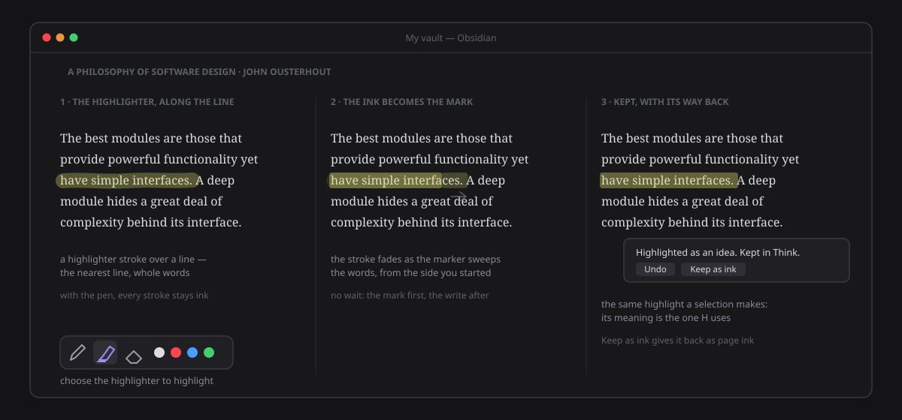

- **The words it takes.** The single line nearest the stroke, never two, even when you draw a little
  above or below it; and every word whose middle lies under the stroke, whole. While you draw it is a
  wide, translucent nib in the highlight's colour, so what you see under the nib is what you get. Over
  no text it keeps nothing, and says *Nothing under the highlighter*.
- **Its meaning.** The one **H** uses: the meaning you chose last, an *Idea* the first time. Click
  the highlight afterwards to change it, as for any highlight.
- **Several lines.** Draw across the next line within a few seconds and the same highlight grows onto
  it: a sentence that wraps is one highlight, saved as one update. Only the new words sweep.
- **The same highlight.** It is exactly the thought a selection makes: the same passage, the same
  place in the book, the same heading, in Think, in review and in the notebook.
- **The way back.** A quiet line says *Highlighted as an idea. Kept in Think.* with **Undo** and
  **Keep as ink**. Undo takes the highlight away, its mark fading. *Keep as ink* takes it away and
  gives you back the stroke you drew, as page ink. The palette's undo, **Ctrl/⌘+Z** and the
  two-finger tap take it back too: it is your last ink action.
- **On a printed page.** In Page view the highlighter reads the page's own text, so a PDF with text
  highlights there too: the mark is drawn as a wash over the printed words, and every highlight of
  that page is drawn the same way. On a page with no text, a scan, it keeps nothing. A highlight made
  in Page view is found again in the Reading view, and the other way round.
- **Reduced motion.** The stroke goes and the mark is there, at once; Undo and *Keep as ink* are
  instant too.

### Keep what you lasso

The lasso is the one gesture, and the door from ink to knowledge. Choose the palette's **lasso** and
draw a loop: what it caught decides what it offers, in this order.

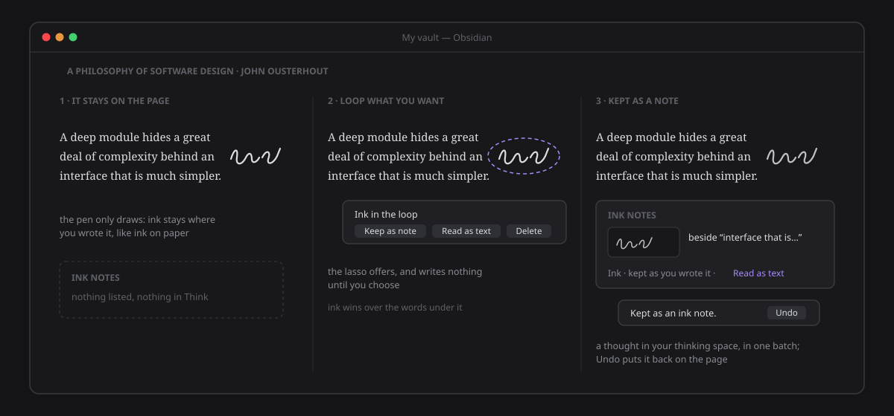

- **Page ink → Keep as note, Read as text, Delete.** A stroke is caught when its middle is inside the
  loop. **Keep as note** makes those strokes one **ink note**: a thought in your thinking space with its
  drawing, a row under **Ink notes** in the margin, a card in Think. The strokes leave the page ink in
  the same recorded batch, and settle into the kept tone where you drew them. The line says *Kept as an
  ink note.*, with **Undo**, which puts them back on the page. **Read as text** reads them first and
  keeps them only with a reading you accept ([below](#read-as-text)). **Delete** fades them from the
  page, with **Undo**. Page ink wins over the words under it: loop ink written over a sentence and the
  ink is what is offered.
- **Ink notes → Read as text, Delete ink.** Loop ink notes and it offers **Read as text** (one request
  per note) and **Delete ink** for them.
- **Words → the selection popover.** Loop words with no ink and the **same popover a selection
  opens** comes up for exactly those words — the four meanings, *Highlight and note*, *Copy* — so the
  lasso is selection with the Pencil.
- **Nothing → it says so.** *The lasso caught nothing*.
- **Nothing until you choose.** The loop stays, dashed, while its offer is up, and fades when it goes.
  The lasso never writes anything by itself ([constitution §XII](constitution.md)).
- **Reduced motion.** No fade: the loop and the strokes appear or go, at once.

### Read as text

Handwriting is kept as you wrote it, and that is right — but to the vault a drawing is invisible:
Think's find bar cannot find *contradicts "ship early"?* scrawled beside a paragraph, and the tension
it names never meets the note it names. A web view has no handwriting recognition (Apple's lives in
PencilKit, which a plugin cannot reach), so the only reading there is one **you ask for**, from the
AI provider **you** configured — and what comes back is a proposal, never a write.


- **One press reads one ink note.** Under each ink note — in the margin's **Ink notes** and on its
  card in Think — a quiet chip says *Ink · kept as you wrote it* with **Read as text**. With the
  lasso, ink notes caught in a loop offer **Read as text** too: one request per note, each its own
  proposal. Nothing reads ink by itself — not as you write, not when a book opens, not in an
  automation, never in bulk.
- **Page ink, read before it is kept.** Loop page ink and press **Read as text**: the same request
  and the same card, for exactly the strokes in the loop. **Accept** or **Edit** keeps them as an ink
  note with that reading as its text, in one recorded batch, and its move follows. **Reject** or
  **Esc** writes nothing: the strokes stay on the page as they were.
- **Exactly what is sent, and to whom.** An **image of that one ink note's strokes alone** — drawn
  from its points, dark on plain light, at most 1024 px on its long side, without the page, your
  other marks or your theme — and **the passage it sits beside** (its sentence), capped by your AI
  input limit and marked as data, not instructions. It goes to the endpoint in **Settings › AI**, the
  same one every AI action uses, and nowhere else. Never a note title, a file name, a path or another
  highlight.
- **No provider.** With AI off or not set up, **Read as text** is still there; pressing it says
  *Reading handwriting uses your AI provider* and opens **Settings › AI**. Nothing leaves the device.
- **While it reads.** The chip says *Reading…* with **Cancel**, and the strokes being read breathe,
  slowly. One request at a time per ink note. **Cancel stops waiting**: the answer, if it comes, is
  dropped and nothing is written — but the request may already have reached your provider (a request
  cannot be called back once it has left).
- **The reading is a proposal.** A card grows out of the chip: *Reads as: "…"*, with **Accept**,
  **Edit** and **Reject**. **Accept** makes the reading the ink note's **text**; **Edit** lets you
  correct it first and keeps your version; either way the card travels back into the chip, which now
  says *Read as: "…"*. **Reject** writes nothing; the card slides away and the chip offers **Read as
  text** again. **Esc** closes the card with no verdict. The drawing is never touched — its file is
  byte-for-byte what you wrote.
- **Then a move, only on a reading you confirmed.** If the reading is a **tension** with something it
  names, and that name matches the title of one of your notes — **locally, without AI**: the title
  equals the name or starts with it, the name is at least two words or six letters, and exactly one
  note matches — a second card proposes *As a move: a tension between this passage and "X"*. Accepting
  writes what **challenge** writes by hand in Think: the ink note becomes a thought about both the
  book and X, recorded as a challenge in the move log, and its margin entry names X. A **question** is
  proposed as *As a move: keep it as a question*, which gives it the meaning **Question**. Nothing
  else is ever proposed — no links, no new notes. Rejecting the move keeps the reading.
- **Every verdict is recorded.** Accept, edit and reject — of the reading and of the move — land in
  the judgement record as descriptors only: the thought, `ink-reading` or `ink-move:tension` /
  `ink-move:question`, origin *AI*, the verdict. No image, no reading and no model output reach the
  record or the log ([constitution §XII](constitution.md)). A thought lives in the thinking space,
  which the knowledge scope leaves out; its verdicts are kept anyway, as the move log keeps its moves.
- **Searchable once accepted.** An accepted reading is the thought's text, so Think's find bar and
  Obsidian's search find it — the card still shows your handwriting.
- **When it fails.** An error, a time-out or a cancel says *Could not read this ink. Nothing was
  written.* A model that does not take images says *Your model did not read the image — choose one
  that reads images in Settings › AI*: many OpenAI-compatible models read images; the message means
  the one you configured refused this one. Each logs a warning with no content.
- **Reduced motion.** The card appears and goes at once, and *Reading…* is still text.

### Where ink is kept

**Page ink: one file per book.** What the pen writes is kept in your thinking space (the folder in
**Settings › Thinking**), in its `ink/` folder: one file per book, named after it. It is an SVG
container with the points inside as data, as an ink note's drawing is, so it syncs wherever your
drawings sync. It is never a thought, so Think, the shelf and review never see it. The book itself is
never written.

- **It stays with its words.** Ink is anchored to the words nearest it — the same anchor highlights
  use — and to which side of them it was written on. Make the type larger and it grows with the text;
  narrow the column and it keeps its side; change the theme and it takes the theme's colour; let the
  text re-flow and it follows its words. Ink written in a wide margin moves in to stay on screen when
  the margin narrows.
- **On a printed page** (a PDF in Page view, or a designed book's page) ink is kept as a place on that
  page, so it stays on the same spot through any zoom. Its colours follow the page, not the theme:
  pencil is dark on white paper and light on a page designed in black.
- **Two devices.** Each save reads the file again and merges with it first: what another device
  wrote is kept, and what you erased stays erased. If two devices both write the same book before
  either has synced, your sync service decides between the two files, and one side's latest strokes
  can be lost.
- **When the words change.** Page ink whose words are gone stays in the file and is simply not drawn.
  A file from a newer version of the plugin is left as it is, never written over, and the palette
  says *This book's ink file could not be read, so new ink here is not kept*.
- **A book renamed or moved.** Its ink file is named after where the book was, so its ink stops
  showing at the new place. Nothing is lost: the file still says which book it is about.
- **Taking it back.** The eraser and **Undo** take strokes off the page; the file follows at the next
  pause. The file's first save is in the [write record](../architecture/reversibility.md) as a file
  created; later saves are recorded as replacements.

**Ink notes: in Think, as a thought, with its drawing beside it.** What you keep with the lasso is a
[thought](../architecture/thought-lab.md) about the book you were reading — and, with the same name,
an **SVG file** of the drawing. Ink notes you kept before page ink existed are exactly what they were.

- **Listed where it cannot be drawn.** An ink note whose words have changed is listed in the margin
  under **Ink notes**, with a small drawing and *Detached — the passage has changed*. One written in
  Page view is listed in the reading view as *Written in Page view*, and the other way round. A
  drawing from a newer version of the plugin is listed, never thrown away.
- **Shown, never counted.** Ink notes appear in the margin, in Think as a card of your handwriting,
  and in the book notebook — but they are not highlights: not counted on the shelf, never in review.
- **Taking it back.** **Delete ink** on its row sends the thought and its drawing to Obsidian's trash
  together, with **Undo**. Erasing an ink note's last stroke does the same. A kept ink note is one
  recorded batch in the [write record](../architecture/reversibility.md), undone as one.
- **No thinking space?** The pencil is still there; the palette says that ink is kept in your thinking
  space and how to choose its folder, and nothing draws.

## Every note goes back to its paragraph

A note you make from a passage of a PDF or an EPUB remembers **which paragraph** it came from, in
the note itself, for as long as the note exists — so you can always check a sentence against its
source. That is what makes a note citable.


- **Written once, when the note is made.** Crystallizing a highlight writes a `source` property —
  a list, so one note can cite several passages — that reads like a citation:

  ```yaml
  source:
    - "[[Books/Thinking, Fast and Slow.epub#OEBPS/ch03.xhtml|Thinking, Fast and Slow]] p. 143 · 3 · The lazy controller · “…physical exertion. ‹A general law of least effort applies› to cognitive…”"
    - "[[Papers/cap.pdf#page=6|CAP twelve years later]] p. 6 · “‹Partitions are rare› but…”"
  ```

  From left to right: the book, as a link whose subpath is **the chapter's own path inside the
  file** (an EPUB's spine item) or Obsidian's own `#page=N` for a PDF; the **print page**, only when
  the source has one; the chapter as the book names it; and the **opening words of the passage**
  between `‹ ›`, inside a few words of context. The `source::` line the note always had is still
  written under its text, so the note still counts as sourced and as born from the book.
- **A quote, not a CFI.** An EPUB CFI counts element steps in the book's original XHTML, but the
  Reader draws a cleaned copy of it: it would be a coordinate the Reader could not check, broken
  silently by any change to the cleaning. A few words survive both. The opening words are bounded
  (twelve words, 90 characters, a little context each side), so the property stays readable.
- **The page is never invented.** A PDF gives its page, and its printed label when it has one. An
  EPUB gives a print page only when the book declares its print pages — an EPUB 3 page list, an EPUB 2
  NCX page list, or page-break marks in its text. A book that declares none cites its chapter.
- **Highlights carry the same place.** A highlight remembers the chapter's identity and the page,
  and crystallizing copies them into the note, so the way back never depends on the highlight still
  being in Think.
- **Open source passage.** In [This note](this-note.md), **Born from** names the book and the page;
  click it and the Reader opens on that chapter with the passage at the **reading line** (a third of
  the way down), marked for a moment under the words. The preview of the note, before it exists,
  shows the same source with **↗ Open source passage**. It is one camera move: from This note the
  book's chip lifts and travels into the Reader; when the Reader is already open on the book, the
  column glides there; when the passage is in another chapter, the chapter turns the way it always
  does and then settles. A key, the wheel or a touch during the move ends it at once. The place you
  left is on the trail, so **← Back** returns there.
- **Another edition.** When the words are not there (another edition, a re-exported PDF), the
  Reader opens the chapter at its top and says so once, inline: *The passage was not found in this
  edition. Opened at its chapter.* It never guesses a nearby paragraph. A spine that was reordered
  still lands: the chapter is found by its path, not its number.
- **Old notes.** A note made before this keeps its `source::` line, is never rewritten, and now
  opens at its EPUB chapter too — the chapter the book labels so (`3 · The lazy controller`), never
  the third file in the book.
- **Under reduced motion** the landing is instant, and the mark shows for 1.5 s without fading.

### Passage links

**Copy link to passage**, the link icon on the *Born from* row, puts on the clipboard an Obsidian
URI that opens the Reader at that passage — pasted in any note, or clicked from outside Obsidian.
The row reads *Link copied* for a moment.

```
obsidian://zettelflow-read?vault=<vault>&file=<vault path>&chapter=<chapter>&q=<opening words>[&pre=<before>][&suf=<after>][&page=<print page>]
```

| Field | What it is | Cap |
|---|---|---|
| `vault` | The vault's name (Obsidian routes the link by it) | — |
| `file` | The PDF or EPUB's path in the vault | 1024 characters |
| `chapter` | The chapter's identity: an EPUB spine item's path (`OEBPS/ch03.xhtml`), or `page:<index from 0>` for a PDF | 512 |
| `q` | The passage's opening words | 90 |
| `pre`, `suf` | A few words before and after them | 24 each |
| `page` | The print page, when the source has one | 32 |

The link carries the path and the anchor's few words, nothing more. One that names a file that is
not a PDF or an EPUB, or not in the vault, is over a cap, misses `file`, `chapter` or `q`, or has a
field not listed here opens nothing and shows nothing (it is logged at debug). **This shape is a
public surface:** later versions keep reading it, and any change to it is additive.

## What survived?

A chapter ends and the next one begins in the same breath — and the moment when one of your marks
could still become a note of your own passes with it. At the end of a chapter worth pausing at, the
book gives you **a blank leaf** instead: what you marked in the chapter, what it touched in your
vault, and one question — *is one of these worth a note of its own?* You answer by writing, or you
turn the leaf and keep reading.


- **When it comes.** Only when all of these hold:
    - you **turn forward by reading** past the end of a chapter — →, Space or the bar's next at its
      end, or a swipe on iPad. A Contents jump, a search hit, Home and End, the back pill, a link
      from a note, a resume or going back never pause;
    - it is **a real chapter**: at least about 1,500 words in an EPUB, so a cover, a title page or a
      copyright page never qualifies — or, in a PDF, a top-level section of its outline of at least
      three pages, read in the reading view. A PDF without an outline, a paper read as printed in
      Page view, a designed book, an article and a path of notes have no chapter ends;
    - you **read it in this sitting**: the Reader was on that chapter for at least two minutes. The
      clock stops while the Reader is hidden — another app, a locked iPad — and is never kept;
    - **something of yours is in it**: a highlight, a margin note or an ink note, from any sitting.
      A chapter you marked nothing in never stops you;
    - it is **not the last chapter** — the book's end card has that place;
    - you did not skip the last one (below), you are not listening, and the switch is on.
- **What it shows, and nothing else.** *End of chapter 4* — or *End of* the PDF section's name — the
  heading **What survived?** and the chapter's title; **Your marks in this chapter**, each in its
  meaning's colour with its words and your note; **Your ink**, as ink; **It touched** — the notes of
  yours you crystallized from this chapter, the ones its marks link to, and the ones you opened from
  it as a peek; and the question.
- **The answers are yours.** Pick a mark: it lifts, its ink is drawn beside it, and **Write a note**
  opens the [crystallize preview](#every-note-goes-back-to-its-paragraph) for it, growing from that
  row. Nothing is written until **Create note**; **Cancel** brings you back to the leaf. A note it
  touched opens as a peek, where you are.
- **It never writes for you.** No summary, no key points, no count of what you marked, no score, no
  AI text — the foot of the leaf says so: *No summary is written for you.* The leaf itself writes
  nothing, and your place in the book stays the chapter you just finished.
- **A skip is not asked twice.** Turning on from the leaf within four seconds without touching it
  is a skip: the next chapter end that would pause does not, and the one after it may. Going back to
  the chapter with **←**, or jumping elsewhere, is not a skip. Nothing remembers skips
  beyond that, nothing counts them, and nothing mentions them.
- **One switch, in three places.** **Pause at chapter ends** — on by default — is in the Reader's
  **Type** panel, in **Settings → Reading**, and at the foot of the leaf itself as a quiet **Don't
  pause at chapter ends**. All three are one value. Beside it, **Recall this chapter** puts the chapter
  away to be written from memory ([Recall](#recall)).
- **Keys.** **→** or **Space** keep reading; **←** turns back to the chapter's last page; **Esc**
  leaves the Reader as it always does. The shortcuts sheet lists them.

### A pause, never a modal

The leaf is a page of the book. It arrives by your own chapter motion — *Leaf turns*, *Keeps flowing*
or *Sheet slides off* in Settings → Reading — and leaves to the next chapter by the same motion, in
the same direction: no overlay, no backdrop, nothing dimmed, nothing over the text. Once the turn has
landed its contents settle in the reading column — the ornament, the heading, then your marks one
after another, each a fade and a 4 px rise 40 ms apart, the question last; any key or touch completes
the settle at once. **←** plays the arrival backwards onto the chapter's last page. Under reduced
motion the leaf is simply there, and simply gone; it is still a page between two chapters.

## Recall

Highlighting feels like understanding, and is not: what stays from a chapter is what you can say
without it in front of you. **Recall this chapter** puts the chapter and your marks away, asks for
the chapter in your own words, then shows you what you marked — yours first, then the book's, the
way Think does *think first, then look*. **Read → think → recall → rewrite.**

![Recall: on the left the chapter put away — the page has slid down out of the column as a sheet, leaving the paper and the chapter's title, and beside it the card asks Without looking: what was this chapter's argument? above your words, typo and all, with Reveal what I marked and Done; on the right the page is back with your two marks returning in the order you made them, and the card shows What you wrote — your words, where they were — and under it What you marked then, then Keep it as a note and Done](../resources/reader/recall.svg)

- **Where it is.** In **Contents**, at the top, on the chapter you are in — and at the foot of the
  [*What survived?*](#what-survived) leaf, for the chapter that just ended: the book goes back onto
  that chapter first, and recall begins once it has landed. It works on an EPUB's chapter, a paper's
  section (its outline's, or the page you are on when it has none) and an article's section. A
  designed book, a paper read as printed in Page view and a path of notes have no recall.
- **The chapter goes away.** The page slides down out of the column as one sheet and leaves the
  paper with the chapter's title on it; your highlights, margin notes and ink go with it, through the
  same *hide* as [reading clean](#layers-and-read-it-clean). Beside the page — or, in portrait on a
  tablet, in the sheet from the bottom — the card asks **Without looking: what was this chapter's
  argument?** above a box, *In your own words…*.
- **Your words, exactly.** What you type is kept as you type it: no spellcheck, no autocorrect, no
  capitals added, nothing completed or suggested. A typo stays a typo.
- **Reveal what I marked.** The sheet slides back up, then your marks return **in the order you made
  them**, as *Reveal my thinking* brings them back. The card's question gives way to **What you
  wrote** — your words where they were, never moved — and under it **What you marked then**: each
  mark in its meaning's colour, with its passage and your note. A chapter you marked nothing in says
  so plainly: *You marked nothing in this chapter*.
- **Not a test.** Nothing compares your words with your marks, nothing is highlighted as a match,
  nothing is counted or scored, and there is no streak. It is a way to see what stayed.
- **Keep it as a note.** A preview shows exactly what will be written: a title (*{the chapter} — in
  my words*, editable), your words **as you wrote them**, and one line,
  `source:: [[the book#the chapter|its title]] · the chapter`, so the Library counts the note as
  [born from the book](library.md). Nothing is written until **Create note**: one new note,
  create-only, at a free path in Obsidian's *Default location for new notes*, recorded — **Undo** is
  on the card and in Home → Recent. With a canvas holding the *Crystallizes thoughts* role, the
  preview continues in that flow instead, which decides the folder, the template and the
  properties. **Cancel** writes nothing.
- **Done** leaves recall and writes nothing. When you had not looked yet, the page comes back the way
  it went, then your marks. What you wrote and did not keep stays as a draft for that chapter while
  the Reader is open, and comes back if you recall it again; closing the Reader lets it go. Nothing
  asks you to keep it. **Esc**, the card's ×, another panel or turning to another chapter leave
  recall the same way.

### One gesture each way

Putting the chapter away is the chapter turn's own sheet sliding down out of the column (`cover`,
400 ms, the shared curve) while the card's question rises 8 px into place; nothing cuts. The reveal
plays the same shot backwards: the sheet slides back up, and only once it has landed do your marks
return, one after another, each row of *What you marked then* arriving with its ink in the page. Any
key or touch during either move completes it. Under reduced motion the page goes and comes back at
once, and every mark is simply there.

## The end of a path

Past the last chapter — **Next**, **Space** or **Finish** — the reading does not just close. An
end card says what it added up to and what you can do with it.

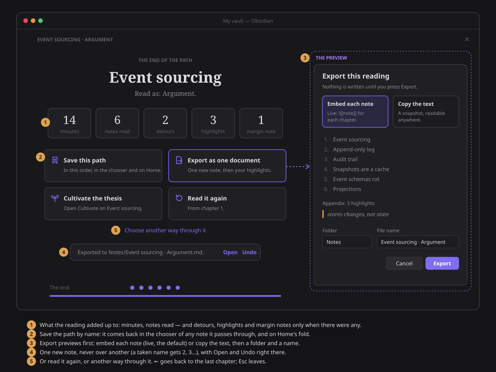

- **What it added up to.** The minutes it took, the notes you read, and — only when there were any
  — the detours you took and the highlights and margin notes you made in this reading. No zeros, no
  score: a reading is not graded.
- **Save this path.** Name it (it proposes the note and the way you read it) and the path is kept,
  in this order, in the plugin's data. It comes back as **Your saved paths** in the chooser of any
  note it passes through — read it again, rename it in place, or delete it — on Home's **Where
  you left off** while you are part-way through it, one click back into the Reader — and on the
  [Library](library.md)'s shelf, with how far you are and what you marked. Saving again
  under a new name renames it; the same chapters are never kept twice.
- **Export as one document.** A preview first: the chapters, an appendix of your highlights on
  them, and how each chapter is carried — **Embed each note** (the default: `![[note]]`, live,
  nothing duplicated) or **Copy the text** (a snapshot, readable anywhere). Pick the folder (it
  proposes the folder the reading started in) and the file name, then **Export**. One new note is
  created — never over an existing one: a name that is taken gets *2*, *3*… The card says where it
  went, with **Open** and **Undo**; undo sends it to the trash.
- **Cultivate the thesis.** Gives the workspace back and opens
  [Cultivate](cultivate.md) on the reading's thesis — or the note it started from.
- **Read it again** from chapter 1, or — for a way through a note — **choose another way
  through it**.

**←** goes back to the last chapter; **Esc** leaves the reader.

## Pages or scroll

**Type → Layout** has three answers, and they apply to every book and every reading:

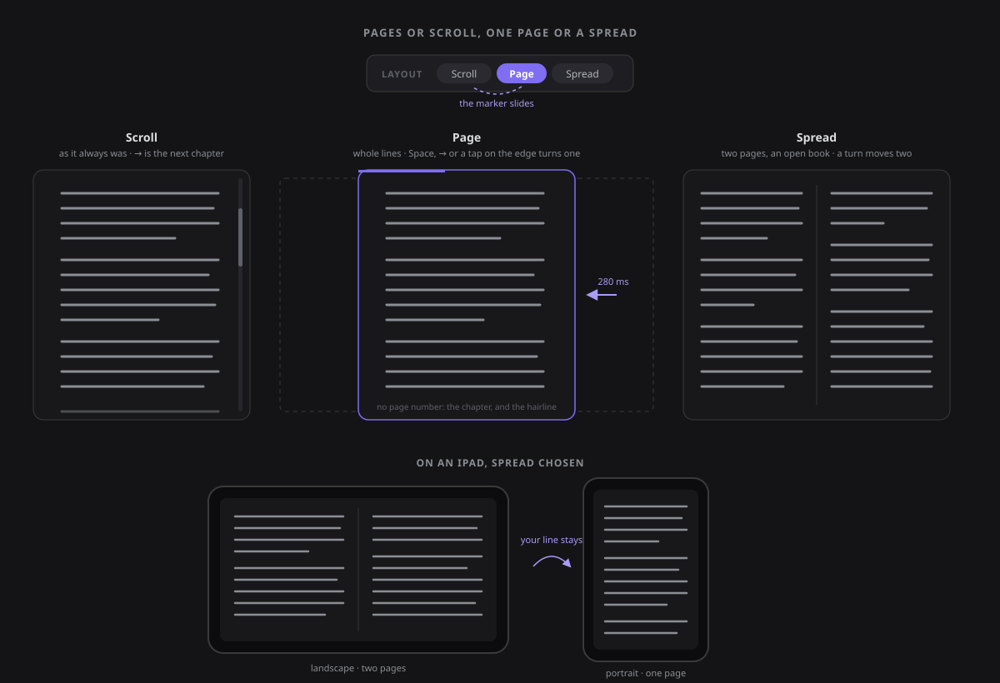

- **Scroll** is how the Reader always read: one long column, a scrollbar, **←** **→** for the
  chapters. It stays the default, and nothing about it changed.
- **Page** lays the chapter out in pages the size of the screen: whole lines only, no scroll.
  **Space**, **→**, **Page down**, a tap on the right edge or a swipe left turn a page; past the last
  page you are in the next chapter, with the chapter turn you chose. Back from a chapter's first
  page lands on the previous chapter's **last** page.
- **Spread** shows two pages side by side, like an open book, and a turn moves two. When the reading
  is too narrow for two comfortable lines (about 45 characters each at your size), it shows one
  page — without changing your choice. An iPad shows a spread in landscape and one page in portrait.

The page **slides** on (about a quarter of a second); with a finger it follows you 1:1 and turns
past a third of the width or on a flick, or springs back. Holding a key never queues turns.
Changing the layout, the font, the size or the window keeps **the line you were reading** on
screen, and the text around it settles into its new shape. Under reduced motion it is all instant.

There are **no page numbers**: an EPUB has none of its own, and a number would change with your
font size. The place is the chapter, and the hairline across the top fills page by page. A
search hit, a jump and its way back (**Alt+←**), a bookmark and a highlight opened from Think all
land on the page that holds them — and the strip **travels** there, never cuts (see
[Going to a place](#going-to-a-place-is-a-camera-move)). A resumed reading opens on its page, inside
the opening shot. A selection can run across a page break and be highlighted.
Pictures and tables are scaled to fit a page, never cut across two. In a spread there is no room
for the margin: the highlights are in **Alongside**.

A book written **right to left** turns the other way: forward is to the left (**←**, the left edge,
a swipe right), and its pages flow from the right. PDF Page view keeps its own pages (#767).

A book of **designed pages** — a comic, a picture book, a cookbook declared *fixed layout* (#771) —
reads its pages through the same run of pages as a PDF in Page view: *Page* shows one, *Spread* two
as the book pairs them, turned as **one leaf**, and *Scroll* the pages in one run. If you never chose
a layout, a designed book reads as a spread in landscape and a page in portrait; once you choose, your
choice wins. In a right-to-left book the leaf turns over the other way. Under reduced motion turns and
fits are instant, and a pinch still follows your fingers. See
[Designed pages](library.md#designed-pages-comics-picture-books-and-cookbooks).

## Type you can tune

The **Type** panel is one panel, read top to bottom: **Layout** (above), **Look** (the reading
theme), **Font** (your theme's own, or a serif), **Size**, then the finer type — **Line spacing**,
**Width**, **Margins** and **Justify** — then **Focus mode**, the time left and
**Pause at chapter ends** ([what survived?](#what-survived)). Each row has its
name, and the marker under your choice slides to the next one you pick. Every change applies at
once, so you choose by looking, and the choices are kept for every book, next time too.


| Row | The three steps | The default |
|---|---|---|
| **Line spacing** | Tight · Normal · Airy (1.5 · 1.75 · 2) | Normal |
| **Width** | Narrow · Medium · Wide (about 56 · 68 · 80 characters a line) | Medium |
| **Margins** | Small · Medium · Large (the room between the text and the edges) | Medium |
| **Justify** | off · on | off |

- **The defaults are the page as it always was.** Someone who never opens these rows sees exactly
  3.6's page, and preferences saved before them read as they did.
- **Width is in characters**, so it follows the size. *Wide* stops at about 80: a longer line is hard
  to find your way back along. On a narrow screen (a phone, an iPad in portrait) *Wide* is as wide
  as the page allows, and stays chosen for when there is room.
- **Margins** show where the screen is narrow: on an iPad, *Large* leaves somewhere to hold it
  without a thumb on a word. In *Page* and *Spread* they are also the air between the pages, and
  Width is the pages' line.
- **Justify** evens the right edge and breaks long words with hyphens — in **the book's own
  language**. The column declares what you are reading: an EPUB's language (its package, or a
  chapter's or a passage's own `lang` / `xml:lang`), a PDF's when it declares one. A PDF that
  declares none, and a note reading, keep Obsidian's language, as before. Under the switch the panel
  says, quietly, which language the words are hyphenated in (*Hyphenated as Spanish*), so a wrong
  guess can be seen. The hyphenation itself is the platform's: a language it has no dictionary for
  is justified without hyphens. The iPad and macOS app hyphenate. The Windows desktop app ships
  without hyphenation dictionaries (measured in Obsidian 1.14.4), so there the text is justified
  but no word is broken.
- **Your line stays.** A change lays the page out once, puts the line you were reading back where
  your eyes are, and the lines around it settle in (a 120 ms fade from 0.85). Width, margins and
  spacing are never animated as such. Under reduced motion it is all instant, and the line is still
  kept.
- **PDF Page view** draws the page as printed: these rows shape the reading view only, and the panel
  says so in one line.

| Theme | Looks like |
|---|---|
| **Your theme** | the reader uses whatever Obsidian looks like now |
| **Light** / **Dark** | your theme's own light or dark palette, for the reading column only |
| **Sepia** | the light palette warmed with your theme's yellow |

No colour is invented: every look comes from your theme.

## What it writes

**Nothing, to any note you read.** Reading is the whole job, and a test holds the line: nothing in
the Reader reaches a file writer — except **Export**, [Recall](#recall)'s **Create note** and
[Snapshot](#snapshot-a-figure-or-a-table)'s choice, and only when you press them: create-only (or an
append to the note you picked), through `FileService`, in a recorded batch you can undo. The things
you can keep while reading — a highlight, or an ink note — are **thoughts** in Think, written through
the thought store like every other thought, and a second test holds that line too. An ink note adds one
file to its thought: the **drawing**, an SVG of the same name beside it in the thinking space, written
in the same recorded batch. What the pen writes and you have not kept is **page ink**: one file per book
in the thinking space's `ink/` folder, never a thought, written through `FileService` once per pause,
turn or close (`PageInkStore.ts`). An older version of the plugin reads an ink note as a highlight with no note;
nothing is lost. A note made from a passage — through the same preview as everywhere, create-only —
carries its `source` list from the start; a crystallize flow's note gets it added once the flow has
built the note, as one recorded property write you can undo (its own row in *Recent*, after the
note's). The book itself is never written. The only things it remembers are where you are in a reading (in the workspace
layout, and the resume places in the plugin's settings), your type choices and the paths you saved
(in the plugin's settings), and the places you bookmarked in a book or a paper (beside its resume
place, in the plugin's settings — an older version of the plugin reads past them, so going back to
one forgets them). Choosing a way through a note writes nothing either, and neither do peeks, detours or
adding a note to a reading — an added note lasts as long as the reading on screen. **Alongside**
writes nothing while you read, scroll or switch lenses; its *Not related* is one verdict in the
judgement record, never a write to a note, and whether it is open and its lens are kept on this
device only. A move by your AI provider writes only what you accept: one thought. **Make it a
claim** writes one new note when you press *Create* — create-only, through the claim's one writer
(`claimWrites.ts`, over `FileService`), in a recorded batch — and **Link to an idea** one entry of
the idea's `source` list, through #751's one writer. **Layers** write only the layer a new mark is made on, beside its meaning (`layer:`, never for Reading), and the layers you show and where new marks go, per book, in the plugin's settings; hiding and revealing write nothing. **What survived?** writes nothing: the time spent on
a chapter and a skip live in memory only, the switch is one of your type choices, and a note comes
only from the preview's *Create note*. **Recall** writes nothing while you write, reveal or leave —
your words are a draft in memory for as long as the Reader is open — and one new note only on its
preview's *Create note*: create-only, through the Reader's second named writer
(`readerRecallNote.ts`, over `FileService`), in a recorded batch you can undo. **Snapshot** writes
nothing while you drag or look at its card; a choice writes the image, as an attachment, and the one
thing that refers to it — a new note, a fleeting note, or the lines added at the end of the note you
picked — through the Reader's third named writer (`readerSnapshotSave.ts`, over `FileService` and the
thought store), as one recorded batch you can undo. **Cite** writes nothing at all: its only act is
*Copy*, which puts the citation you see on your clipboard.

## For contributors

- The view is `ReaderView` (`zettelflow-reader`), a standalone `ItemView` like *This note*, and
  `openReader(app, seed)` is its only opener.
- Touch (#750) is decided in pure modules the later slices reuse: `readerDevice.ts` (what the device
  is: `touchPointer`, `isApple`, `canFullscreen`, `panelShape`, `DEVICE_LIMITS`/`tooLarge`),
  `readerGestures.ts` (the classifier: `startGesture` locks a tap, swipe, scroll or press once;
  `edgeZone`, `isThing`, `releaseTurn`, `rubberBand`, `completionRate`, `twoFingerBack`, and
  `twoFingers` — two fingers decided once as a pinch, back or a tap (#776);
  `EDGE_BACK_SWIPE` stays off: the left strip is Obsidian's),
  `readerPlace.ts` (`placeAt`/`scrollFor`: a block and a share of it, kept through a reshape) and
  `readerSheet.ts` (the sheet's heights and settle). `beginChapterScrub` in `readerTurn.ts` builds
  the clock's own turn paused and moves it by the finger; the chapter shown next adopts it
  (`adoptChapterScrub`).
- Pages (#753) are CSS multi-column, not a pagination engine: in *Page* and *Spread* the chapter's
  `<article>` is one strip of columns the stage's height, moved with the individual `translate`
  property (so it never clashes with the `transform` the entrance uses). The decisions are pure in
  `readerPages.ts` (`pageGeometry`, `spreadFits`, `pageCount`, `pageHolding`, `pageForShare`,
  `keyIntent`, `edgeTurn`, `forwardSign`); `readerPager.ts` measures once per layout inside
  `measure("reader.paginate")` (shown under Health → speed), writes `--zf-page-*` with `setCssProps`
  and animates the turn on `translate` alone. A place is a `Range` at the first line on screen, so
  the DOM is never rebuilt. `readerSettle.ts` settles the text around that line after a change;
  `readerTypePanel.ts` draws the Type panel with `segmentedRow` — the one control later rows reuse.
  Page turns at a chapter's ends go through the view's `go(±1)`, where the chapter turn is played.
- The trail and bookmarks (#761): `ReaderTrail` in `readerJumps.ts` (one trail: `push`, `pop`,
  `list` newest first, `takeAt`; per reading, at most 20) holds a *spot* — the chapter and an offset
  into `chapterText` (`offsetAt`/`pointAt` in `readerMarks.ts`), with the share and scroll as
  fallbacks — and its `TrailReason`. Bookmarks are pure in `readerBookmarks.ts` (`bookmarkAt` keeps the
  offset and an ~80-character `TextQuote`; `landingOffset` finds it again by its words; at most 200 a
  book) and kept in `SourceMeta.bookmarks` (`withBookmarks`; `withFacts` carries them through a
  replaced file) by `rememberSourceBookmarks`. Every move goes through the view's `landOn` /
  `landHere`: another chapter is `show()` with its turn, then a landing at once; this chapter is a
  travel — `ReaderPager.travelTo` / `reveal(anchor, true)` in pages and `glideTo` in a scroll, both
  on `translate`, planned by the pure `readerTravel.ts` (`pageTravel`, `scrollTravel`,
  `travelDuration`). They return how long they take, and `readerHere.ts` waits that long before the
  *you are here* mark (`markHereAt`, `markHereOn`; `zf-reader-here`, opacity only). The old
  `reader-highlight--flash` box-shadow ring is gone.
- Alongside (#754) is pure in `architecture/knowledge/alongside/` (the State barrel exports it):
  `alongsideVocabulary` (titles and aliases, folded and indexed by first word, memoised per
  revision; `commonWords.ts` holds the never-matches list), `nearPassage` (named · born from this
  chapter · born from this book · marked · the chapter's note; one reason each, scope-filtered by the
  model), `alongsideLenses` / `allOf` (the six lenses over `noteNeighbourhood`, `sharedContext`,
  `findContradictions` and `buildEvidenceMap`) and `withNamed` (Think's thoughts read once). The
  verdict is `chapterVerdict` / `ruledOutInChapter` in `judgement/chapterVerdict.ts`
  (`reader-not-related:<book>#<chapter key>`), which #756's *Reject* writes too. The panel is
  `ReaderAlongside` in `reader/readerAlongside.ts` (`ALONGSIDE_SETTLE_MS`, `UNDO_MS`, the
  `zettelflow-reader-alongside` local-storage key); its cards move with `reconcile` in
  `readerFlip.ts` — the keyed FLIP list #756, #759 and #762 reuse. The view hands it the passage
  (`blockAtLine` in `readerPlace.ts`) and keeps the reading line through the column's change
  (`holdReadingLine`).
- Provenance (#751) has one producer and one reader, both pure in `application/library/provenance.ts`:
  `PassagePlace` (`file`, `chapter` key, `label`, `page`, bounded `quote`), `placeOf(thought)`,
  `boundQuote`, `samePlace`, `sourceEntry(place, title?)` / `readSourceEntry(value)` (the written
  form), `serializePlace` / `parsePlace` (the view state's one-shot `at`), `passageLink` /
  `parsePassageLink` (the URI), `resolveChapter` / `chapterFromLabel`, `printPageAt` and
  `mergeSourceEntries`. The one property writer is `addSourceEntries(file, entries)` in
  `architecture/plugin/library/sourceWrites.ts` (through `FrontmatterService`, in a `reader-source`
  batch). `SourceChapter.key` / `.page` and `DrawnChapter.pageMarks` come from the sources;
  `ThoughtLocator.chapter` / `.page` from the highlight. The view lands an `at` through the same
  `landHere` as a bookmark — a `Spot` with a `passage` quote, anchored on `foldMarks(chapterText)` and
  put at `READING_LINE` (`readerPlace.ts`) with `ReaderPager.reveal(anchor, travel, line)` — or shows
  `reader-passage-missing`. The protocol handler lives in `ReaderComponent` (`readerLink.ts`).
- The overview (#776) is `readerOverview.ts`, which #767's `readerThumbs.ts` grew into: pure
  `overviewUnits` (a PDF's and a designed book's pages, a flowing book's chapters, each part of a
  mixed book as itself), `cardMarks` (one tick per place and colour — at its share of the drawn text,
  else at the edge — the pen, the ribbon; never a count), `cardProgress`, `cardPixels` (capped at
  `CARD_DPR_MAX`), `releaseFarthest` against `OVERVIEW_LIMITS` and `normalizeContentsTab`
  (`pages` and `overview` read as `contents`: the overview is its own `Panel`, #784), and one DOM `renderOverview` (paper sheets, an
  `IntersectionObserver` from the panel's window, a `draw → let go` seam, a first-draw fade, roving
  focus). The view draws a card through the run's `drawThumb` in Page view, its own one-at-a-time
  queue over `SourcePages.render` in the reading view, `SourcePages.mount` for a designed page and
  `SourceDocument.draw` (pruned to `PREVIEW_BLOCKS`) for a chapter. The shots are `pullBack`,
  `flyToCard` and `returnToPage` over `fly()`, which now returns its `Animation` so input finishes
  it. Two fingers are `twoFingers` / `pinchRelease` in `readerGestures.ts`; Page view's run asks the
  view through `PageRunHost.onPinchOut(scale)`. The chapters read to their end are
  `SourceMeta.read` (`withRead`, `rememberChapterRead`).
- Deep reading (#764) is the idle bar grown up, not a new state: page only is `reader--deep` +
  `reader--idle`, the overlay is `reader--deep` alone, so `wake()` and the `IDLE_MS` timer are the
  ones the bar always had, and `idleAllowed()` keeps the chrome while a panel, search or a popover is
  open. `readerDeep.ts` is pure: `isReadingKey` (the keys that turn quietly), `movedEnough` /
  `JITTER_PX` and `escapeStep` (the one Esc order). The window's fullscreen is asked of `doc.body`
  only where `canFullscreen(doc)` says so, and given back only if deep reading took it; a
  `fullscreenchange` to windowed forgets that. `reader--deep-entering` / `reader--deep-leaving` carry
  the 250 ms gesture; the stage's insets never change under `reader--deep`.
  On a desktop, `deepCover` (in `openReader.ts`) slides Obsidian's ribbon, tab bar, sidebar toggles
  and status bar away (`reader-deep-hides-app`), then lets the Reader's leaf cover the window
  (`reader-deep-covers-app`); `holdLine` keeps the first block on screen at the same height
  through the cover, both ways, and the column travels sideways to its new centre inside the same
  250 ms gesture (`columnShift` + a FLIP in `coverKeepingColumn`), so the cover never steps.
- On mobile, `coverApp` (in `openReader.ts`) puts `zettelkasten-flow__reader-covers-app` on the body:
  the stylesheet slides Obsidian's chrome away and lets the Reader's leaf cover the screen. The stage
  sets `data-ignore-swipe` for the touches it takes, which Obsidian's own drawer swipe respects.
- The opener snapshots the sidebars, folds them and opens one reader leaf. `restoreWorkspace` gives
  them back, once.
- The snapshot also lives in the view state, so a reader left open across a restart still restores.
- Keys (#667) are registered on the view's `scope` (`new Scope(app.scope)`), which Obsidian's keymap
  consults for the active leaf whatever has focus. A handler returns `false` when it took the key;
  Esc is always taken, or Obsidian's global Esc would move the focus to another tab. The three
  commands live in `ReaderComponent` and use `getActiveViewOfType(ReaderView)`.
- `ReaderView.exit()` adds `reader--leaving`, waits for the fade (instant under reduced motion) and
  calls `exitReader`: restore the sidebars, re-activate the previous leaf, detach.
- Obsidian sets `body { user-select: none }`; `reader.scss` gives `user-select: text` back to the
  chapter body, or nothing in it could be selected — the cause of "highlighting does nothing".
- The progress numbers are pure (`readerPace.ts`); focus mode marks the block at the reading line
  with an `IntersectionObserver` on the stage.
- The ways come from pure generators in the State layer (`readingPath.ts`): `aroundThisNote`,
  `argumentPath`, `storyPath`, `essentialsPath`, `regionPath` and `selectionPath`, offered together
  by `readingPathOptions(model, seed, inputs)`. They are on `zf.knowledge.readingPaths` and
  `zf.knowledge.readSelection`; `readFromHere` stays.
- What the model does not hold — the near-but-unlinked notes (the resurface ranking) and when each
  note was first worked on (decisions and moves) — is read once, in `readerPaths.ts`, and handed in.
- The chooser is `ReadingPathModal`; `readFrom` and `readSelection` are the doors' shared entry
  points. The view state carries `kind` and, for a picked set, its `paths`.
- Highlights (#671) are `ReaderHighlights` (`readerHighlights.ts`): selection → popover → a thought
  written by `ThoughtStore.write(text, { about, quote })` inside a recorded batch. The anchor is a
  text quote (`exact`, `prefix`, `suffix`, ~32 characters each, plus the `heading`), matched by the
  pure `anchorQuote` in `application/thinking/quoteAnchor.ts` with whitespace folded. `readerMarks.ts`
  wraps the matched span in one `<mark>` per text node. `openReader(app, { seed, highlight })` lands
  on one.
- The end of a path (#672): `readerEnd.ts` renders the card (it writes nothing; every action is a
  callback from the view). Saved paths are pure (`readerSaved.ts`: newest first, at most 30, one
  entry per set of chapters) in `settings.readerSaved`, reopened as a `selection` with a `name`.
  The document is built by the pure `buildReadingDocument` (`readerDocument.ts`); `readerExport.ts`
  is the preview and the only reader file a test lets reach `FileService`. Cultivate takes a
  `target` in its view state.
