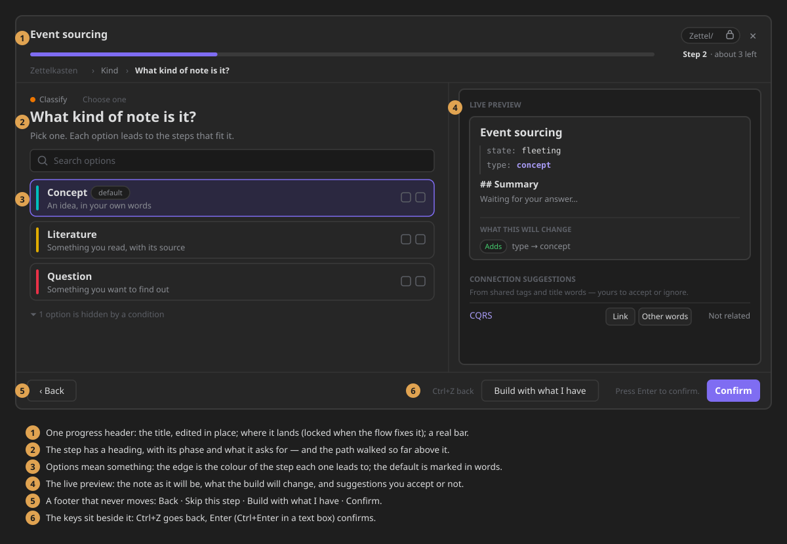
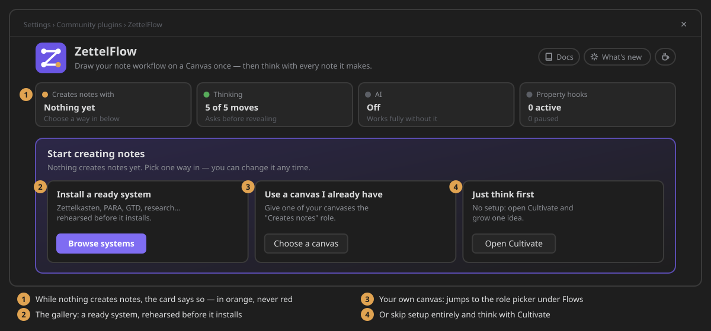

# Get started in 5 minutes

ZettelFlow is an Obsidian plugin. You need **Obsidian 1.14.4 or newer**, on desktop or mobile.

## 1 · Install

1. In Obsidian, open **Settings → Community plugins** and turn community plugins on if you have not yet.
2. Click **Browse**, search for **ZettelFlow**, then **Install** and **Enable**.
3. A ZettelFlow button appears in the ribbon. Click it and a **menu** opens: *Think*, *Create note*,
   *Community* and the rest. Everything below starts there.

## 2 · Pick one way in

There are four ways in. None of them needs the others, and you can switch between them at any time.

=== "See it work in one click"

    Nothing to draw: ZettelFlow makes a small flow for you.

    1. Ribbon menu → **Create note**.
    2. While no canvas creates notes, the wizard opens on a welcome screen. Press
       **Create the example flow**.
    3. It writes `_ZettelFlow/examples/My first flow.canvas` with one step, gives it the
       *Creates notes* role and opens it.
    4. Ribbon menu → **Create note** again: the wizard asks for a name and creates the note in
       `_ZettelFlow/examples/notes`.

    Then open a step of the example (select it → **Edit step**) to see what it is made of.

=== "Install a ready-made system"

    Zettelkasten, PARA, GTD, research, writing, decisions… complete flows you can try before
    anything is written to your vault.

    1. Ribbon menu → **Community**.
    2. In the **Systems** room, click a card: its drawing opens in place, with its level and steps.
    3. **Try it: walk the flow** on the drawing without creating anything, then **Install**.

    → [Install a ready-made system](how-to-contribute/systems-gallery.md)

=== "Draw your own note flow"

    

    1. **Give the canvas its role.** Create a canvas (for example `flows/Daily note.canvas`),
       right-click it in the file explorer → **Use this canvas to create notes**, and press
       **Give it the role**. Until a canvas has a role it is just a canvas: ZettelFlow adds nothing
       to it.
    2. **Create the first step.** Open the canvas: it says *This canvas has no steps yet*. Press
       **Create the first step** and pick **Note — file with frontmatter (recommended)**. The first
       step **starts the flow** on its own.
    3. **Say what it asks.** Select the step → **Edit step**. Under **What does this step ask?**,
       press **Add an action** and pick **Ask for text**. Write its **Question**, and choose
       **Where it writes**: *Properties*, *Body* or *Context only*.
    4. **Create a note.** Ribbon menu → **Create note**: the wizard asks your question and creates
       the note.

    To add more steps, press **Create a step** (the ZettelFlow icon in the canvas's bottom bar) and
    draw an arrow from one step to the next.

    

    → [Create a note: the wizard](development/new-note-wizard.md) ·
    [Configure a step](development/step-editor.md) ·
    [Your flows and their roles](architecture/flow-roles.md) · [Actions](actions/Prompt.md)

=== "Start from your own idea"

    No canvas and no setup: it works in an empty vault.

    1. Ribbon menu → **Cultivate — start a thinking session**.
    2. At the end of the stage strip, press **From a question of mine…** and choose a note, or
       capture one.
    3. State your question, look at the notes it gathers, write a response or a gap, and
       **Save progress**.

    Then open **This note** from the ribbon menu: the note you are reading gets a companion in the
    right sidebar with its state, what argues with it, what it is missing and the one next step.

    → [Cultivate an idea](development/cultivate.md) · [This note](development/this-note.md)

## 3 · Words that changed

If you followed an older guide or video, these are the same things under their current names.

| Older name | What you see now |
|---|---|
| root / *root toggle* | **Starts the flow** (in *When does it appear?*) |
| *optional* toggle | **Can be skipped** |
| *children header* | **Explains the options** |
| ribbon canvas / *new notes canvas* | the **Creates notes** role (Settings → **Your flows**, or right-click the canvas) |
| *zone* (Frontmatter / Body) | **Where it writes**: *Properties*, *Body* or *Context only* |
| *key* | **Property key** |
| *static value* | **Always the same answer** + **Fixed value** |
| Prompt · Calendar · Selector · Checkbox · Number | **Ask for text** · **Pick a date** · **Choose an option** · **Yes or no** · **Ask for a number** |

The step's YAML keeps the old field names (`root`, `optional`, `zone`, `key`), so a flow you made
before still works.

## 4 · Your settings, at a glance

Open **Settings → ZettelFlow**. The top of the tab says what is on right now. In a fresh vault, a
start card offers the same three ways in, so you never meet an empty page.

→ [Settings, section by section](development/settings-panel.md)

## 5 · Where to next

- **[Why ZettelFlow](why.md)** — what it is for, and how it sits next to Templater, QuickAdd and Dataview.
- **[Showcase](showcase.md)** — the whole product, one illustration at a time.
- **[Everything it does](reference/capabilities.md)** — every capability and where to find it.
- **[FAQ](faq.md)** — mobile, offline, AI, privacy, undo, big vaults.

Stuck? Ask in [GitHub Discussions](https://github.com/RafaelGB/Obsidian-ZettelFlow/discussions).
