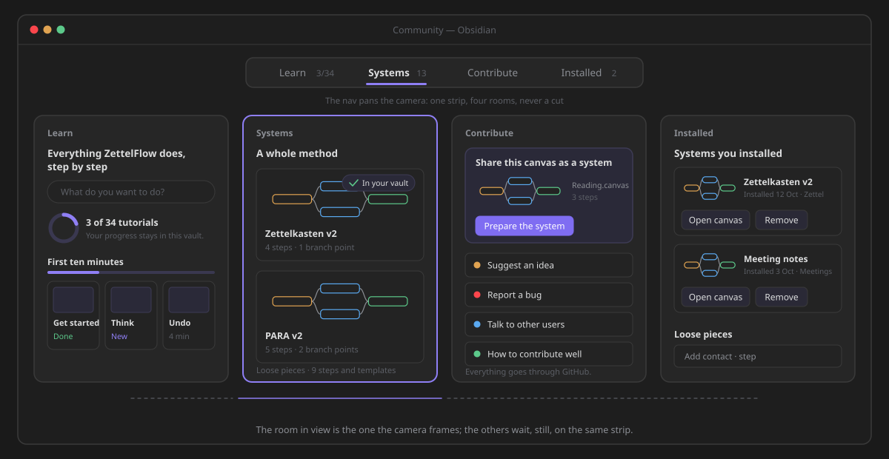

# ZettelFlow Community Resources Guide

## Introduction to Community Resources
ZettelFlow allows the community to share templates, flows, and actions to help users enhance their note-taking experience. They are reached from **[Community](../community/index.md)**, one view with four rooms: you find them in its **Systems** room and look after what you installed in its **Installed** room.

## Types of Community Resources
ZettelFlow offers five main types of community resources:

### 1. Flows *(legacy — superseded by Systems)*
Flows were complete workflows installed by copying to the clipboard and pasting onto a canvas. As of
the **Systems Gallery**, this is superseded by one-click **[Systems](#5-systems-one-click)** (a canvas
plus its steps, written in one click — no clipboard). Community's Systems room shows **systems** and
no flows; a flow you already have still pastes onto a canvas, but it is no longer the recommended way
to adopt a workflow.

### 2. Steps
Steps are individual components that can be added to your existing workflows. They represent a single action or decision point in a note creation process.

### 3. Actions
Actions are specific functions that can be performed within a step, such as adding a date, selecting options, or running scripts.

### 4. Markdown
Markdown templates provide reusable text content that can be incorporated into your notes.

### 5. Systems (one-click)
Systems are whole **knowledge methodologies** shipped as a single [`.zftemplate`](../architecture/zftemplate-schema.md) bundle — a canvas plus its step notes. Unlike a flow (which you copy to the clipboard and paste onto a canvas), a system installs in **one click**: say how you will use it and ZettelFlow writes the canvas and every step, then the tab becomes the canvas, ready to run. Systems compose the cognitive capabilities — on creation a note is related, cross-checked, link-suggested and maturity-scored against your own graph — so you start from a real workflow, not a blank canvas.

Shipped systems:

- **Academic research** — two entry points on one canvas: a literature note mined for claims, matched to candidate sources, cross-checked for contradictions and scored on creation; and a permanent note that lands already related, link-suggested and scored.
- **Zettelkasten v2** — three independent note types on one canvas (fleeting, literature, permanent), each its own entry point, where the permanent note carries the on-creation pattern (find related · find contradictions · suggest links · calculate maturity). This **supersedes the older "Zettelkasten Inbox" flow**, which remains available for back-compat.
- **PARA v2** — Tiago Forte's PARA as four entry points (Project, Area, Resource, Archive); each lands a note in its PARA folder, tags it by category and connects it with find related. This **supersedes the older "PARA classify system" flow**, which remains available for back-compat.
- **GTD** — Getting Things Done as three entry points (Inbox capture, Next action, Project), moving a thought from capture through clarify to a context-tagged next action.
- **Reading** — turn reading into knowledge: a Reading source entry point captures highlights and mines them for claims and candidate sources; a Reading note entry point distills an insight and connects it.
- **Writing** — from idea to finished draft: Draft (thesis + related source notes), Section (one point + suggested connections) and Review (surfaces contradictions to resolve) entry points.
- **Software architecture KB** — a decision log: an ADR entry point records context/decision/consequences and checks new decisions against existing ones for contradictions; a Component entry point captures a component and its dependencies.

To install a system: open **Community → Systems**, click a card to open it in place, walk it under *Try it: walk the flow*, answer *How will you use it?* and press **Install**. See [Community](../community/index.md#systems) for the whole path, and the [Systems Gallery](systems-gallery.md) for the catalog of shipped systems and a guide to authoring your own.

## How to Access Community Resources
1. Open Obsidian and make sure ZettelFlow is installed.
2. Press the ZettelFlow ribbon button and choose **Community** (or run *Browse systems* from the command palette).
3. Open the **Systems** room. Steps and markdown templates are folded at the bottom, under *Loose pieces*.
4. Click a piece to open its own install dialog.

## Keeping a step you copied
The step and action editors can copy what they hold for reuse. While one is copied, **Community →
Installed** shows *Add the template from the clipboard* above its *Loose pieces*: press it and the
step or action becomes an installed piece, with *Edit* and *Remove* like any other.
